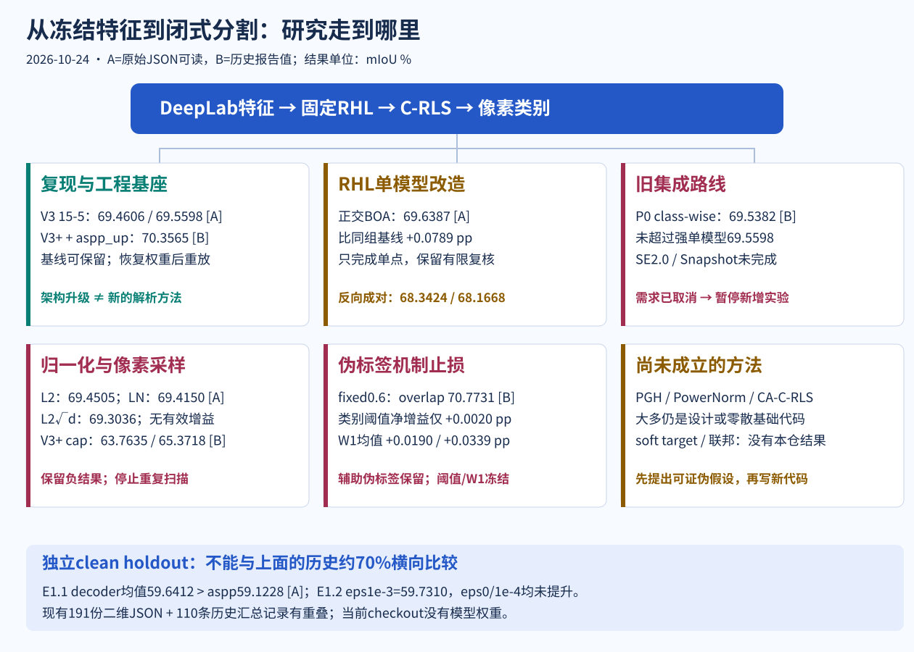

# SegACIL / CFSSeg 2D 方法与实验完整回顾

## Material Passport

- 日期：2026-10-24；证据快照：main `087fa5e`，RHL `804172c`，伪标签 `85d7ea1`。
- 模式：结果核对与研究回顾；Verification Status：**ANALYZED**。本次没有重跑训练或推理。
- 原始指标：跨现存分支读取 191 份二维 JSON，另从可达Git历史恢复16份已删除的旧dirty replay指标，共207份；历史阶段总表110条记录另行逐行保留。**这些记录有大量重叠，不相加当作独立实验次数。**
- 原始 JSON 数值统一转为百分数；差值单位为百分点 pp。A=本次可读原始结果，B=历史正式报告/CSV 数值、原文件当前缺失，C=只有实现或设计。A 也不等于可立即复跑，当前没有模型权重。

## 1. 先给结论

项目已有完整基线、多个负结果和一套更严格的评价协议；**还没有可据现有证据宣布成立的、稳定超过基线的新单模型核心方法**。

最有用的工程成果是 V3+ 的 AIR 特征适配，以及 clean validation、manifest、恢复机制。BOA 正交初始化有单点 +0.0789 pp 弱信号，值得有限复核；不能称为已验证稳定创新。固定伪标签有作用，但类别阈值的额外机制收益约 +0.0020 pp，后续 W1 简单加权也没有达到继续门槛。集成现在不再是项目要求，可以从近期研究路线移出。

## 2. 先统一协议，再读数字

| 编号 | 评价来源 | 典型 all mIoU | 应怎样使用 |
|---|---|---:|---|
| H-seq | 旧训练链，VOC 官方 val 被代码叫作 test，sequential | 约 69–70% | 历史复现/消融；部分参数在这个集合上反复选择，不能称未触碰测试集 |
| H-pseudo | overlap/disjoint，伪标签 feature 分支的历史协议 | 约 69–71% | 只能在相同 setting、teacher、step0、seed 内配对 |
| V-old | 7 月 12–14 日旧 step1 task-filtered val | 约 44–45% | 有类别覆盖缺陷，不能作为最终模型排序证据 |
| V-clean | 7 月 16 日从训练池划出的 10% holdout；所有 step 排除 | 约 59% | 当前方法选择协议；须复用相同 clean step0 与列表 hash |
| T-audit | 7 月 15 日补做的官方 val-as-test 审计 | 约 69–70% | 解释旧 val 排序反转；已观察过，不能再当纯最终测试 |

`old` 默认是类别 0–15（包含背景，共 16 类），`new` 为 16–20（5 类）；最终 15-5 all 是 21 类均值，不是 old/new 简单平均。15-1 的中间步 new 是累计已见新类；必须读该 JSON 中的类别分组，不能把尚未出现类纳入相同口径。

附录保留原JSON的`Mean IoU`。部分step0文件的这个值仍按21类计入尚未学习类的零值，不能把它当成“已见16类mIoU”，后者应读取`0 to 15 mIoU`。没有单独报告的新类指标标为“—”，不擅自补成0。

**70.3565% 的 V3+ 与 59.7310% 的 clean V3 不构成优劣对照**：训练样本、step0、模型和评估集合都不同。V3+ 的 `aspp_up` 最优也不与 clean V3 的 `decoder` 最优冲突，它们是不同模型的特征接口。

## 3. 方法/实验状态总表

| 方法或类型 | 已有代码 | 已有实验 | 结果与结论 | 下一步 |
|---|---|---|---|---|
| 原方法复现 15-5/15-1 | main | 完成多条链 | 69.4606/69.5598；15-1 最终 68.9464/69.5079 | 基线保留 |
| batch/buffer/gamma | main、历史队列 | 多轮完成 | 8224 是局部工程选择；非方法创新 | 不扩大零碎搜索 |
| L2 / L2-sqrt / LN | main | 完成 | 相对同 batch none：基本持平或下降 | 保留消融，停扫 |
| RHL-SE 静态/类别融合 | main + P0 runner | 完成 | P0=69.5382，未超过强单模型69.5598 | 暂停集成线 |
| BOA 初始化 | rhl-next；老 P1 | 4 case 完成 | orthogonal=69.6387；antithetic显著退化 | 只保留有限的正交复核 |
| BOA 1.5 | 基础 init/scale 已有 | 多seed/尺度/容量复核无完成证据 | 无新性能结论 | 最多一次预注册 pilot |
| DeepLabV3+ + source | main 已吸收 | source sweep、golden replay 完成 | aspp_up=70.3565，B级历史报告 | 作为架构对照，需恢复权重 |
| V3+ class-cap | 旧 control 分支 | 4096/8192 完成 | 63.7635/65.3718，严重伤旧类 | 冻结负结果 |
| fixed pseudo-label | adaptive分支有完整step1实现 | 15-5、15-1 完成 | overlap fixed0.6比off +0.4640 pp | 保留辅助机制 |
| batch/global/class/artifact阈值 | adaptive分支 | 单seed、多seed、机制控制完成 | artifact比matched-global六组均值+0.0020 pp | 冻结为主方法的路线 |
| W0 correctness audit | adaptive分支 | 完成只读诊断 | confidence/margin有排序能力 | 保留诊断 |
| W1可靠性加权C-RLS | adaptive分支 | 4个seed1 run完成 | 跨setting均值+0.0190/+0.0339 pp | 已STOP，不进W2/W3 |
| clean E1.1 feature source | main | 8组完成 | decoder均值59.6412，aspp59.1228 | decoder作为clean基线 |
| E1.2 tail epsilon | main | eps0、1e-4完成，复用1e-3 | 59.7119/59.7143低于59.7310 | 不认作涨点 |
| 新协议E1.3/E1.4/E2 | 参数接线部分已有 | 未见正式结果 | 尚无gamma/LR/loss搜索新结论 | 有机制动机再做 |
| PGH原型引导 | 只有方案；通用kernel类不等于PGH | 未见 | 无结果 | 先解决跨step特征变化问题 |
| PowerNorm | 只有方案 | 未见 | 无结果 | 次级候选 |
| CA-C-RLS类别平衡 | 旧GeneralizedARM类；完整新链未接通 | 未见新方案结果 | 与W1伪标签可靠性加权不是同一个方法 | 条件候选 |
| RHL-SE 2.0 | 旧gate原型已存在，完整2.0未实现 | 无2.0正式结果 | 旧confidence gate不能冒称2.0 | 暂停 |
| Snapshot ensemble | resume/保存能力部分可复用；无完整snapshot链 | 未见 | 无结果 | 暂停 |
| soft/partial target | 方案候选 | 未见 | W1停止不等于已测试soft target | 新假设成立才启动 |
| 联邦持续分割 | 本仓未实现 | 未见 | 只有本次路线建议 | 先核查与AFCL/FISS差异 |

## 4. 原方法复现与参数实验

以下直接来自原始 JSON；链接对应完整 per-class 指标。两份 15-1 结果的本地/TRS 归属以路径为准，修正旧 Home 的混淆。

<!-- TABLE:baselines -->

| run / 配置 | step | old % | new % | all % | 原始证据 |
| --- | --- | --- | --- | --- | --- |
| 0615_step1_bs16_trs | step1 | 78.406135 | 41.364401 | 69.586675 | [R003](<../../checkpoints/0615_step1_bs16_trs/voc/15-5/sequential/step1/test_results_20260616_075752.json>) |
| 0615_step1_bs16_trs | step1 | 78.467818 | 41.229112 | 69.601459 | [R004](<../../checkpoints/0615_step1_bs16_trs/voc/15-5/sequential/step1/test_results_20260616_234601(tmux 615-segacil-bs16).json>) |
| 1128 | step5 | 77.905035 | 40.278896 | 68.946431 | [R010](<../../checkpoints/1128/voc/15-1/sequential/step5/test_results_20260604_224745.json>) |
| 1128_trs | step5 | 78.252339 | 41.525806 | 69.507926 | [R016](<../../checkpoints/1128_trs/voc/15-1/sequential/step5/test_results_20260509_083832.json>) |
| 20260606 | step1 | 78.008491 | 42.107460 | 69.460626 | [R019](<../../checkpoints/20260606/voc/15-5/sequential/step1/test_results_20260607_104912.json>) |
| 20260607 | step1 | 77.794165 | 43.209936 | 69.559825 | [R021](<../../checkpoints/20260607/voc/15-5/sequential/step1/test_results_20260607_203548.json>) |
| 20260617_bs48_step1_8196 | step1 | 77.885718 | 41.876431 | 69.312078 | [R051](<../../checkpoints/20260617_bs48_step1_8196/voc/15-5/sequential/step1/test_results_20260617_093250.json>) |
| 20260621_baseline_bs16_16_trs | step1 | 78.391552 | 40.918132 | 69.469309 | [R061](<../../checkpoints/20260621_baseline_bs16_16_trs/voc/15-5/sequential/step1/test_results_20260622_083613.json>) |
| 20260621_baseline_bs64_32 | step1 | 78.215196 | 41.854106 | 69.557794 | [R063](<../../checkpoints/20260621_baseline_bs64_32/voc/15-5/sequential/step1/test_results_20260622_105925.json>) |

<!-- END:baselines -->

15-5 batch32 与 batch64 的差异不能简单解释为“闭式解理应完全不受 batch 影响，所以代码一定错”。当前代码还包括随机增强、`drop_last=True`、RHL 随机状态、随机 tail 与数值求逆；batch 改变时，实际见到的样本/增强和 RNG 消耗可能变化。数学等价只适用于同一个固定的 X、Y 数据集合。

### 4.1 buffer/gamma 的已完成搜索

7 月 5 日 Phase A：8196/8204 的 gamma=0.1/1/10，加 buffer=8192…8224 的局部搜索。随后 8208/8224 多 RHL seed，8228…8240 右侧扩展，再确认 8224/8232。结果都属于超参数敏感性与工程选型。

<!-- TABLE:buffer -->

| run / 配置 | step | old % | new % | all % | 原始证据 |
| --- | --- | --- | --- | --- | --- |
| 20260705_buffer_gamma_search_trs_phaseA_b8192_g1_rhlm1_trs | step1 | 78.386000 | 41.130341 | 69.515605 | [R089](<../../checkpoints/20260705_buffer_gamma_search_trs_phaseA_b8192_g1_rhlm1_trs/voc/15-5/sequential/step1/test_results_20260706_041138.json>) |
| 20260705_buffer_gamma_search_trs_phaseA_b8196_g0p1_rhlm1_trs | step1 | 78.285447 | 41.799328 | 69.598276 | [R091](<../../checkpoints/20260705_buffer_gamma_search_trs_phaseA_b8196_g0p1_rhlm1_trs/voc/15-5/sequential/step1/test_results_20260705_080426.json>) |
| 20260705_buffer_gamma_search_trs_phaseA_b8196_g10_rhlm1_trs | step1 | 78.285493 | 41.798673 | 69.598155 | [R093](<../../checkpoints/20260705_buffer_gamma_search_trs_phaseA_b8196_g10_rhlm1_trs/voc/15-5/sequential/step1/test_results_20260705_141930.json>) |
| 20260705_buffer_gamma_search_trs_phaseA_b8196_g1_rhlm1_trs | step1 | 78.285459 | 41.799244 | 69.598265 | [R095](<../../checkpoints/20260705_buffer_gamma_search_trs_phaseA_b8196_g1_rhlm1_trs/voc/15-5/sequential/step1/test_results_20260705_111203.json>) |
| 20260705_buffer_gamma_search_trs_phaseA_b8200_g1_rhlm1_trs | step1 | 78.441694 | 41.373135 | 69.615847 | [R097](<../../checkpoints/20260705_buffer_gamma_search_trs_phaseA_b8200_g1_rhlm1_trs/voc/15-5/sequential/step1/test_results_20260706_071905.json>) |
| 20260705_buffer_gamma_search_trs_phaseA_b8204_g0p1_rhlm1_trs | step1 | 78.453205 | 41.476979 | 69.649341 | [R099](<../../checkpoints/20260705_buffer_gamma_search_trs_phaseA_b8204_g0p1_rhlm1_trs/voc/15-5/sequential/step1/test_results_20260705_172704.json>) |
| 20260705_buffer_gamma_search_trs_phaseA_b8204_g10_rhlm1_trs | step1 | 78.453269 | 41.476317 | 69.649233 | [R101](<../../checkpoints/20260705_buffer_gamma_search_trs_phaseA_b8204_g10_rhlm1_trs/voc/15-5/sequential/step1/test_results_20260705_234212.json>) |
| 20260705_buffer_gamma_search_trs_phaseA_b8204_g1_rhlm1_trs | step1 | 78.453220 | 41.476892 | 69.649332 | [R103](<../../checkpoints/20260705_buffer_gamma_search_trs_phaseA_b8204_g1_rhlm1_trs/voc/15-5/sequential/step1/test_results_20260705_203440.json>) |
| 20260705_buffer_gamma_search_trs_phaseA_b8208_g1_rhlm1_trs | step1 | 78.482991 | 41.738912 | 69.734401 | [R105](<../../checkpoints/20260705_buffer_gamma_search_trs_phaseA_b8208_g1_rhlm1_trs/voc/15-5/sequential/step1/test_results_20260706_102629.json>) |
| 20260705_buffer_gamma_search_trs_phaseA_b8212_g1_rhlm1_trs | step1 | 78.360513 | 41.438021 | 69.569444 | [R107](<../../checkpoints/20260705_buffer_gamma_search_trs_phaseA_b8212_g1_rhlm1_trs/voc/15-5/sequential/step1/test_results_20260706_133416.json>) |
| 20260705_buffer_gamma_search_trs_phaseA_b8216_g1_rhlm1_trs | step1 | 78.348233 | 40.940211 | 69.441561 | [R109](<../../checkpoints/20260705_buffer_gamma_search_trs_phaseA_b8216_g1_rhlm1_trs/voc/15-5/sequential/step1/test_results_20260706_164152.json>) |
| 20260705_buffer_gamma_search_trs_phaseA_b8220_g1_rhlm1_trs | step1 | 78.380413 | 41.658075 | 69.637000 | [R111](<../../checkpoints/20260705_buffer_gamma_search_trs_phaseA_b8220_g1_rhlm1_trs/voc/15-5/sequential/step1/test_results_20260706_194930.json>) |
| 20260705_buffer_gamma_search_trs_phaseA_b8224_g1_rhlm1_trs | step1 | 78.431891 | 41.834654 | 69.718263 | [R113](<../../checkpoints/20260705_buffer_gamma_search_trs_phaseA_b8224_g1_rhlm1_trs/voc/15-5/sequential/step1/test_results_20260706_225702.json>) |
| 20260705_buffer_gamma_search_trs_phaseB_b8208_g1_rhl1_trs | step1 | 78.482991 | 41.738912 | 69.734401 | [R115](<../../checkpoints/20260705_buffer_gamma_search_trs_phaseB_b8208_g1_rhl1_trs/voc/15-5/sequential/step1/test_results_20260707_020434.json>) |
| 20260705_buffer_gamma_search_trs_phaseB_b8208_g1_rhl2_trs | step1 | 78.460207 | 42.373424 | 69.868116 | [R117](<../../checkpoints/20260705_buffer_gamma_search_trs_phaseB_b8208_g1_rhl2_trs/voc/15-5/sequential/step1/test_results_20260707_051202.json>) |
| 20260705_buffer_gamma_search_trs_phaseB_b8208_g1_rhl3_trs | step1 | 78.426517 | 42.326289 | 69.831224 | [R119](<../../checkpoints/20260705_buffer_gamma_search_trs_phaseB_b8208_g1_rhl3_trs/voc/15-5/sequential/step1/test_results_20260707_081936.json>) |
| 20260705_buffer_gamma_search_trs_phaseB_b8224_g1_rhl1_trs | step1 | 78.431891 | 41.834654 | 69.718263 | [R121](<../../checkpoints/20260705_buffer_gamma_search_trs_phaseB_b8224_g1_rhl1_trs/voc/15-5/sequential/step1/test_results_20260707_112722.json>) |
| 20260705_buffer_gamma_search_trs_phaseB_b8224_g1_rhl2_trs | step1 | 78.418566 | 42.982502 | 69.981408 | [R123](<../../checkpoints/20260705_buffer_gamma_search_trs_phaseB_b8224_g1_rhl2_trs/voc/15-5/sequential/step1/test_results_20260707_143503.json>) |
| 20260705_buffer_gamma_search_trs_phaseB_b8224_g1_rhl3_trs | step1 | 78.432651 | 42.739210 | 69.934213 | [R125](<../../checkpoints/20260705_buffer_gamma_search_trs_phaseB_b8224_g1_rhl3_trs/voc/15-5/sequential/step1/test_results_20260707_174242.json>) |
| 20260709_buffer_right_seed_search_trs_right_b8228_g1_rhl2_trs | step1 | 78.457253 | 41.956255 | 69.766539 | [R127](<../../checkpoints/20260709_buffer_right_seed_search_trs_right_b8228_g1_rhl2_trs/voc/15-5/sequential/step1/test_results_20260709_230729.json>) |
| 20260709_buffer_right_seed_search_trs_right_b8232_g1_rhl2_trs | step1 | 78.487667 | 42.436347 | 69.904020 | [R129](<../../checkpoints/20260709_buffer_right_seed_search_trs_right_b8232_g1_rhl2_trs/voc/15-5/sequential/step1/test_results_20260710_021515.json>) |
| 20260709_buffer_right_seed_search_trs_right_b8236_g1_rhl2_trs | step1 | 78.257919 | 42.639057 | 69.777237 | [R131](<../../checkpoints/20260709_buffer_right_seed_search_trs_right_b8236_g1_rhl2_trs/voc/15-5/sequential/step1/test_results_20260710_052309.json>) |
| 20260709_buffer_right_seed_search_trs_right_b8240_g1_rhl2_trs | step1 | 78.316999 | 42.741709 | 69.846692 | [R133](<../../checkpoints/20260709_buffer_right_seed_search_trs_right_b8240_g1_rhl2_trs/voc/15-5/sequential/step1/test_results_20260710_083047.json>) |
| 20260709_buffer_right_seed_search_trs_stability_b8208_g1_rhl4_trs | step1 | 78.542803 | 42.540610 | 69.970852 | [R135](<../../checkpoints/20260709_buffer_right_seed_search_trs_stability_b8208_g1_rhl4_trs/voc/15-5/sequential/step1/test_results_20260710_113804.json>) |
| 20260709_buffer_right_seed_search_trs_stability_b8208_g1_rhl5_trs | step1 | 78.368723 | 41.733559 | 69.646065 | [R137](<../../checkpoints/20260709_buffer_right_seed_search_trs_stability_b8208_g1_rhl5_trs/voc/15-5/sequential/step1/test_results_20260710_144513.json>) |
| 20260709_buffer_right_seed_search_trs_stability_b8224_g1_rhl4_trs | step1 | 78.495463 | 42.880448 | 70.015697 | [R139](<../../checkpoints/20260709_buffer_right_seed_search_trs_stability_b8224_g1_rhl4_trs/voc/15-5/sequential/step1/test_results_20260710_175229.json>) |
| 20260709_buffer_right_seed_search_trs_stability_b8224_g1_rhl5_trs | step1 | 78.322193 | 42.138840 | 69.707109 | [R141](<../../checkpoints/20260709_buffer_right_seed_search_trs_stability_b8224_g1_rhl5_trs/voc/15-5/sequential/step1/test_results_20260710_205945.json>) |
| 20260711_buffer_final_confirmation_trs_b8224_g1_rhl2_trs | step1 | 78.418566 | 42.982502 | 69.981408 | [R143](<../../checkpoints/20260711_buffer_final_confirmation_trs_b8224_g1_rhl2_trs/voc/15-5/sequential/step1/test_results_20260711_180335.json>) |
| 20260711_buffer_final_confirmation_trs_b8232_g1_rhl4_trs | step1 | 78.558232 | 42.148790 | 69.889317 | [R145](<../../checkpoints/20260711_buffer_final_confirmation_trs_b8232_g1_rhl4_trs/voc/15-5/sequential/step1/test_results_20260711_211111.json>) |
| 20260711_buffer_final_confirmation_trs_b8232_g1_rhl5_trs | step1 | 78.391172 | 41.779339 | 69.674069 | [R147](<../../checkpoints/20260711_buffer_final_confirmation_trs_b8232_g1_rhl5_trs/voc/15-5/sequential/step1/test_results_20260712_001849.json>) |
| 20260714_e1_1_aspp_buffer_local_seed2_trs_b8208_g1_rhl2_trs | step1 | 78.048262 | 42.955292 | 69.692793 | [R167](<../../checkpoints/20260714_e1_1_aspp_buffer_local_seed2_trs_b8208_g1_rhl2_trs/voc/15-5/sequential/step1/full_test_audit_20260715.json>) |
| 20260714_e1_1_aspp_buffer_local_seed2_trs_b8208_g1_rhl2_trs | step1 | 44.460476 | 46.563119 | 44.961106 | [R168](<../../checkpoints/20260714_e1_1_aspp_buffer_local_seed2_trs_b8208_g1_rhl2_trs/voc/15-5/sequential/step1/val_results_20260714_123445.json>) |
| 20260714_e1_1_aspp_buffer_local_seed2_trs_b8240_g1_rhl2_trs | step1 | 77.928034 | 43.251886 | 69.671808 | [R170](<../../checkpoints/20260714_e1_1_aspp_buffer_local_seed2_trs_b8240_g1_rhl2_trs/voc/15-5/sequential/step1/full_test_audit_20260715.json>) |
| 20260714_e1_1_aspp_buffer_local_seed2_trs_b8240_g1_rhl2_trs | step1 | 44.140628 | 47.655559 | 44.977517 | [R171](<../../checkpoints/20260714_e1_1_aspp_buffer_local_seed2_trs_b8240_g1_rhl2_trs/voc/15-5/sequential/step1/val_results_20260714_154110.json>) |

<!-- END:buffer -->

8224 vs 8232 的 rhl_seed=2/4/5 配对平均 all 差约 **+0.0789 pp**；旧报告近似95%区间为 **[-0.0371, +0.1949] pp**，跨零。8208 vs 8224 的五 RHL seed 均值分别约69.8101/69.8713%。这支持固定8224作为后续起点，不支持“8224是普遍最优”或挑最佳seed宣称新方法涨点。

参数微调的总表及重复run保留在末尾附录。多个相同指标的复跑/归档不是独立随机样本，不能用于人为扩大n。

## 5. RHL归一化：实现和实验都完成，收益不成立

归一化作用在随机映射/ReLU之后，C-RLS之前。none保留原幅值，l2把每个像素向量拉到单位范数，l2_sqrt再乘sqrt(d)，无仿射LN还会中心化。

<!-- TABLE:normalization -->

| run / 配置 | step | old % | new % | all % | 原始证据 |
| --- | --- | --- | --- | --- | --- |
| 20260609_rhl_l2sqrt_g1_retry | step1 | 77.775407 | 43.080168 | 69.514636 | [R023](<../../checkpoints/20260609_rhl_l2sqrt_g1_retry/voc/15-5/sequential/step1/test_results_20260609_192910.json>) |
| 20260610_rhl_l2_g1 | step1 | 77.939010 | 42.287276 | 69.450502 | [R025](<../../checkpoints/20260610_rhl_l2_g1/voc/15-5/sequential/step1/test_results_20260610_125752.json>) |
| 20260610_rhl_l2sqrt_g0p1_bs64 | step1 | 77.943326 | 41.656666 | 69.303645 | [R027](<../../checkpoints/20260610_rhl_l2sqrt_g0p1_bs64/voc/15-5/sequential/step1/test_results_20260610_204628.json>) |
| 20260610_rhl_l2sqrt_g10_bs64 | step1 | 77.943321 | 41.656592 | 69.303624 | [R029](<../../checkpoints/20260610_rhl_l2sqrt_g10_bs64/voc/15-5/sequential/step1/test_results_20260610_233856.json>) |
| 20260610_rhl_l2sqrt_g1_bs64 | step1 | 77.943325 | 41.656656 | 69.303642 | [R031](<../../checkpoints/20260610_rhl_l2sqrt_g1_bs64/voc/15-5/sequential/step1/test_results_20260610_221231.json>) |
| 20260610_rhl_ln_g1_bs64 | step1 | 77.957369 | 42.079210 | 69.414950 | [R033](<../../checkpoints/20260610_rhl_ln_g1_bs64/voc/15-5/sequential/step1/test_results_20260610_174503.json>) |
| 20260610_rhl_none_g1 | step1 | 78.008491 | 42.107460 | 69.460626 | [R035](<../../checkpoints/20260610_rhl_none_g1/voc/15-5/sequential/step1/test_results_20260610_115359.json>) |

<!-- END:normalization -->

同batch64的none=69.460626，l2=69.450502，LN=69.414950，l2_sqrt gamma1=69.303642。早期batch32的l2_sqrt=69.514636不能与batch64的none拼成正向结论。gamma=0.1/1/10的l2_sqrt结果近乎相同。

已确认：参数进入真实路径，历史报告有范数统计，多个正式JSON存在。**未确认的因果解释**：幅值可能含目标强度/难度信息；强归一化可能损失它；gamma相对样本Gram尺度可能过小。没有特征谱/幅值消融，不能把这些解释写成已经证实的失败原因。建议保留阴性证据，停止重复静态norm扫描。

## 6. RHL-SE：做过哪些集成，为什么暂停

已做独立RHL seeds 1/2/3、K2/K3 logit与prob平均、手工全局权重、old/new分组、class-wise权重、confidence gate、验证集驱动class-wise搜索，以及不同**评估**batch的复核。成员raw JSON可读；融合输出本次主要是B级历史表格。

<!-- TABLE:ensemble -->

| ID | 方法 / 实验 | 协议 | old % | new % | all % | 来源等级 |
| --- | --- | --- | --- | --- | --- | --- |
| E028 | RHL子空间成员 seed1 | 15-5 sequential | 78.0085 | 42.1075 | 69.4606 | B：历史CSV |
| E029 | RHL子空间成员 seed2 | 15-5 sequential | 77.8998 | 42.3649 | 69.4391 | B：历史CSV |
| E030 | RHL子空间成员 seed3 | 15-5 sequential | 77.9544 | 42.4415 | 69.4989 | B：历史CSV |
| E031 | K2等权logit融合 | 15-5 sequential | 77.9567 | 42.4183 | 69.4952 | B：历史CSV |
| E032 | K2等权概率融合 | 15-5 sequential | 77.9577 | 42.4256 | 69.4976 | B：历史CSV |
| E033 | K2等权概率融合CPU复核 | 15-5 sequential | 77.9577 | 42.4256 | 69.4976 | B：历史CSV |
| E034 | K3加权logit融合 | 15-5 sequential | 77.9837 | 42.3648 | 69.5030 | B：历史CSV |
| E035 | K3加权概率融合A | 15-5 sequential | 77.9724 | 42.4030 | 69.5035 | B：历史CSV |
| E036 | K3加权概率融合B | 15-5 sequential | 77.9848 | 42.3737 | 69.5060 | B：历史CSV |
| E037 | K3等权logit融合 | 15-5 sequential | 77.9974 | 42.3163 | 69.5019 | B：历史CSV |
| E038 | K3等权概率融合 | 15-5 sequential | 77.9985 | 42.3254 | 69.5049 | B：历史CSV |
| E039 | old/new分组概率融合 | 15-5 sequential | 78.0029 | 42.3043 | 69.5033 | B：历史CSV |
| E040 | 手工class-wise概率融合 | 15-5 sequential | 78.0022 | 42.3893 | 69.5229 | B：历史CSV |
| E041 | 置信度门控概率融合 | 15-5 sequential | 78.0191 | 42.2294 | 69.4977 | B：历史CSV |
| E042 | 验证集驱动class-wise完整评估 batch1 | 15-5 sequential | 77.9804 | 42.5218 | 69.5379 | B：历史CSV |
| E043 | 验证集驱动class-wise完整评估 batch1 | 15-5 sequential | 77.9804 | 42.5218 | 69.5379 | B：历史CSV |
| E044 | 验证集驱动class-wise完整评估 batch16 | 15-5 sequential | 77.9811 | 42.5228 | 69.5386 | B：历史CSV |
| E045 | 验证集驱动class-wise完整评估 batch32 | 15-5 sequential | 77.9803 | 42.5236 | 69.5382 | B：历史CSV |
| E046 | 验证集驱动class-wise测试 | 15-5 sequential | 77.9804 | 42.5218 | 69.5379 | B：历史CSV |

<!-- END:ensemble -->

最好的P0正式class-wise结果约69.5382；比旧seed1=69.4606有+0.0776 pp，但比强batch32单模型69.5598低约0.0216 pp。对照对象不同必须同时说明，不能只选较弱baseline。

历史诊断指出成员预测高度一致、互补空间小；oracle只是假设知道正确答案的上界，不是能部署的模型。现有confidence gate的小幅变化也不能当作完整SE2.0（温度校准、像素可靠性、规则/线性gate及严格隔离）已验证。

本次用户已取消集成要求，暂停RHL-SE扩成员、SE2.0和Snapshot。保留rhl_seed隔离、成员诊断工具和负结果。正交随机特征、单个模型中固定特征拼接，均不必自动归为多模型集成。

## 7. BOA：唯一单点弱正信号，后续复核停在代码准备

<!-- TABLE:boa -->

| run / 配置 | step | old % | new % | all % | 原始证据 |
| --- | --- | --- | --- | --- | --- |
| 20260617_p1_boa_rhl_BOA-0_gaussian_legacy_seed1_bs32 | step1 | 77.794165 | 43.209936 | 69.559825 | [R053](<../../checkpoints/20260617_p1_boa_rhl_BOA-0_gaussian_legacy_seed1_bs32/voc/15-5/sequential/step1/test_results_20260617_223901.json>) |
| 20260617_p1_boa_rhl_BOA-1_orthogonal_legacy_seed1_bs32 | step1 | 77.822460 | 43.450724 | 69.638714 | [R055](<../../checkpoints/20260617_p1_boa_rhl_BOA-1_orthogonal_legacy_seed1_bs32/voc/15-5/sequential/step1/test_results_20260617_233020.json>) |
| 20260617_p1_boa_rhl_BOA-2_orthogonal_antithetic_legacy_seed1_bs32 | step1 | 77.706707 | 38.376759 | 68.342433 | [R057](<../../checkpoints/20260617_p1_boa_rhl_BOA-2_orthogonal_antithetic_legacy_seed1_bs32/voc/15-5/sequential/step1/test_results_20260618_001844.json>) |
| 20260617_p1_boa_rhl_BOA-3_orthogonal_antithetic_kaiming_seed1_bs32 | step1 | 77.657324 | 37.797318 | 68.166847 | [R059](<../../checkpoints/20260617_p1_boa_rhl_BOA-3_orthogonal_antithetic_kaiming_seed1_bs32/voc/15-5/sequential/step1/test_results_20260618_010704.json>) |

<!-- END:boa -->

BOA-0精确复现69.559825；BOA-1正交/legacy为69.638714，**+0.078889 pp**。antithetic/legacy和antithetic/kaiming分别降至68.342433、68.166847。

在固定总buffer下配成[W,-W]会减少不同投影轴的数量；实验显示新类退化明显，放大scale未救回。这是与结构假设一致的观察，尚未通过“恢复独立轴数量”的等容量实验直接证明。注意输入只有256维，不应把8196条投影称为8196个线性独立方向；正交性只在分块内成立。

`gaussian + legacy` 是兼容配置名，实际调用PyTorch Linear初始化，不等价于标准高斯采样。论文应按真实分布描述。

BOA1.5的seed配对、gamma尺度匹配、12288/16392容量对照、有效秩诊断都未见完成证据。rhl-next只是7月19日迁移并兼容最新main，不能给它添加新的性能结果。

建议最多一次小规模正交复核：固定clean step0、投影能量、输入样本和至少3个配对seed，预注册实用门槛。若只重复得到约0.08 pp，不把它升级为主要论文贡献。

## 8. V3+：有效工程升级；class-cap为负结果

<!-- TABLE:v3plus -->

| ID | 方法 / 实验 | 协议 | old % | new % | all % | 来源等级 |
| --- | --- | --- | --- | --- | --- | --- |
| E051 | V3+ ASPP上采样特征 | 15-5 sequential | 77.9276 | 46.1287 | 70.3565 | B：历史CSV |
| E052 | V3+ ASPP特征 | 15-5 sequential | 77.7115 | 45.0984 | 69.9464 | B：历史CSV |
| E053 | V3+ buffer8200敏感性 | 15-5 sequential | 78.1346 | 39.3059 | 68.8897 | B：历史CSV |
| E054 | V3+ buffer8216敏感性 | 15-5 sequential | 78.1784 | 40.2370 | 69.1447 | B：历史CSV |
| E055 | V3+ decoder特征 | 15-5 sequential | 78.1453 | 39.5933 | 68.9663 | B：历史CSV |
| E056 | V3+ decoder降采样特征 | 15-5 sequential | 77.5002 | 40.1131 | 68.5985 | B：历史CSV |
| E057 | V3+ step1 batch32敏感性 | 15-5 sequential | 78.1453 | 39.5933 | 68.9663 | B：历史CSV |
| E058 | V3+ 类别采样上限4096 | 15-5 sequential | 69.4642 | 45.5214 | 63.7635 | B：历史CSV |
| E059 | V3+ 类别采样上限8192 | 15-5 sequential | 71.0924 | 47.0660 | 65.3718 | B：历史CSV |
| E060 | V3+主线黄金重放 | 15-5 sequential | 77.9276 | 46.1287 | 70.3565 | B：历史CSV |
| E061 | V3+早期基线 | 15-5 sequential | 78.1453 | 39.5933 | 68.9663 | B：历史CSV |

<!-- END:v3plus -->

V3+最初decoder结果68.9663，换为aspp_up后70.3565；历史golden replay精确值0.7035645831，old=0.7792763236，new=0.4612870137。原始V3+ JSON和权重本次不在两个checkout中，故本轮标为B级，不把历史“已复现”冒充本次复现。

这是 **DeepLabV3+ + AIR特征源改变** 的联合体系，不能把所有收益归结为“更强backbone”：ResNet101并没换。decoder_stride8约68.5985，aspp约69.9464，说明特征语义与分辨率均有关，不能仅凭分辨率解释全部变化。

class-cap4096/8192分别63.7635/65.3718；后者新类47.0660比基线46.1287更高，但旧类从77.9276掉到71.0924，all明显下降。它节约了采样后高维计算/显存，却改变类分布与有效目标，不能用新类单项上升掩盖整体失败。该代码留在control分支，没有进入main默认路径。

## 9. 伪标签：需要把“机制有用”与“阈值创新成立”分开

### 9.1 fixed、batch quantile、offline artifact

非sequential协议中，旧类可能被标成background。旧teacher可把其中一部分恢复成旧类标签。fixed使用统一阈值，batch_global/class使用当前batch的分位数，artifact_class从训练数据离线统计类别阈值。

25个overlap seed1、7个disjoint seed1的历史正式结果，以及三seed与15-1链保留如下。表值按原文的精度呈现；这些是B级文档证据，本次没有对应原始result文件。

<!-- TABLE:pseudo_all -->

来源：[7-19历史全阶段复盘](<../idea构思与实验设计/自适应伪标签阈值/7月新篇/7-19_自适应伪标签阈值全阶段总结与小白版复盘.md>)。以下仅提取已完成实验的表，0–1 mIoU已乘100；不沿用其过时的W0/W1待做段。

#### `15-5 overlap seed1`：25 个正式 step1 结果

#### Baseline、fixed 与 batch quantile

| # | 策略 | all mIoU | old mIoU | new mIoU | 接收率 | 直接结论 |
| ---: | --- | ---: | ---: | ---: | ---: | --- |
| 1 | off | 70.309100 | 79.117900 | 42.120900 | — | 无伪标签基线 |
| 2 | fixed 0.6 | 70.773100 | 79.676100 | 42.283600 | 94.9132% | fixed 最强 |
| 3 | fixed 0.7 | 70.738300 | 79.634600 | 42.270300 | 90.3503% | 有效但弱于 0.6 |
| 4 | fixed 0.8 | 70.696400 | 79.583000 | 42.259200 | 84.6965% | 阈值提高后下降 |
| 5 | fixed 0.9 | 70.630200 | 79.502400 | 42.239300 | 76.1808% | 过保守 |
| 6 | batch_global q0.7 | 70.325700 | 79.142300 | 42.112400 | 30.0003% | 几乎退化到 off |
| 7 | batch_global q0.5 | 70.429400 | 79.267200 | 42.148700 | 50.0001% | 提高覆盖后改善 |
| 8 | batch_global q0.3 | 70.581100 | 79.446900 | 42.210700 | 70.0000% | 继续改善 |
| 9 | batch_global q0.1 | 70.735800 | 79.634500 | 42.260100 | 90.0000% | 接近 fixed0.7 |
| 10 | batch_class q0.7 | 70.453500 | 79.294100 | 42.163600 | 30.0008% | 跑通但过保守 |
| 11 | batch_class q0.5 | 70.567600 | 79.425700 | 42.221700 | 50.0005% | 覆盖增加后改善 |
| 12 | batch_class q0.3 | 70.677300 | 79.559600 | 42.254000 | 69.9999% | 接近 fixed |
| 13 | batch_class q0.3 + min_conf0.6 | 70.676600 | 79.559500 | 42.251200 | 69.7287% | absolute floor 无收益 |
| 14 | batch_class q0.1 | 70.769400 | 79.675800 | 42.269100 | 89.9997% | 接近 fixed0.6，未超过 |

#### Offline artifact

| # | 策略 | all mIoU | old mIoU | new mIoU | 接收率 | 直接结论 |
| ---: | --- | ---: | ---: | ---: | ---: | --- |
| 15 | artifact q0.20 | 70.723100 | 79.621800 | 42.247300 | 80.1851% | 仍偏保守 |
| 16 | artifact q0.10 | 70.771600 | 79.679000 | 42.268000 | 90.1512% | 接近 fixed0.6 |
| 17 | artifact q0.07 | 70.784000 | 79.692900 | 42.275600 | 93.0301% | 略超 fixed |
| 18 | artifact q0.05 | 70.793000 | 79.702700 | 42.282100 | 95.0256% | 弱正向 |
| 19 | artifact q0.05 + min_conf0.6 | 70.772300 | 79.677200 | 42.276800 | 93.6502% | 抬高下界后退化 |
| 20 | artifact q0.03 | 70.801900 | 79.711800 | 42.290200 | 97.0145% | 继续提高 |
| 21 | artifact q0.015 | 70.807000 | 79.717400 | 42.293900 | 98.4628% | 进入平台区 |
| 22 | artifact q0.01 | 70.808200 | 79.718500 | 42.294900 | 98.9409% | 最强区间 |
| 23 | artifact q0.01 + min_conf0.6 | 70.773100 | 79.676100 | 42.283600 | 94.9132% | 精确退回 fixed0.6 |
| 24 | artifact q0.005 | 70.808100 | 79.718500 | 42.294900 | 99.4369% | 与 q0.01 并列 |
| 25 | artifact q0.00 | 70.805700 | 79.715400 | 42.294800 | 99.9798% | 近全接收，略低于平台峰值 |

#### `15-5 disjoint seed1`：7 个正式 step1 结果

| # | 策略 | all mIoU | old mIoU | new mIoU | 接收率 | 直接结论 |
| ---: | --- | ---: | ---: | ---: | ---: | --- |
| 1 | off | 68.943800 | 77.088400 | 42.881000 | — | disjoint 无伪标签基线 |
| 2 | fixed 0.6 | 69.463900 | 77.858200 | 42.602100 | 90.6862% | all/old 上升，new 有下降 |
| 3 | artifact q0.005 | 69.485200 | 77.882000 | 42.615200 | 99.4795% | 略高于 fixed |
| 4 | artifact q0.01 | 69.483800 | 77.881000 | 42.612900 | 98.9413% | 与 q0.005 接近 |
| 5 | artifact q0.015 | 69.482600 | 77.880100 | 42.610500 | 98.4050% | 平台内轻微下降 |
| 6 | artifact q0.00 | 69.487200 | 77.882200 | 42.623300 | 99.9936% | seed1 最强，近全接收 |
| 7 | artifact q0.005 + min_conf0.6 | 69.463900 | 77.858200 | 42.602100 | 90.6862% | 再次退化为 fixed0.6 |

#### `15-5 overlap` 三 seed：fixed0.6 对 artifact q0.01

| seed | fixed all | artifact all | Δ all（pp） | fixed old | artifact old | fixed new | artifact new |
| ---: | ---: | ---: | ---: | ---: | ---: | ---: | ---: |
| 1 | 70.773100 | 70.808200 | +0.0351 | 79.676100 | 79.718500 | 42.283600 | 42.294900 |
| 2 | 70.760800 | 70.801700 | +0.0409 | 79.625700 | 79.675200 | 42.393200 | 42.406400 |
| 3 | 70.363200 | 70.405800 | +0.0426 | 79.622500 | 79.673400 | 40.733300 | 40.749300 |

#### `15-5 disjoint` 三 seed：fixed0.6 对 artifact q0

| seed | fixed all | artifact all | Δ all（pp） | fixed old | artifact old | fixed new | artifact new |
| ---: | ---: | ---: | ---: | ---: | ---: | ---: | ---: |
| 1 | 69.463900 | 69.487200 | +0.0233 | 77.858200 | 77.882200 | 42.602100 | 42.623300 |
| 2 | 69.384200 | 69.418100 | +0.0339 | 77.962000 | 77.978200 | 41.935400 | 42.025700 |
| 3 | 69.244100 | 69.285800 | +0.0417 | 77.816700 | 77.856600 | 41.811700 | 41.859100 |

#### `15-1 overlap seed1`：3 条完整五步链

#### all mIoU

| 策略 | step1 | step2 | step3 | step4 | step5 |
| --- | ---: | ---: | ---: | ---: | ---: |
| off | 76.603300 | 76.054400 | 72.466700 | 72.329200 | 69.770300 |
| fixed0.6 | 76.897600 | 76.355300 | 72.855600 | 72.712500 | 70.412000 |
| fixed0.7 | 76.865900 | 76.315900 | 72.754300 | 72.611800 | 70.160600 |

#### old/new mIoU

| 策略 | step | old mIoU | 当前累计新类 mIoU |
| --- | ---: | ---: | ---: |
| off | 1 | 80.211600 | 18.869500 |
| off | 2 | 79.831500 | 45.837000 |
| off | 3 | 79.352000 | 35.745000 |
| off | 4 | 79.244700 | 44.667600 |
| off | 5 | 78.952600 | 40.387000 |
| fixed0.6 | 1 | 80.522400 | 18.901100 |
| fixed0.6 | 2 | 80.148500 | 46.009500 |
| fixed0.6 | 3 | 79.783000 | 35.909900 |
| fixed0.6 | 4 | 79.682600 | 44.832000 |
| fixed0.6 | 5 | 79.617100 | 40.955800 |
| fixed0.7 | 1 | 80.489100 | 18.895100 |
| fixed0.7 | 2 | 80.112100 | 45.946500 |
| fixed0.7 | 3 | 79.675400 | 35.841600 |
| fixed0.7 | 4 | 79.573800 | 44.763600 |
| fixed0.7 | 5 | 79.415000 | 40.546500 |

<!-- END:pseudo_all -->

overlap off=70.3091，fixed0.6=70.7731，增益+0.4640 pp；disjoint off=68.9438，fixed0.6=69.4639，增益+0.5201 pp。更高固定阈值降低覆盖，效果反而稍弱。低q artifact只比fixed0.6多约0.02–0.04 pp；min_conf0.6会把artifact精确压回fixed0.6附近。

15-1 off/fixed0.6/fixed0.7三条五步链已完成，最终69.7703/70.4120/70.1606。**不是15-1 adaptive artifact链已完成**；这组只支持固定伪标签辅助价值。

### 9.2 matched-global排除了主要混杂

<!-- TABLE:matched -->

来源：[7-19历史全阶段复盘](<../idea构思与实验设计/自适应伪标签阈值/7月新篇/7-19_自适应伪标签阈值全阶段总结与小白版复盘.md>)。以下仅提取已完成实验的表，0–1 mIoU已乘100；不沿用其过时的W0/W1待做段。

#### matched-global 六组正式机制判别

| setting | seed | artifact all | global all | artifact-global Δ all（pp） | Δ old（pp） | Δ new（pp） |
| --- | ---: | ---: | ---: | ---: | ---: | ---: |
| overlap | 1 | 70.808156 | 70.803822 | +0.004334 | +0.006169 | -0.001539 |
| overlap | 2 | 70.801674 | 70.799660 | +0.002013 | +0.002520 | +0.000394 |
| overlap | 3 | 70.405765 | 70.399926 | +0.005838 | +0.007256 | +0.001301 |
| disjoint | 1 | 69.487240 | 69.487314 | -0.000075 | +0.000055 | -0.000490 |
| disjoint | 2 | 69.418100 | 69.418154 | -0.000054 | -0.000093 | +0.000070 |
| disjoint | 3 | 69.285784 | 69.285809 | -0.000024 | -0.000030 | -0.000008 |

| 范围 | artifact-global all mIoU（pp） | artifact 胜出 | 结论 |
| --- | ---: | ---: | --- |
| overlap 三 seed | +0.004062 | 3/3 | 方向一致但量级极小 |
| disjoint 三 seed | -0.000051 | 0/3 | 数值等效且轻微反向 |
| 六组 | +0.002005 | 3/6 | 只有 `+0.1 pp` 门槛的约 2% |

<!-- END:matched -->

artifact比fixed0.6的六组均值约+0.0362 pp；但和匹配总体分位点的global阈值比，只剩 **+0.002005 pp**。overlap三seed约+0.004062，disjoint约-0.000051。

已得到的机制证据是：主要收益来自更高总体接收覆盖，不是精细类别阈值。这里的matched是总体分位点控制，不意味着每一张图的accepted mask逐像素完全相同。这个结论足以停止hard threshold微调，但不是“伪标签永远无用”。

### 9.3 W0：信号能排序正确性

W0在原始完整mask上只读审计，不能把诊断raw标签喂入训练。matched-global下，overlap accepted precision=89.4548%，disjoint=77.1731%；accepted hidden-old recall分别90.2821%、83.3488%。confidence及confidence×margin的十分位桶呈单调趋势，报告的Spearman rho=1.0是**桶级排序**，不是每个像素都能完美判断。

错误以“真背景被预测为旧类”为主：overlap 3,703,358，disjoint 7,657,741；旧类间错分分别542,322/1,629,323。完整W0 summary在归档分支有Git artifact，后续恢复可直接校验。W0只说明存在信号，不能推导加权后mIoU必涨。

### 9.4 W1：简单连续可靠性加权已经做完并STOP

对同样的accepted hard pseudo-label，把特征和one-hot目标同时乘sqrt(weight)，实现weighted ridge；可见GT权重1，ignore为0。与“按类别数量平衡的CA-C-RLS”不是同一目标。

| setting | 策略 | old % | new % | all % | 对matched-global Δall pp | 证据 |
|---|---|---:|---:|---:|---:|---|
| overlap | baseline | 79.7124 | 42.2965 | 70.8038 | 0 | B |
| overlap | confidence | 79.6944 | 42.3291 | 70.7979 | -0.0059 | B |
| overlap | confidence×margin | 79.6653 | 42.3804 | 70.7879 | -0.0159 | B |
| disjoint | baseline | 77.8822 | 42.6237 | 69.4873 | 0 | B |
| disjoint | confidence | 77.8750 | 42.8312 | 69.5312 | +0.0439 | B |
| disjoint | confidence×margin | 77.8475 | 43.0866 | 69.5711 | +0.0838 | B |

跨两setting平均Δall分别 **+0.0190 / +0.0339 pp**，均未达到历史预注册+0.1 pp门槛。每行只到seed1；停止扩展是资源决策，不是证明所有seed/数据集都必然无效。

可观察到margin加权加剧old/new权衡；disjoint sofa +1.4836 pp、pottedplant +0.6090 pp，同时chair -0.8534 pp。困难边界像素被降权、下采样后类别质量不均衡是合理解释，但未经专门空间统计核验。overlap权重接近1也限制了变化幅度。不要把推断写成完整因果证明。

W2/W3、更多seed、小网格未执行且已冻结。7-19“全阶段复盘”中把W0/W1写成待做的段落已过时，以W1正式结果和冻结报告为准。

## 10. clean validation及最后一批实验

### 10.1 E1.1：8组正式clean replay

<!-- TABLE:clean -->

| run / 配置 | step | old % | new % | all % | 原始证据 |
| --- | --- | --- | --- | --- | --- |
| 20260718_clean_e1_1_replay_from_main_gpu2_aspp_b8208_g1_rhl2 | step1 | 66.669852 | 33.873359 | 58.861163 | [R173](<../../checkpoints/20260718_clean_e1_1_replay_from_main_gpu2_aspp_b8208_g1_rhl2/voc/15-5/sequential/step1/val_results_20260719_060638.json>) |
| 20260718_clean_e1_1_replay_from_main_gpu2_aspp_b8224_g1_rhl2 | step1 | 66.686339 | 34.671571 | 59.063775 | [R175](<../../checkpoints/20260718_clean_e1_1_replay_from_main_gpu2_aspp_b8224_g1_rhl2/voc/15-5/sequential/step1/val_results_20260718_214004.json>) |
| 20260718_clean_e1_1_replay_from_main_gpu2_aspp_b8224_g1_rhl4 | step1 | 66.671254 | 34.987339 | 59.127465 | [R177](<../../checkpoints/20260718_clean_e1_1_replay_from_main_gpu2_aspp_b8224_g1_rhl4/voc/15-5/sequential/step1/val_results_20260719_002858.json>) |
| 20260718_clean_e1_1_replay_from_main_gpu2_aspp_b8224_g1_rhl5 | step1 | 66.859922 | 34.591848 | 59.177047 | [R179](<../../checkpoints/20260718_clean_e1_1_replay_from_main_gpu2_aspp_b8224_g1_rhl5/voc/15-5/sequential/step1/val_results_20260719_031753.json>) |
| 20260718_clean_e1_1_replay_from_main_gpu2_aspp_b8240_g1_rhl2 | step1 | 66.538138 | 33.999062 | 58.790739 | [R181](<../../checkpoints/20260718_clean_e1_1_replay_from_main_gpu2_aspp_b8240_g1_rhl2/voc/15-5/sequential/step1/val_results_20260719_085542.json>) |
| 20260718_clean_e1_1_replay_from_main_gpu2_decoder_b8224_g1_rhl2 | step1 | 67.659633 | 34.359493 | 59.731028 | [R183](<../../checkpoints/20260718_clean_e1_1_replay_from_main_gpu2_decoder_b8224_g1_rhl2/voc/15-5/sequential/step1/val_results_20260718_131323.json>) |
| 20260718_clean_e1_1_replay_from_main_gpu2_decoder_b8224_g1_rhl4 | step1 | 67.557143 | 34.373363 | 59.656243 | [R185](<../../checkpoints/20260718_clean_e1_1_replay_from_main_gpu2_decoder_b8224_g1_rhl4/voc/15-5/sequential/step1/val_results_20260718_160216.json>) |
| 20260718_clean_e1_1_replay_from_main_gpu2_decoder_b8224_g1_rhl5 | step1 | 67.570254 | 33.827870 | 59.536353 | [R187](<../../checkpoints/20260718_clean_e1_1_replay_from_main_gpu2_decoder_b8224_g1_rhl5/voc/15-5/sequential/step1/val_results_20260718_185109.json>) |

<!-- END:clean -->

所有8组manifest记录clean commit `e81a552`、同一clean step0与holdout hash。8224、seeds2/4/5下，decoder均值59.6412%，aspp59.1228%，decoder高约0.5184 pp。aspp新类均值略高，但old/all更弱。

旧7月12–14日val与7月15日full_test_audit完整结果在附录。它们揭示“换结果文件名前缀”并不等于建立独立验证集。7月17日dirty replay被正式clean replay替代；文档仍保留其数值作为过程证据，不作为最新排序依据。

### 10.2 E1.2：epsilon初筛已经完成

<!-- TABLE:epsilon -->

| run / 配置 | step | old % | new % | all % | 原始证据 |
| --- | --- | --- | --- | --- | --- |
| 20260718_clean_e1_1_replay_from_main_gpu2_decoder_b8224_g1_rhl2 | step1 | 67.659633 | 34.359493 | 59.731028 | [R183](<../../checkpoints/20260718_clean_e1_1_replay_from_main_gpu2_decoder_b8224_g1_rhl2/voc/15-5/sequential/step1/val_results_20260718_131323.json>) |
| 20260719_clean_e1_2_tail_epsilon_gpu2_decoder_b8224_g1_rhl2_eps0 | step1 | 67.611945 | 34.431573 | 59.711857 | [R189](<../../checkpoints/20260719_clean_e1_2_tail_epsilon_gpu2_decoder_b8224_g1_rhl2_eps0/voc/15-5/sequential/step1/val_results_20260719_183654.json>) |
| 20260719_clean_e1_2_tail_epsilon_gpu2_decoder_b8224_g1_rhl2_eps1em4 | step1 | 67.617340 | 34.424687 | 59.714327 | [R191](<../../checkpoints/20260719_clean_e1_2_tail_epsilon_gpu2_decoder_b8224_g1_rhl2_eps1em4/voc/15-5/sequential/step1/val_results_20260719_212525.json>) |

<!-- END:epsilon -->

epsilon=0相对1e-3的all差 **-0.019172 pp**，1e-4差 **-0.016701 pp**。两组均有val JSON和clean manifest `5c6cf48`。不需要把它们再排入“未做实验”。

epsilon控制新增输出列的随机初始化，不是ridge gamma。非零tail可能引入初始先验残留，因此在未来声称“严格等价联合闭式解”的联邦实现中，要先做零初始化与累计充分统计量的一致性检验。历史1e-3略高并不能证明这种随机先验普遍有效。

当前E1.2只筛一个rhl_seed；没有必要为了约0.02 pp继续大扫。E1.3在clean协议的新gamma sweep、E1.4 batch稳定性、E2 step0 LR/loss/预算没有完成证据。旧gamma搜索不算这些阶段已完成。

## 11. 未实验方法：是代码待验，还是仅提案

| 对象 | 实际进度 | 主要问题 | 保留判断 |
|---|---|---|---|
| BOA1.5 | init/scale/runner可复用；没有完整新矩阵 | 单点收益弱，尺度/seed/容量需分开 | 有界pilot |
| PGH cosine/RBF多原型 | 没有prototype bank、HybridBuffer、runner的接线证据 | 每step改原型会改变旧特征坐标；旧Gram无法自动补新特征交叉项 | 保留设计，先推导闭式兼容 |
| PowerNorm | beta、clipping、trace-matched gamma未实现 | 不能重复旧L2失败逻辑，需证明幅值作用 | 次级储备 |
| CA-C-RLS | main有未调用GeneralizedARM；新counts/weights链未实现 | 每类Gram的O(Cd²)存储，目标与mIoU不一致 | 低维验证后再决定 |
| soft/partial/structured target | 未实现 | sigmoid/BCE非归一化、background与未知类语义 | 新问题驱动时再开 |
| SE2.0、Snapshot | 部分旧gate/resume基础代码；完整方法未实现 | 多样性、标签泄漏、额外backbone成本 | 按新需求暂停 |
| ConvNeXt/UPerNet、HRNet/OCR、SegNeXt、InternImage、InceptionNeXt | 方案讨论；未见集成/实验 | 会重置step0与公平对照 | 不作为近期主要创新 |
| Random Fourier/kernel-like RHL | 有通用GaussianKernel类，但未见候选方法训练入口/结果 | 核近似与固定特征条件 | 储备 |
| 轻量adapter/LoRA +解析头 | 文献笔记中的提案 | 表征更新会让历史统计失效 | 暂不同时打开 |
| 低秩/分块Gram、矩阵sketch | 笔记提案；没有本仓新实验 | 近似误差、累计漂移、真实通信/内存 | 联邦成本方向可重新论证 |
| 开放词汇/视觉语言先验 | 早期idea | 新模型/数据与公平性成本大 | 长期储备 |

未来类别的原型不能从完整训练mask提前提取，尤其在class-incremental协议里。若PGH只在step0构建并永久冻结，闭式统计可保持一致，但它缺少未来类别原型；若在线扩展原型库，就必须明确历史统计如何迁移，或承认近似、额外记忆/重放。这个约束需要在继续代码实现之前解决。

## 12. 3D旁线与工程实验

虽然本次研究主线是2D，仍核查了3D资产：main有 `CFSSeg-code3D`，S3DIS 8-1、cvfold0、tau=0.0035 summary为old 47.8662%、new23.8522%、all38.6300%、accuracy78.9643%。原始summary记录156个uncertainty ratio均为0。这是一个旁线复现/诊断，不是二维改进，也不是完整跨fold/S3DIS+ScanNet矩阵完成。

step0 resume、manifest增强、协议验证、GPU OOM fallback、teacher输出兼容属于工程修复，不算新方法性能消融。OOM或保存中断不能记成方法无效；summary失败也不等于训练失败。当前权重缺失意味着历史报告中的“final.pth存在”不能照搬为现机器事实。

## 13. 失败结论的强度与严谨性复核

| 检查项 | 本次处理 |
|---|---|
| Simpson聚合反转 | overlap/disjoint、old/new、各协议分开；W1不只报平均 |
| 生态谬误 | 不把某协议单点推广到所有数据集/客户端 |
| Berkson/选择条件偏差 | 以最好seed或最佳case挑选存在风险；未据此做总体推断 |
| collider偏差 | 未做观察性回归因果解释；不适用的环节明确保留 |
| 忽略基率 | old16类、新5类；all按类数平均，报告二者 |
| 向均值回归 | BOA单点和buffer最佳seed不视为稳定提升 |
| 幸存者偏差 | 负结果、重复run、dirty/旧val及未完成阶段均保留 |
| 多重搜索效应 | 大量buffer/阈值探索是选择过程，不能按未选样本解释显著性 |
| 研究路径自由度 | 未来预注册一次pilot、门槛和终止条件 |
| 相关与因果 | W0排序≠W1训练收益；失败原因区分观测/推测 |
| 反向因果 | 未作观察性因果主张；不以最终模型分数反推训练机制已证实 |

11项均检查；这是描述性审计，不是统计学“全部通过”的认证。没有进行新推理重放、跨服务器完整性核查或原始mask重新评估。

## 14. 接下来最有价值的动作

恢复权重与原始证据，固定clean协议；将集成、阈值中心路线移出近期队列；用有限BOA复核或新的分割目标假设检验单模型路线；同时用一页新颖性矩阵判断联邦方案相对AFCL/FISS究竟新增什么。完整实施路线见 [后续规划](05_联邦持续学习与后续研究规划.md)。

## 15. 完整结果附录与证据入口

以下不是挑选最好点的表。A类列出全部191份结果（含realign step0、中间step、旧val与官方审计）；历史总表的110条E记录另列，保留原精度，不能和A类累计为301次独立实验。完整per-class及run参数见 [raw_metrics.json](evidence/raw_metrics.json)、[metrics_inventory.csv](evidence/metrics_inventory.csv)、[per_class_metrics.csv](evidence/per_class_metrics.csv)。

<!-- TABLE:all_raw -->

| ID / 原始JSON | run | 任务 / setting / step | split | old % | new % | all % |
| --- | --- | --- | --- | --- | --- | --- |
| [R001](<../../checkpoints/0615_step1_bs16_trs/voc/15-5/sequential/step0/test_results_20260616_071559.json>) | 0615_step1_bs16_trs | 15-5 / sequential / step0 | official-val-as-test | 75.683468 | — | 57.663595 |
| [R002](<../../checkpoints/0615_step1_bs16_trs/voc/15-5/sequential/step0/test_results_20260616_230744.json>) | 0615_step1_bs16_trs | 15-5 / sequential / step0 | official-val-as-test | 75.675221 | — | 57.657311 |
| [R003](<../../checkpoints/0615_step1_bs16_trs/voc/15-5/sequential/step1/test_results_20260616_075752.json>) | 0615_step1_bs16_trs | 15-5 / sequential / step1 | official-val-as-test | 78.406135 | 41.364401 | 69.586675 |
| [R004](<../../checkpoints/0615_step1_bs16_trs/voc/15-5/sequential/step1/test_results_20260616_234601(tmux 615-segacil-bs16).json>) | 0615_step1_bs16_trs | 15-5 / sequential / step1 | official-val-as-test | 78.467818 | 41.229112 | 69.601459 |
| [R005](<../../checkpoints/1128/voc/15-1/sequential/step0/test_results_20260604_223620.json>) | 1128 | 15-1 / sequential / step0 | official-val-as-test | 80.141530 | — | 75.427322 |
| [R006](<../../checkpoints/1128/voc/15-1/sequential/step1/test_results_20260604_223804.json>) | 1128 | 15-1 / sequential / step1 | official-val-as-test | 80.100381 | 17.769252 | 76.433844 |
| [R007](<../../checkpoints/1128/voc/15-1/sequential/step2/test_results_20260604_224014.json>) | 1128 | 15-1 / sequential / step2 | official-val-as-test | 79.109525 | 36.533450 | 74.378850 |
| [R008](<../../checkpoints/1128/voc/15-1/sequential/step3/test_results_20260604_224242.json>) | 1128 | 15-1 / sequential / step3 | official-val-as-test | 78.365642 | 34.643018 | 71.462069 |
| [R009](<../../checkpoints/1128/voc/15-1/sequential/step4/test_results_20260604_224511.json>) | 1128 | 15-1 / sequential / step4 | official-val-as-test | 77.973297 | 43.524230 | 71.083483 |
| [R010](<../../checkpoints/1128/voc/15-1/sequential/step5/test_results_20260604_224745.json>) | 1128 | 15-1 / sequential / step5 | official-val-as-test | 77.905035 | 40.278896 | 68.946431 |
| [R011](<../../checkpoints/1128_trs/voc/15-1/sequential/step0/test_results_20260509_075227.json>) | 1128_trs | 15-1 / sequential / step0 | official-val-as-test | 80.745634 | — | 75.995891 |
| [R012](<../../checkpoints/1128_trs/voc/15-1/sequential/step1/test_results_20260509_080032.json>) | 1128_trs | 15-1 / sequential / step1 | official-val-as-test | 80.765999 | 15.739815 | 76.940929 |
| [R013](<../../checkpoints/1128_trs/voc/15-1/sequential/step2/test_results_20260509_080712.json>) | 1128_trs | 15-1 / sequential / step2 | official-val-as-test | 79.588506 | 37.919317 | 74.958596 |
| [R014](<../../checkpoints/1128_trs/voc/15-1/sequential/step3/test_results_20260509_081617.json>) | 1128_trs | 15-1 / sequential / step3 | official-val-as-test | 78.755724 | 35.563448 | 71.935891 |
| [R015](<../../checkpoints/1128_trs/voc/15-1/sequential/step4/test_results_20260509_082658.json>) | 1128_trs | 15-1 / sequential / step4 | official-val-as-test | 78.320188 | 44.011656 | 71.458482 |
| [R016](<../../checkpoints/1128_trs/voc/15-1/sequential/step5/test_results_20260509_083832.json>) | 1128_trs | 15-1 / sequential / step5 | official-val-as-test | 78.252339 | 41.525806 | 69.507926 |
| [R017](<../../checkpoints/20260606/voc/15-5/sequential/step0/test_results_20260607_104432.json>) | 20260606 | 15-5 / sequential / step0 | official-val-as-test | 74.809191 | — | 56.997479 |
| [R018](<../../checkpoints/20260606/voc/15-5/sequential/step0/test_results_20260616_212602.json>) | 20260606 | 15-5 / sequential / step0 | official-val-as-test | 74.812093 | — | 56.999690 |
| [R019](<../../checkpoints/20260606/voc/15-5/sequential/step1/test_results_20260607_104912.json>) | 20260606 | 15-5 / sequential / step1 | official-val-as-test | 78.008491 | 42.107460 | 69.460626 |
| [R020](<../../checkpoints/20260607/voc/15-5/sequential/step0/test_results_20260607_202543.json>) | 20260607 | 15-5 / sequential / step0 | official-val-as-test | 74.722515 | — | 56.931440 |
| [R021](<../../checkpoints/20260607/voc/15-5/sequential/step1/test_results_20260607_203548.json>) | 20260607 | 15-5 / sequential / step1 | official-val-as-test | 77.794165 | 43.209936 | 69.559825 |
| [R022](<../../checkpoints/20260609_rhl_l2sqrt_g1_retry/voc/15-5/sequential/step0/test_results_20260609_192414.json>) | 20260609_rhl_l2sqrt_g1_retry | 15-5 / sequential / step0 | official-val-as-test | 74.538934 | — | 56.791569 |
| [R023](<../../checkpoints/20260609_rhl_l2sqrt_g1_retry/voc/15-5/sequential/step1/test_results_20260609_192910.json>) | 20260609_rhl_l2sqrt_g1_retry | 15-5 / sequential / step1 | official-val-as-test | 77.775407 | 43.080168 | 69.514636 |
| [R024](<../../checkpoints/20260610_rhl_l2_g1/voc/15-5/sequential/step0/test_results_20260610_125308.json>) | 20260610_rhl_l2_g1 | 15-5 / sequential / step0 | official-val-as-test | 74.608305 | — | 56.844423 |
| [R025](<../../checkpoints/20260610_rhl_l2_g1/voc/15-5/sequential/step1/test_results_20260610_125752.json>) | 20260610_rhl_l2_g1 | 15-5 / sequential / step1 | official-val-as-test | 77.939010 | 42.287276 | 69.450502 |
| [R026](<../../checkpoints/20260610_rhl_l2sqrt_g0p1_bs64/voc/15-5/sequential/step0/test_results_20260610_202650.json>) | 20260610_rhl_l2sqrt_g0p1_bs64 | 15-5 / sequential / step0 | official-val-as-test | 74.606924 | — | 56.843370 |
| [R027](<../../checkpoints/20260610_rhl_l2sqrt_g0p1_bs64/voc/15-5/sequential/step1/test_results_20260610_204628.json>) | 20260610_rhl_l2sqrt_g0p1_bs64 | 15-5 / sequential / step1 | official-val-as-test | 77.943326 | 41.656666 | 69.303645 |
| [R028](<../../checkpoints/20260610_rhl_l2sqrt_g10_bs64/voc/15-5/sequential/step0/test_results_20260610_231934.json>) | 20260610_rhl_l2sqrt_g10_bs64 | 15-5 / sequential / step0 | official-val-as-test | 74.606921 | — | 56.843369 |
| [R029](<../../checkpoints/20260610_rhl_l2sqrt_g10_bs64/voc/15-5/sequential/step1/test_results_20260610_233856.json>) | 20260610_rhl_l2sqrt_g10_bs64 | 15-5 / sequential / step1 | official-val-as-test | 77.943321 | 41.656592 | 69.303624 |
| [R030](<../../checkpoints/20260610_rhl_l2sqrt_g1_bs64/voc/15-5/sequential/step0/test_results_20260610_215304.json>) | 20260610_rhl_l2sqrt_g1_bs64 | 15-5 / sequential / step0 | official-val-as-test | 74.606921 | — | 56.843369 |
| [R031](<../../checkpoints/20260610_rhl_l2sqrt_g1_bs64/voc/15-5/sequential/step1/test_results_20260610_221231.json>) | 20260610_rhl_l2sqrt_g1_bs64 | 15-5 / sequential / step1 | official-val-as-test | 77.943325 | 41.656656 | 69.303642 |
| [R032](<../../checkpoints/20260610_rhl_ln_g1_bs64/voc/15-5/sequential/step0/test_results_20260610_172554.json>) | 20260610_rhl_ln_g1_bs64 | 15-5 / sequential / step0 | official-val-as-test | 74.609918 | — | 56.845652 |
| [R033](<../../checkpoints/20260610_rhl_ln_g1_bs64/voc/15-5/sequential/step1/test_results_20260610_174503.json>) | 20260610_rhl_ln_g1_bs64 | 15-5 / sequential / step1 | official-val-as-test | 77.957369 | 42.079210 | 69.414950 |
| [R034](<../../checkpoints/20260610_rhl_none_g1/voc/15-5/sequential/step0/test_results_20260610_114917.json>) | 20260610_rhl_none_g1 | 15-5 / sequential / step0 | official-val-as-test | 74.809191 | — | 56.997479 |
| [R035](<../../checkpoints/20260610_rhl_none_g1/voc/15-5/sequential/step1/test_results_20260610_115359.json>) | 20260610_rhl_none_g1 | 15-5 / sequential / step1 | official-val-as-test | 78.008491 | 42.107460 | 69.460626 |
| [R036](<../../checkpoints/20260616/voc/15-5/sequential/step0/test_results_20260616_222733.json>) | 20260616 | 15-5 / sequential / step0 | official-val-as-test | 74.848935 | — | 57.027760 |
| [R037](<../../checkpoints/20260616/voc/15-5/sequential/step1/test_results_20260616_223811.json>) | 20260616 | 15-5 / sequential / step1 | official-val-as-test | 77.833662 | 41.169224 | 69.104034 |
| [R038](<../../checkpoints/20260616_rhl_se_seed1/voc/15-5/sequential/step0/test_results_20260616_120058.json>) | 20260616_rhl_se_seed1 | 15-5 / sequential / step0 | official-val-as-test | 74.809191 | — | 56.997479 |
| [R039](<../../checkpoints/20260616_rhl_se_seed1/voc/15-5/sequential/step1/test_results_20260616_120655.json>) | 20260616_rhl_se_seed1 | 15-5 / sequential / step1 | official-val-as-test | 78.008491 | 42.107460 | 69.460626 |
| [R040](<../../checkpoints/20260616_rhl_se_seed2/voc/15-5/sequential/step0/test_results_20260616_124450.json>) | 20260616_rhl_se_seed2 | 15-5 / sequential / step0 | official-val-as-test | 74.630771 | — | 56.861540 |
| [R041](<../../checkpoints/20260616_rhl_se_seed2/voc/15-5/sequential/step1/test_results_20260616_125047.json>) | 20260616_rhl_se_seed2 | 15-5 / sequential / step1 | official-val-as-test | 77.899807 | 42.364911 | 69.439117 |
| [R042](<../../checkpoints/20260616_rhl_se_seed3/voc/15-5/sequential/step0/test_results_20260616_132745.json>) | 20260616_rhl_se_seed3 | 15-5 / sequential / step0 | official-val-as-test | 74.747306 | — | 56.950328 |
| [R043](<../../checkpoints/20260616_rhl_se_seed3/voc/15-5/sequential/step1/test_results_20260616_133547.json>) | 20260616_rhl_se_seed3 | 15-5 / sequential / step1 | official-val-as-test | 77.954364 | 42.441512 | 69.498923 |
| [R044](<../../checkpoints/20260617_bs32_8192/voc/15-5/sequential/step0/test_results_20260617_141029.json>) | 20260617_bs32_8192 | 15-5 / sequential / step0 | official-val-as-test | 74.726463 | — | 56.934448 |
| [R045](<../../checkpoints/20260617_bs32_8192/voc/15-5/sequential/step1/test_results_20260617_142131.json>) | 20260617_bs32_8192 | 15-5 / sequential / step1 | official-val-as-test | 77.780953 | 42.524475 | 69.386554 |
| [R046](<../../checkpoints/20260617_bs32_8196/voc/15-5/sequential/step0/test_results_20260617_120342.json>) | 20260617_bs32_8196 | 15-5 / sequential / step0 | official-val-as-test | 74.722515 | — | 56.931440 |
| [R047](<../../checkpoints/20260617_bs32_8196/voc/15-5/sequential/step1/test_results_20260617_121741.json>) | 20260617_bs32_8196 | 15-5 / sequential / step1 | official-val-as-test | 77.794165 | 43.209936 | 69.559825 |
| [R048](<../../checkpoints/20260617_bs48_step1/voc/15-5/sequential/step0/test_results_20260617_075251.json>) | 20260617_bs48_step1 | 15-5 / sequential / step0 | official-val-as-test | 74.848935 | — | 57.027760 |
| [R049](<../../checkpoints/20260617_bs48_step1/voc/15-5/sequential/step1/test_results_20260617_080533.json>) | 20260617_bs48_step1 | 15-5 / sequential / step1 | official-val-as-test | 77.833662 | 41.169224 | 69.104034 |
| [R050](<../../checkpoints/20260617_bs48_step1_8196/voc/15-5/sequential/step0/test_results_20260617_091927.json>) | 20260617_bs48_step1_8196 | 15-5 / sequential / step0 | official-val-as-test | 74.845092 | — | 57.024832 |
| [R051](<../../checkpoints/20260617_bs48_step1_8196/voc/15-5/sequential/step1/test_results_20260617_093250.json>) | 20260617_bs48_step1_8196 | 15-5 / sequential / step1 | official-val-as-test | 77.885718 | 41.876431 | 69.312078 |
| [R052](<../../checkpoints/20260617_p1_boa_rhl_BOA-0_gaussian_legacy_seed1_bs32/voc/15-5/sequential/step0/test_results_20260617_222718.json>) | 20260617_p1_boa_rhl_BOA-0_gaussian_legacy_seed1_bs32 | 15-5 / sequential / step0 | official-val-as-test | 74.722515 | — | 56.931440 |
| [R053](<../../checkpoints/20260617_p1_boa_rhl_BOA-0_gaussian_legacy_seed1_bs32/voc/15-5/sequential/step1/test_results_20260617_223901.json>) | 20260617_p1_boa_rhl_BOA-0_gaussian_legacy_seed1_bs32 | 15-5 / sequential / step1 | official-val-as-test | 77.794165 | 43.209936 | 69.559825 |
| [R054](<../../checkpoints/20260617_p1_boa_rhl_BOA-1_orthogonal_legacy_seed1_bs32/voc/15-5/sequential/step0/test_results_20260617_231842.json>) | 20260617_p1_boa_rhl_BOA-1_orthogonal_legacy_seed1_bs32 | 15-5 / sequential / step0 | official-val-as-test | 74.672247 | — | 56.893140 |
| [R055](<../../checkpoints/20260617_p1_boa_rhl_BOA-1_orthogonal_legacy_seed1_bs32/voc/15-5/sequential/step1/test_results_20260617_233020.json>) | 20260617_p1_boa_rhl_BOA-1_orthogonal_legacy_seed1_bs32 | 15-5 / sequential / step1 | official-val-as-test | 77.822460 | 43.450724 | 69.638714 |
| [R056](<../../checkpoints/20260617_p1_boa_rhl_BOA-2_orthogonal_antithetic_legacy_seed1_bs32/voc/15-5/sequential/step0/test_results_20260618_000740.json>) | 20260617_p1_boa_rhl_BOA-2_orthogonal_antithetic_legacy_seed1_bs32 | 15-5 / sequential / step0 | official-val-as-test | 74.778224 | — | 56.973885 |
| [R057](<../../checkpoints/20260617_p1_boa_rhl_BOA-2_orthogonal_antithetic_legacy_seed1_bs32/voc/15-5/sequential/step1/test_results_20260618_001844.json>) | 20260617_p1_boa_rhl_BOA-2_orthogonal_antithetic_legacy_seed1_bs32 | 15-5 / sequential / step1 | official-val-as-test | 77.706707 | 38.376759 | 68.342433 |
| [R058](<../../checkpoints/20260617_p1_boa_rhl_BOA-3_orthogonal_antithetic_kaiming_seed1_bs32/voc/15-5/sequential/step0/test_results_20260618_005602.json>) | 20260617_p1_boa_rhl_BOA-3_orthogonal_antithetic_kaiming_seed1_bs32 | 15-5 / sequential / step0 | official-val-as-test | 74.778219 | — | 56.973881 |
| [R059](<../../checkpoints/20260617_p1_boa_rhl_BOA-3_orthogonal_antithetic_kaiming_seed1_bs32/voc/15-5/sequential/step1/test_results_20260618_010704.json>) | 20260617_p1_boa_rhl_BOA-3_orthogonal_antithetic_kaiming_seed1_bs32 | 15-5 / sequential / step1 | official-val-as-test | 77.657324 | 37.797318 | 68.166847 |
| [R060](<../../checkpoints/20260621_baseline_bs16_16_trs/voc/15-5/sequential/step0/test_results_20260622_075417.json>) | 20260621_baseline_bs16_16_trs | 15-5 / sequential / step0 | official-val-as-test | 75.499465 | — | 57.523402 |
| [R061](<../../checkpoints/20260621_baseline_bs16_16_trs/voc/15-5/sequential/step1/test_results_20260622_083613.json>) | 20260621_baseline_bs16_16_trs | 15-5 / sequential / step1 | official-val-as-test | 78.391552 | 40.918132 | 69.469309 |
| [R062](<../../checkpoints/20260621_baseline_bs64_32/voc/15-5/sequential/step0/test_results_20260622_105443.json>) | 20260621_baseline_bs64_32 | 15-5 / sequential / step0 | official-val-as-test | 75.143256 | — | 57.252005 |
| [R063](<../../checkpoints/20260621_baseline_bs64_32/voc/15-5/sequential/step1/test_results_20260622_105925.json>) | 20260621_baseline_bs64_32 | 15-5 / sequential / step1 | official-val-as-test | 78.215196 | 41.854106 | 69.557794 |
| [R064](<../../checkpoints/20260622_buffer8204_step1_32_run2_trs/voc/15-5/sequential/step0/test_results_20260624_100218.json>) | 20260622_buffer8204_step1_32_run2_trs | 15-5 / sequential / step0 | official-val-as-test | 75.407011 | — | 57.452961 |
| [R065](<../../checkpoints/20260622_buffer8204_step1_32_run2_trs/voc/15-5/sequential/step1/test_results_20260624_104111.json>) | 20260622_buffer8204_step1_32_run2_trs | 15-5 / sequential / step1 | official-val-as-test | 78.453101 | 41.476948 | 69.649255 |
| [R066](<../../checkpoints/20260622_buffer8216_step1_32_run2/voc/15-5/sequential/step0/test_results_20260623_223427.json>) | 20260622_buffer8216_step1_32_run2 | 15-5 / sequential / step0 | official-val-as-test | 75.405796 | — | 57.452035 |
| [R067](<../../checkpoints/20260622_buffer8216_step1_32_run2/voc/15-5/sequential/step1/test_results_20260623_231319.json>) | 20260622_buffer8216_step1_32_run2 | 15-5 / sequential / step1 | official-val-as-test | 78.347894 | 40.939494 | 69.441133 |
| [R068](<../../checkpoints/20260622_buffer8216_step1_32_trs/voc/15-5/sequential/step0/test_results_20260623_094256.json>) | 20260622_buffer8216_step1_32_trs | 15-5 / sequential / step0 | official-val-as-test | 75.405796 | — | 57.452035 |
| [R069](<../../checkpoints/20260622_buffer8216_step1_32_trs/voc/15-5/sequential/step1/test_results_20260623_102140.json>) | 20260622_buffer8216_step1_32_trs | 15-5 / sequential / step1 | official-val-as-test | 78.347894 | 40.939494 | 69.441133 |
| [R070](<../../checkpoints/20260622_trs/voc/15-5/sequential/step0/test_results_20260622_203333.json>) | 20260622_trs | 15-5 / sequential / step0 | official-val-as-test | 75.407705 | — | 57.453489 |
| [R071](<../../checkpoints/20260622_trs/voc/15-5/sequential/step1/test_results_20260622_211224.json>) | 20260622_trs | 15-5 / sequential / step1 | official-val-as-test | 78.441627 | 41.372389 | 69.615618 |
| [R072](<../../checkpoints/20260624_buffer8200_step1_32_run2_trs/voc/15-5/sequential/step0/test_results_20260624_164245.json>) | 20260624_buffer8200_step1_32_run2_trs | 15-5 / sequential / step0 | official-val-as-test | 75.407705 | — | 57.453489 |
| [R073](<../../checkpoints/20260624_buffer8200_step1_32_run2_trs/voc/15-5/sequential/step1/test_results_20260624_172136.json>) | 20260624_buffer8200_step1_32_run2_trs | 15-5 / sequential / step1 | official-val-as-test | 78.441627 | 41.372389 | 69.615618 |
| [R074](https://github.com/Ruiter578/CFSSeg/blob/c9672f157ccd507546007bf093608571140b199b/checkpoints/20260625_baseline_bs64_32_8200/voc/15-5/sequential/step0/test_results_20260626_163126.json) | 20260625_baseline_bs64_32_8200 | 15-5 / sequential / step0 | official-val-as-test | 75.023735 | — | 57.160941 |
| [R075](https://github.com/Ruiter578/CFSSeg/blob/c9672f157ccd507546007bf093608571140b199b/checkpoints/20260625_baseline_bs64_32_8200/voc/15-5/sequential/step1/test_results_20260626_163608.json) | 20260625_baseline_bs64_32_8200 | 15-5 / sequential / step1 | official-val-as-test | 77.885255 | 42.366267 | 69.428353 |
| [R076](<../../checkpoints/20260625_buffer8208_step1_32_run2_trs/voc/15-5/sequential/step0/test_results_20260625_210048.json>) | 20260625_buffer8208_step1_32_run2_trs | 15-5 / sequential / step0 | official-val-as-test | 75.407321 | — | 57.453197 |
| [R077](<../../checkpoints/20260625_buffer8208_step1_32_run2_trs/voc/15-5/sequential/step1/test_results_20260625_213931.json>) | 20260625_buffer8208_step1_32_run2_trs | 15-5 / sequential / step1 | official-val-as-test | 78.482606 | 41.739757 | 69.734309 |
| [R078](<../../checkpoints/20260626_buffer8196_step1_32_run2_trs/voc/15-5/sequential/step0/test_results_20260626_210124.json>) | 20260626_buffer8196_step1_32_run2_trs | 15-5 / sequential / step0 | official-val-as-test | 75.408032 | — | 57.453739 |
| [R079](<../../checkpoints/20260626_buffer8196_step1_32_run2_trs/voc/15-5/sequential/step1/test_results_20260626_214010.json>) | 20260626_buffer8196_step1_32_run2_trs | 15-5 / sequential / step1 | official-val-as-test | 78.285110 | 41.798586 | 69.597842 |
| [R080](<../../checkpoints/20260702_buffer8192_step1_32_run2_trs/voc/15-5/sequential/step0/test_results_20260702_185737.json>) | 20260702_buffer8192_step1_32_run2_trs | 15-5 / sequential / step0 | official-val-as-test | 75.404623 | — | 57.451141 |
| [R081](<../../checkpoints/20260702_buffer8192_step1_32_run2_trs/voc/15-5/sequential/step1/test_results_20260702_193546.json>) | 20260702_buffer8192_step1_32_run2_trs | 15-5 / sequential / step1 | official-val-as-test | 78.385633 | 41.129685 | 69.515170 |
| [R082](<../../checkpoints/20260703_buffer8204_step1_32_run2_trs/voc/15-5/sequential/step0/test_results_20260703_191155.json>) | 20260703_buffer8204_step1_32_run2_trs | 15-5 / sequential / step0 | official-val-as-test | 75.407011 | — | 57.452961 |
| [R083](<../../checkpoints/20260703_buffer8204_step1_32_run2_trs/voc/15-5/sequential/step1/test_results_20260703_195046.json>) | 20260703_buffer8204_step1_32_run2_trs | 15-5 / sequential / step1 | official-val-as-test | 78.453101 | 41.476948 | 69.649255 |
| [R084](<../../checkpoints/20260703_buffer8212_step1_32_run2_trs/voc/15-5/sequential/step0/test_results_20260703_082848.json>) | 20260703_buffer8212_step1_32_run2_trs | 15-5 / sequential / step0 | official-val-as-test | 75.407034 | — | 57.452978 |
| [R085](<../../checkpoints/20260703_buffer8212_step1_32_run2_trs/voc/15-5/sequential/step1/test_results_20260703_090736.json>) | 20260703_buffer8212_step1_32_run2_trs | 15-5 / sequential / step1 | official-val-as-test | 78.359929 | 41.436241 | 69.568575 |
| [R086](<../../checkpoints/20260703_buffer8216_step1_32_run2_trs/voc/15-5/sequential/step0/test_results_20260703_154917.json>) | 20260703_buffer8216_step1_32_run2_trs | 15-5 / sequential / step0 | official-val-as-test | 75.405796 | — | 57.452035 |
| [R087](<../../checkpoints/20260703_buffer8216_step1_32_run2_trs/voc/15-5/sequential/step1/test_results_20260703_162802.json>) | 20260703_buffer8216_step1_32_run2_trs | 15-5 / sequential / step1 | official-val-as-test | 78.347894 | 40.939494 | 69.441133 |
| [R088](<../../checkpoints/20260705_buffer_gamma_search_trs_phaseA_b8192_g1_rhlm1_trs/voc/15-5/sequential/step0/test_results_20260706_033331.json>) | 20260705_buffer_gamma_search_trs_phaseA_b8192_g1_rhlm1_trs | 15-5 / sequential / step0 | official-val-as-test | 75.404822 | — | 57.451293 |
| [R089](<../../checkpoints/20260705_buffer_gamma_search_trs_phaseA_b8192_g1_rhlm1_trs/voc/15-5/sequential/step1/test_results_20260706_041138.json>) | 20260705_buffer_gamma_search_trs_phaseA_b8192_g1_rhlm1_trs | 15-5 / sequential / step1 | official-val-as-test | 78.386000 | 41.130341 | 69.515605 |
| [R090](<../../checkpoints/20260705_buffer_gamma_search_trs_phaseA_b8196_g0p1_rhlm1_trs/voc/15-5/sequential/step0/test_results_20260705_072541.json>) | 20260705_buffer_gamma_search_trs_phaseA_b8196_g0p1_rhlm1_trs | 15-5 / sequential / step0 | official-val-as-test | 75.408412 | — | 57.454028 |
| [R091](<../../checkpoints/20260705_buffer_gamma_search_trs_phaseA_b8196_g0p1_rhlm1_trs/voc/15-5/sequential/step1/test_results_20260705_080426.json>) | 20260705_buffer_gamma_search_trs_phaseA_b8196_g0p1_rhlm1_trs | 15-5 / sequential / step1 | official-val-as-test | 78.285447 | 41.799328 | 69.598276 |
| [R092](<../../checkpoints/20260705_buffer_gamma_search_trs_phaseA_b8196_g10_rhlm1_trs/voc/15-5/sequential/step0/test_results_20260705_134055.json>) | 20260705_buffer_gamma_search_trs_phaseA_b8196_g10_rhlm1_trs | 15-5 / sequential / step0 | official-val-as-test | 75.408493 | — | 57.454090 |
| [R093](<../../checkpoints/20260705_buffer_gamma_search_trs_phaseA_b8196_g10_rhlm1_trs/voc/15-5/sequential/step1/test_results_20260705_141930.json>) | 20260705_buffer_gamma_search_trs_phaseA_b8196_g10_rhlm1_trs | 15-5 / sequential / step1 | official-val-as-test | 78.285493 | 41.798673 | 69.598155 |
| [R094](<../../checkpoints/20260705_buffer_gamma_search_trs_phaseA_b8196_g1_rhlm1_trs/voc/15-5/sequential/step0/test_results_20260705_103325.json>) | 20260705_buffer_gamma_search_trs_phaseA_b8196_g1_rhlm1_trs | 15-5 / sequential / step0 | official-val-as-test | 75.408428 | — | 57.454041 |
| [R095](<../../checkpoints/20260705_buffer_gamma_search_trs_phaseA_b8196_g1_rhlm1_trs/voc/15-5/sequential/step1/test_results_20260705_111203.json>) | 20260705_buffer_gamma_search_trs_phaseA_b8196_g1_rhlm1_trs | 15-5 / sequential / step1 | official-val-as-test | 78.285459 | 41.799244 | 69.598265 |
| [R096](<../../checkpoints/20260705_buffer_gamma_search_trs_phaseA_b8200_g1_rhlm1_trs/voc/15-5/sequential/step0/test_results_20260706_064022.json>) | 20260705_buffer_gamma_search_trs_phaseA_b8200_g1_rhlm1_trs | 15-5 / sequential / step0 | official-val-as-test | 75.407957 | — | 57.453681 |
| [R097](<../../checkpoints/20260705_buffer_gamma_search_trs_phaseA_b8200_g1_rhlm1_trs/voc/15-5/sequential/step1/test_results_20260706_071905.json>) | 20260705_buffer_gamma_search_trs_phaseA_b8200_g1_rhlm1_trs | 15-5 / sequential / step1 | official-val-as-test | 78.441694 | 41.373135 | 69.615847 |
| [R098](<../../checkpoints/20260705_buffer_gamma_search_trs_phaseA_b8204_g0p1_rhlm1_trs/voc/15-5/sequential/step0/test_results_20260705_164826.json>) | 20260705_buffer_gamma_search_trs_phaseA_b8204_g0p1_rhlm1_trs | 15-5 / sequential / step0 | official-val-as-test | 75.407200 | — | 57.453105 |
| [R099](<../../checkpoints/20260705_buffer_gamma_search_trs_phaseA_b8204_g0p1_rhlm1_trs/voc/15-5/sequential/step1/test_results_20260705_172704.json>) | 20260705_buffer_gamma_search_trs_phaseA_b8204_g0p1_rhlm1_trs | 15-5 / sequential / step1 | official-val-as-test | 78.453205 | 41.476979 | 69.649341 |
| [R100](<../../checkpoints/20260705_buffer_gamma_search_trs_phaseA_b8204_g10_rhlm1_trs/voc/15-5/sequential/step0/test_results_20260705_230329.json>) | 20260705_buffer_gamma_search_trs_phaseA_b8204_g10_rhlm1_trs | 15-5 / sequential / step0 | official-val-as-test | 75.407283 | — | 57.453168 |
| [R101](<../../checkpoints/20260705_buffer_gamma_search_trs_phaseA_b8204_g10_rhlm1_trs/voc/15-5/sequential/step1/test_results_20260705_234212.json>) | 20260705_buffer_gamma_search_trs_phaseA_b8204_g10_rhlm1_trs | 15-5 / sequential / step1 | official-val-as-test | 78.453269 | 41.476317 | 69.649233 |
| [R102](<../../checkpoints/20260705_buffer_gamma_search_trs_phaseA_b8204_g1_rhlm1_trs/voc/15-5/sequential/step0/test_results_20260705_195557.json>) | 20260705_buffer_gamma_search_trs_phaseA_b8204_g1_rhlm1_trs | 15-5 / sequential / step0 | official-val-as-test | 75.407205 | — | 57.453108 |
| [R103](<../../checkpoints/20260705_buffer_gamma_search_trs_phaseA_b8204_g1_rhlm1_trs/voc/15-5/sequential/step1/test_results_20260705_203440.json>) | 20260705_buffer_gamma_search_trs_phaseA_b8204_g1_rhlm1_trs | 15-5 / sequential / step1 | official-val-as-test | 78.453220 | 41.476892 | 69.649332 |
| [R104](<../../checkpoints/20260705_buffer_gamma_search_trs_phaseA_b8208_g1_rhlm1_trs/voc/15-5/sequential/step0/test_results_20260706_094756.json>) | 20260705_buffer_gamma_search_trs_phaseA_b8208_g1_rhlm1_trs | 15-5 / sequential / step0 | official-val-as-test | 75.407442 | — | 57.453289 |
| [R105](<../../checkpoints/20260705_buffer_gamma_search_trs_phaseA_b8208_g1_rhlm1_trs/voc/15-5/sequential/step1/test_results_20260706_102629.json>) | 20260705_buffer_gamma_search_trs_phaseA_b8208_g1_rhlm1_trs | 15-5 / sequential / step1 | official-val-as-test | 78.482991 | 41.738912 | 69.734401 |
| [R106](<../../checkpoints/20260705_buffer_gamma_search_trs_phaseA_b8212_g1_rhlm1_trs/voc/15-5/sequential/step0/test_results_20260706_125528.json>) | 20260705_buffer_gamma_search_trs_phaseA_b8212_g1_rhlm1_trs | 15-5 / sequential / step0 | official-val-as-test | 75.407184 | — | 57.453093 |
| [R107](<../../checkpoints/20260705_buffer_gamma_search_trs_phaseA_b8212_g1_rhlm1_trs/voc/15-5/sequential/step1/test_results_20260706_133416.json>) | 20260705_buffer_gamma_search_trs_phaseA_b8212_g1_rhlm1_trs | 15-5 / sequential / step1 | official-val-as-test | 78.360513 | 41.438021 | 69.569444 |
| [R108](<../../checkpoints/20260705_buffer_gamma_search_trs_phaseA_b8216_g1_rhlm1_trs/voc/15-5/sequential/step0/test_results_20260706_160310.json>) | 20260705_buffer_gamma_search_trs_phaseA_b8216_g1_rhlm1_trs | 15-5 / sequential / step0 | official-val-as-test | 75.405998 | — | 57.452189 |
| [R109](<../../checkpoints/20260705_buffer_gamma_search_trs_phaseA_b8216_g1_rhlm1_trs/voc/15-5/sequential/step1/test_results_20260706_164152.json>) | 20260705_buffer_gamma_search_trs_phaseA_b8216_g1_rhlm1_trs | 15-5 / sequential / step1 | official-val-as-test | 78.348233 | 40.940211 | 69.441561 |
| [R110](<../../checkpoints/20260705_buffer_gamma_search_trs_phaseA_b8220_g1_rhlm1_trs/voc/15-5/sequential/step0/test_results_20260706_191047.json>) | 20260705_buffer_gamma_search_trs_phaseA_b8220_g1_rhlm1_trs | 15-5 / sequential / step0 | official-val-as-test | 75.407220 | — | 57.453120 |
| [R111](<../../checkpoints/20260705_buffer_gamma_search_trs_phaseA_b8220_g1_rhlm1_trs/voc/15-5/sequential/step1/test_results_20260706_194930.json>) | 20260705_buffer_gamma_search_trs_phaseA_b8220_g1_rhlm1_trs | 15-5 / sequential / step1 | official-val-as-test | 78.380413 | 41.658075 | 69.637000 |
| [R112](<../../checkpoints/20260705_buffer_gamma_search_trs_phaseA_b8224_g1_rhlm1_trs/voc/15-5/sequential/step0/test_results_20260706_221824.json>) | 20260705_buffer_gamma_search_trs_phaseA_b8224_g1_rhlm1_trs | 15-5 / sequential / step0 | official-val-as-test | 75.404906 | — | 57.451357 |
| [R113](<../../checkpoints/20260705_buffer_gamma_search_trs_phaseA_b8224_g1_rhlm1_trs/voc/15-5/sequential/step1/test_results_20260706_225702.json>) | 20260705_buffer_gamma_search_trs_phaseA_b8224_g1_rhlm1_trs | 15-5 / sequential / step1 | official-val-as-test | 78.431891 | 41.834654 | 69.718263 |
| [R114](<../../checkpoints/20260705_buffer_gamma_search_trs_phaseB_b8208_g1_rhl1_trs/voc/15-5/sequential/step0/test_results_20260707_012555.json>) | 20260705_buffer_gamma_search_trs_phaseB_b8208_g1_rhl1_trs | 15-5 / sequential / step0 | official-val-as-test | 75.407442 | — | 57.453289 |
| [R115](<../../checkpoints/20260705_buffer_gamma_search_trs_phaseB_b8208_g1_rhl1_trs/voc/15-5/sequential/step1/test_results_20260707_020434.json>) | 20260705_buffer_gamma_search_trs_phaseB_b8208_g1_rhl1_trs | 15-5 / sequential / step1 | official-val-as-test | 78.482991 | 41.738912 | 69.734401 |
| [R116](<../../checkpoints/20260705_buffer_gamma_search_trs_phaseB_b8208_g1_rhl2_trs/voc/15-5/sequential/step0/test_results_20260707_043320.json>) | 20260705_buffer_gamma_search_trs_phaseB_b8208_g1_rhl2_trs | 15-5 / sequential / step0 | official-val-as-test | 75.287895 | — | 57.362206 |
| [R117](<../../checkpoints/20260705_buffer_gamma_search_trs_phaseB_b8208_g1_rhl2_trs/voc/15-5/sequential/step1/test_results_20260707_051202.json>) | 20260705_buffer_gamma_search_trs_phaseB_b8208_g1_rhl2_trs | 15-5 / sequential / step1 | official-val-as-test | 78.460207 | 42.373424 | 69.868116 |
| [R118](<../../checkpoints/20260705_buffer_gamma_search_trs_phaseB_b8208_g1_rhl3_trs/voc/15-5/sequential/step0/test_results_20260707_074055.json>) | 20260705_buffer_gamma_search_trs_phaseB_b8208_g1_rhl3_trs | 15-5 / sequential / step0 | official-val-as-test | 75.335177 | — | 57.398230 |
| [R119](<../../checkpoints/20260705_buffer_gamma_search_trs_phaseB_b8208_g1_rhl3_trs/voc/15-5/sequential/step1/test_results_20260707_081936.json>) | 20260705_buffer_gamma_search_trs_phaseB_b8208_g1_rhl3_trs | 15-5 / sequential / step1 | official-val-as-test | 78.426517 | 42.326289 | 69.831224 |
| [R120](<../../checkpoints/20260705_buffer_gamma_search_trs_phaseB_b8224_g1_rhl1_trs/voc/15-5/sequential/step0/test_results_20260707_104835.json>) | 20260705_buffer_gamma_search_trs_phaseB_b8224_g1_rhl1_trs | 15-5 / sequential / step0 | official-val-as-test | 75.404906 | — | 57.451357 |
| [R121](<../../checkpoints/20260705_buffer_gamma_search_trs_phaseB_b8224_g1_rhl1_trs/voc/15-5/sequential/step1/test_results_20260707_112722.json>) | 20260705_buffer_gamma_search_trs_phaseB_b8224_g1_rhl1_trs | 15-5 / sequential / step1 | official-val-as-test | 78.431891 | 41.834654 | 69.718263 |
| [R122](<../../checkpoints/20260705_buffer_gamma_search_trs_phaseB_b8224_g1_rhl2_trs/voc/15-5/sequential/step0/test_results_20260707_135618.json>) | 20260705_buffer_gamma_search_trs_phaseB_b8224_g1_rhl2_trs | 15-5 / sequential / step0 | official-val-as-test | 75.278605 | — | 57.355127 |
| [R123](<../../checkpoints/20260705_buffer_gamma_search_trs_phaseB_b8224_g1_rhl2_trs/voc/15-5/sequential/step1/test_results_20260707_143503.json>) | 20260705_buffer_gamma_search_trs_phaseB_b8224_g1_rhl2_trs | 15-5 / sequential / step1 | official-val-as-test | 78.418566 | 42.982502 | 69.981408 |
| [R124](<../../checkpoints/20260705_buffer_gamma_search_trs_phaseB_b8224_g1_rhl3_trs/voc/15-5/sequential/step0/test_results_20260707_170355.json>) | 20260705_buffer_gamma_search_trs_phaseB_b8224_g1_rhl3_trs | 15-5 / sequential / step0 | official-val-as-test | 75.328065 | — | 57.392811 |
| [R125](<../../checkpoints/20260705_buffer_gamma_search_trs_phaseB_b8224_g1_rhl3_trs/voc/15-5/sequential/step1/test_results_20260707_174242.json>) | 20260705_buffer_gamma_search_trs_phaseB_b8224_g1_rhl3_trs | 15-5 / sequential / step1 | official-val-as-test | 78.432651 | 42.739210 | 69.934213 |
| [R126](<../../checkpoints/20260709_buffer_right_seed_search_trs_right_b8228_g1_rhl2_trs/voc/15-5/sequential/step0/test_results_20260709_222844.json>) | 20260709_buffer_right_seed_search_trs_right_b8228_g1_rhl2_trs | 15-5 / sequential / step0 | official-val-as-test | 75.277529 | — | 57.354308 |
| [R127](<../../checkpoints/20260709_buffer_right_seed_search_trs_right_b8228_g1_rhl2_trs/voc/15-5/sequential/step1/test_results_20260709_230729.json>) | 20260709_buffer_right_seed_search_trs_right_b8228_g1_rhl2_trs | 15-5 / sequential / step1 | official-val-as-test | 78.457253 | 41.956255 | 69.766539 |
| [R128](<../../checkpoints/20260709_buffer_right_seed_search_trs_right_b8232_g1_rhl2_trs/voc/15-5/sequential/step0/test_results_20260710_013631.json>) | 20260709_buffer_right_seed_search_trs_right_b8232_g1_rhl2_trs | 15-5 / sequential / step0 | official-val-as-test | 75.277795 | — | 57.354510 |
| [R129](<../../checkpoints/20260709_buffer_right_seed_search_trs_right_b8232_g1_rhl2_trs/voc/15-5/sequential/step1/test_results_20260710_021515.json>) | 20260709_buffer_right_seed_search_trs_right_b8232_g1_rhl2_trs | 15-5 / sequential / step1 | official-val-as-test | 78.487667 | 42.436347 | 69.904020 |
| [R130](<../../checkpoints/20260709_buffer_right_seed_search_trs_right_b8236_g1_rhl2_trs/voc/15-5/sequential/step0/test_results_20260710_044428.json>) | 20260709_buffer_right_seed_search_trs_right_b8236_g1_rhl2_trs | 15-5 / sequential / step0 | official-val-as-test | 75.279446 | — | 57.355768 |
| [R131](<../../checkpoints/20260709_buffer_right_seed_search_trs_right_b8236_g1_rhl2_trs/voc/15-5/sequential/step1/test_results_20260710_052309.json>) | 20260709_buffer_right_seed_search_trs_right_b8236_g1_rhl2_trs | 15-5 / sequential / step1 | official-val-as-test | 78.257919 | 42.639057 | 69.777237 |
| [R132](<../../checkpoints/20260709_buffer_right_seed_search_trs_right_b8240_g1_rhl2_trs/voc/15-5/sequential/step0/test_results_20260710_075204.json>) | 20260709_buffer_right_seed_search_trs_right_b8240_g1_rhl2_trs | 15-5 / sequential / step0 | official-val-as-test | 75.280429 | — | 57.356517 |
| [R133](<../../checkpoints/20260709_buffer_right_seed_search_trs_right_b8240_g1_rhl2_trs/voc/15-5/sequential/step1/test_results_20260710_083047.json>) | 20260709_buffer_right_seed_search_trs_right_b8240_g1_rhl2_trs | 15-5 / sequential / step1 | official-val-as-test | 78.316999 | 42.741709 | 69.846692 |
| [R134](<../../checkpoints/20260709_buffer_right_seed_search_trs_stability_b8208_g1_rhl4_trs/voc/15-5/sequential/step0/test_results_20260710_105930.json>) | 20260709_buffer_right_seed_search_trs_stability_b8208_g1_rhl4_trs | 15-5 / sequential / step0 | official-val-as-test | 75.394412 | — | 57.443362 |
| [R135](<../../checkpoints/20260709_buffer_right_seed_search_trs_stability_b8208_g1_rhl4_trs/voc/15-5/sequential/step1/test_results_20260710_113804.json>) | 20260709_buffer_right_seed_search_trs_stability_b8208_g1_rhl4_trs | 15-5 / sequential / step1 | official-val-as-test | 78.542803 | 42.540610 | 69.970852 |
| [R136](<../../checkpoints/20260709_buffer_right_seed_search_trs_stability_b8208_g1_rhl5_trs/voc/15-5/sequential/step0/test_results_20260710_140638.json>) | 20260709_buffer_right_seed_search_trs_stability_b8208_g1_rhl5_trs | 15-5 / sequential / step0 | official-val-as-test | 75.310778 | — | 57.379640 |
| [R137](<../../checkpoints/20260709_buffer_right_seed_search_trs_stability_b8208_g1_rhl5_trs/voc/15-5/sequential/step1/test_results_20260710_144513.json>) | 20260709_buffer_right_seed_search_trs_stability_b8208_g1_rhl5_trs | 15-5 / sequential / step1 | official-val-as-test | 78.368723 | 41.733559 | 69.646065 |
| [R138](<../../checkpoints/20260709_buffer_right_seed_search_trs_stability_b8224_g1_rhl4_trs/voc/15-5/sequential/step0/test_results_20260710_171351.json>) | 20260709_buffer_right_seed_search_trs_stability_b8224_g1_rhl4_trs | 15-5 / sequential / step0 | official-val-as-test | 75.400407 | — | 57.447929 |
| [R139](<../../checkpoints/20260709_buffer_right_seed_search_trs_stability_b8224_g1_rhl4_trs/voc/15-5/sequential/step1/test_results_20260710_175229.json>) | 20260709_buffer_right_seed_search_trs_stability_b8224_g1_rhl4_trs | 15-5 / sequential / step1 | official-val-as-test | 78.495463 | 42.880448 | 70.015697 |
| [R140](<../../checkpoints/20260709_buffer_right_seed_search_trs_stability_b8224_g1_rhl5_trs/voc/15-5/sequential/step0/test_results_20260710_202108.json>) | 20260709_buffer_right_seed_search_trs_stability_b8224_g1_rhl5_trs | 15-5 / sequential / step0 | official-val-as-test | 75.308029 | — | 57.377546 |
| [R141](<../../checkpoints/20260709_buffer_right_seed_search_trs_stability_b8224_g1_rhl5_trs/voc/15-5/sequential/step1/test_results_20260710_205945.json>) | 20260709_buffer_right_seed_search_trs_stability_b8224_g1_rhl5_trs | 15-5 / sequential / step1 | official-val-as-test | 78.322193 | 42.138840 | 69.707109 |
| [R142](<../../checkpoints/20260711_buffer_final_confirmation_trs_b8224_g1_rhl2_trs/voc/15-5/sequential/step0/test_results_20260711_172457.json>) | 20260711_buffer_final_confirmation_trs_b8224_g1_rhl2_trs | 15-5 / sequential / step0 | official-val-as-test | 75.278605 | — | 57.355127 |
| [R143](<../../checkpoints/20260711_buffer_final_confirmation_trs_b8224_g1_rhl2_trs/voc/15-5/sequential/step1/test_results_20260711_180335.json>) | 20260711_buffer_final_confirmation_trs_b8224_g1_rhl2_trs | 15-5 / sequential / step1 | official-val-as-test | 78.418566 | 42.982502 | 69.981408 |
| [R144](<../../checkpoints/20260711_buffer_final_confirmation_trs_b8232_g1_rhl4_trs/voc/15-5/sequential/step0/test_results_20260711_203227.json>) | 20260711_buffer_final_confirmation_trs_b8232_g1_rhl4_trs | 15-5 / sequential / step0 | official-val-as-test | 75.394642 | — | 57.443536 |
| [R145](<../../checkpoints/20260711_buffer_final_confirmation_trs_b8232_g1_rhl4_trs/voc/15-5/sequential/step1/test_results_20260711_211111.json>) | 20260711_buffer_final_confirmation_trs_b8232_g1_rhl4_trs | 15-5 / sequential / step1 | official-val-as-test | 78.558232 | 42.148790 | 69.889317 |
| [R146](<../../checkpoints/20260711_buffer_final_confirmation_trs_b8232_g1_rhl5_trs/voc/15-5/sequential/step0/test_results_20260711_234005.json>) | 20260711_buffer_final_confirmation_trs_b8232_g1_rhl5_trs | 15-5 / sequential / step0 | official-val-as-test | 75.315744 | — | 57.383424 |
| [R147](<../../checkpoints/20260711_buffer_final_confirmation_trs_b8232_g1_rhl5_trs/voc/15-5/sequential/step1/test_results_20260712_001849.json>) | 20260711_buffer_final_confirmation_trs_b8232_g1_rhl5_trs | 15-5 / sequential / step1 | official-val-as-test | 78.391172 | 41.779339 | 69.674069 |
| [R148](<../../checkpoints/20260712_e1_1_air_feature_search_trs_aspp_b8224_g1_rhl2_trs/voc/15-5/sequential/step0/val_results_20260712_214846.json>) | 20260712_e1_1_air_feature_search_trs_aspp_b8224_g1_rhl2_trs | 15-5 / sequential / step0 | validation | 33.594013 | — | 25.595439 |
| [R149](<../../checkpoints/20260712_e1_1_air_feature_search_trs_aspp_b8224_g1_rhl2_trs/voc/15-5/sequential/step1/full_test_audit_20260715.json>) | 20260712_e1_1_air_feature_search_trs_aspp_b8224_g1_rhl2_trs | 15-5 / sequential / step1 | official-val-as-test | 77.964663 | 43.589873 | 69.780190 |
| [R150](<../../checkpoints/20260712_e1_1_air_feature_search_trs_aspp_b8224_g1_rhl2_trs/voc/15-5/sequential/step1/val_results_20260712_222640.json>) | 20260712_e1_1_air_feature_search_trs_aspp_b8224_g1_rhl2_trs | 15-5 / sequential / step1 | validation | 44.368876 | 47.559340 | 45.128510 |
| [R151](<../../checkpoints/20260712_e1_1_air_feature_search_trs_aspp_b8224_g1_rhl4_trs/voc/15-5/sequential/step0/val_results_20260713_192329.json>) | 20260712_e1_1_air_feature_search_trs_aspp_b8224_g1_rhl4_trs | 15-5 / sequential / step0 | validation | 33.726079 | — | 25.696060 |
| [R152](<../../checkpoints/20260712_e1_1_air_feature_search_trs_aspp_b8224_g1_rhl4_trs/voc/15-5/sequential/step1/full_test_audit_20260715.json>) | 20260712_e1_1_air_feature_search_trs_aspp_b8224_g1_rhl4_trs | 15-5 / sequential / step1 | official-val-as-test | 77.872292 | 43.573340 | 69.705875 |
| [R153](<../../checkpoints/20260712_e1_1_air_feature_search_trs_aspp_b8224_g1_rhl4_trs/voc/15-5/sequential/step1/val_results_20260713_200121.json>) | 20260712_e1_1_air_feature_search_trs_aspp_b8224_g1_rhl4_trs | 15-5 / sequential / step1 | validation | 44.748720 | 47.566087 | 45.419521 |
| [R154](<../../checkpoints/20260712_e1_1_air_feature_search_trs_aspp_b8224_g1_rhl5_trs/voc/15-5/sequential/step0/val_results_20260714_085042.json>) | 20260712_e1_1_air_feature_search_trs_aspp_b8224_g1_rhl5_trs | 15-5 / sequential / step0 | validation | 33.442842 | — | 25.480261 |
| [R155](<../../checkpoints/20260712_e1_1_air_feature_search_trs_aspp_b8224_g1_rhl5_trs/voc/15-5/sequential/step1/full_test_audit_20260715.json>) | 20260712_e1_1_air_feature_search_trs_aspp_b8224_g1_rhl5_trs | 15-5 / sequential / step1 | official-val-as-test | 77.772371 | 43.447505 | 69.599784 |
| [R156](<../../checkpoints/20260712_e1_1_air_feature_search_trs_aspp_b8224_g1_rhl5_trs/voc/15-5/sequential/step1/val_results_20260714_092838.json>) | 20260712_e1_1_air_feature_search_trs_aspp_b8224_g1_rhl5_trs | 15-5 / sequential / step1 | validation | 44.632376 | 47.751412 | 45.375004 |
| [R157](<../../checkpoints/20260712_e1_1_air_feature_search_trs_decoder_b8224_g1_rhl2_trs/voc/15-5/sequential/step0/val_results_20260712_184256.json>) | 20260712_e1_1_air_feature_search_trs_decoder_b8224_g1_rhl2_trs | 15-5 / sequential / step0 | validation | 32.027459 | — | 24.401874 |
| [R158](<../../checkpoints/20260712_e1_1_air_feature_search_trs_decoder_b8224_g1_rhl2_trs/voc/15-5/sequential/step1/full_test_audit_20260715.json>) | 20260712_e1_1_air_feature_search_trs_decoder_b8224_g1_rhl2_trs | 15-5 / sequential / step1 | official-val-as-test | 78.418386 | 42.983607 | 69.981534 |
| [R159](<../../checkpoints/20260712_e1_1_air_feature_search_trs_decoder_b8224_g1_rhl2_trs/voc/15-5/sequential/step1/val_results_20260712_192049.json>) | 20260712_e1_1_air_feature_search_trs_decoder_b8224_g1_rhl2_trs | 15-5 / sequential / step1 | validation | 42.937908 | 49.122516 | 44.410433 |
| [R160](<../../checkpoints/20260712_e1_1_air_feature_search_trs_decoder_b8224_g1_rhl4_trs/voc/15-5/sequential/step0/val_results_20260713_005440.json>) | 20260712_e1_1_air_feature_search_trs_decoder_b8224_g1_rhl4_trs | 15-5 / sequential / step0 | validation | 31.507083 | — | 24.005396 |
| [R161](<../../checkpoints/20260712_e1_1_air_feature_search_trs_decoder_b8224_g1_rhl4_trs/voc/15-5/sequential/step1/full_test_audit_20260715.json>) | 20260712_e1_1_air_feature_search_trs_decoder_b8224_g1_rhl4_trs | 15-5 / sequential / step1 | official-val-as-test | 78.495423 | 42.881430 | 70.015901 |
| [R162](<../../checkpoints/20260712_e1_1_air_feature_search_trs_decoder_b8224_g1_rhl4_trs/voc/15-5/sequential/step1/val_results_20260713_013231.json>) | 20260712_e1_1_air_feature_search_trs_decoder_b8224_g1_rhl4_trs | 15-5 / sequential / step1 | validation | 42.953216 | 48.889932 | 44.366720 |
| [R163](<../../checkpoints/20260712_e1_1_air_feature_search_trs_decoder_b8224_g1_rhl5_trs/voc/15-5/sequential/step0/val_results_20260714_054438.json>) | 20260712_e1_1_air_feature_search_trs_decoder_b8224_g1_rhl5_trs | 15-5 / sequential / step0 | validation | 32.082960 | — | 24.444160 |
| [R164](<../../checkpoints/20260712_e1_1_air_feature_search_trs_decoder_b8224_g1_rhl5_trs/voc/15-5/sequential/step1/full_test_audit_20260715.json>) | 20260712_e1_1_air_feature_search_trs_decoder_b8224_g1_rhl5_trs | 15-5 / sequential / step1 | official-val-as-test | 78.322172 | 42.139357 | 69.707216 |
| [R165](<../../checkpoints/20260712_e1_1_air_feature_search_trs_decoder_b8224_g1_rhl5_trs/voc/15-5/sequential/step1/val_results_20260714_062233.json>) | 20260712_e1_1_air_feature_search_trs_decoder_b8224_g1_rhl5_trs | 15-5 / sequential / step1 | validation | 42.695575 | 48.307506 | 44.031749 |
| [R166](<../../checkpoints/20260714_e1_1_aspp_buffer_local_seed2_trs_b8208_g1_rhl2_trs/voc/15-5/sequential/step0/val_results_20260714_115648.json>) | 20260714_e1_1_aspp_buffer_local_seed2_trs_b8208_g1_rhl2_trs | 15-5 / sequential / step0 | validation | 33.584989 | — | 25.588563 |
| [R167](<../../checkpoints/20260714_e1_1_aspp_buffer_local_seed2_trs_b8208_g1_rhl2_trs/voc/15-5/sequential/step1/full_test_audit_20260715.json>) | 20260714_e1_1_aspp_buffer_local_seed2_trs_b8208_g1_rhl2_trs | 15-5 / sequential / step1 | official-val-as-test | 78.048262 | 42.955292 | 69.692793 |
| [R168](<../../checkpoints/20260714_e1_1_aspp_buffer_local_seed2_trs_b8208_g1_rhl2_trs/voc/15-5/sequential/step1/val_results_20260714_123445.json>) | 20260714_e1_1_aspp_buffer_local_seed2_trs_b8208_g1_rhl2_trs | 15-5 / sequential / step1 | validation | 44.460476 | 46.563119 | 44.961106 |
| [R169](<../../checkpoints/20260714_e1_1_aspp_buffer_local_seed2_trs_b8240_g1_rhl2_trs/voc/15-5/sequential/step0/val_results_20260714_150314.json>) | 20260714_e1_1_aspp_buffer_local_seed2_trs_b8240_g1_rhl2_trs | 15-5 / sequential / step0 | validation | 33.599188 | — | 25.599381 |
| [R170](<../../checkpoints/20260714_e1_1_aspp_buffer_local_seed2_trs_b8240_g1_rhl2_trs/voc/15-5/sequential/step1/full_test_audit_20260715.json>) | 20260714_e1_1_aspp_buffer_local_seed2_trs_b8240_g1_rhl2_trs | 15-5 / sequential / step1 | official-val-as-test | 77.928034 | 43.251886 | 69.671808 |
| [R171](<../../checkpoints/20260714_e1_1_aspp_buffer_local_seed2_trs_b8240_g1_rhl2_trs/voc/15-5/sequential/step1/val_results_20260714_154110.json>) | 20260714_e1_1_aspp_buffer_local_seed2_trs_b8240_g1_rhl2_trs | 15-5 / sequential / step1 | validation | 44.140628 | 47.655559 | 44.977517 |
| [R172](<../../checkpoints/20260718_clean_e1_1_replay_from_main_gpu2_aspp_b8208_g1_rhl2/voc/15-5/sequential/step0/val_results_20260719_053340.json>) | 20260718_clean_e1_1_replay_from_main_gpu2_aspp_b8208_g1_rhl2 | 15-5 / sequential / step0 | validation | 63.748338 | — | 48.570162 |
| [R173](<../../checkpoints/20260718_clean_e1_1_replay_from_main_gpu2_aspp_b8208_g1_rhl2/voc/15-5/sequential/step1/val_results_20260719_060638.json>) | 20260718_clean_e1_1_replay_from_main_gpu2_aspp_b8208_g1_rhl2 | 15-5 / sequential / step1 | validation | 66.669852 | 33.873359 | 58.861163 |
| [R174](<../../checkpoints/20260718_clean_e1_1_replay_from_main_gpu2_aspp_b8224_g1_rhl2/voc/15-5/sequential/step0/val_results_20260718_210704.json>) | 20260718_clean_e1_1_replay_from_main_gpu2_aspp_b8224_g1_rhl2 | 15-5 / sequential / step0 | validation | 63.744514 | — | 48.567249 |
| [R175](<../../checkpoints/20260718_clean_e1_1_replay_from_main_gpu2_aspp_b8224_g1_rhl2/voc/15-5/sequential/step1/val_results_20260718_214004.json>) | 20260718_clean_e1_1_replay_from_main_gpu2_aspp_b8224_g1_rhl2 | 15-5 / sequential / step1 | validation | 66.686339 | 34.671571 | 59.063775 |
| [R176](<../../checkpoints/20260718_clean_e1_1_replay_from_main_gpu2_aspp_b8224_g1_rhl4/voc/15-5/sequential/step0/val_results_20260718_235558.json>) | 20260718_clean_e1_1_replay_from_main_gpu2_aspp_b8224_g1_rhl4 | 15-5 / sequential / step0 | validation | 63.778777 | — | 48.593354 |
| [R177](<../../checkpoints/20260718_clean_e1_1_replay_from_main_gpu2_aspp_b8224_g1_rhl4/voc/15-5/sequential/step1/val_results_20260719_002858.json>) | 20260718_clean_e1_1_replay_from_main_gpu2_aspp_b8224_g1_rhl4 | 15-5 / sequential / step1 | validation | 66.671254 | 34.987339 | 59.127465 |
| [R178](<../../checkpoints/20260718_clean_e1_1_replay_from_main_gpu2_aspp_b8224_g1_rhl5/voc/15-5/sequential/step0/val_results_20260719_024453.json>) | 20260718_clean_e1_1_replay_from_main_gpu2_aspp_b8224_g1_rhl5 | 15-5 / sequential / step0 | validation | 63.908786 | — | 48.692408 |
| [R179](<../../checkpoints/20260718_clean_e1_1_replay_from_main_gpu2_aspp_b8224_g1_rhl5/voc/15-5/sequential/step1/val_results_20260719_031753.json>) | 20260718_clean_e1_1_replay_from_main_gpu2_aspp_b8224_g1_rhl5 | 15-5 / sequential / step1 | validation | 66.859922 | 34.591848 | 59.177047 |
| [R180](<../../checkpoints/20260718_clean_e1_1_replay_from_main_gpu2_aspp_b8240_g1_rhl2/voc/15-5/sequential/step0/val_results_20260719_082242.json>) | 20260718_clean_e1_1_replay_from_main_gpu2_aspp_b8240_g1_rhl2 | 15-5 / sequential / step0 | validation | 63.747899 | — | 48.569828 |
| [R181](<../../checkpoints/20260718_clean_e1_1_replay_from_main_gpu2_aspp_b8240_g1_rhl2/voc/15-5/sequential/step1/val_results_20260719_085542.json>) | 20260718_clean_e1_1_replay_from_main_gpu2_aspp_b8240_g1_rhl2 | 15-5 / sequential / step1 | validation | 66.538138 | 33.999062 | 58.790739 |
| [R182](<../../checkpoints/20260718_clean_e1_1_replay_from_main_gpu2_decoder_b8224_g1_rhl2/voc/15-5/sequential/step0/val_results_20260718_124023.json>) | 20260718_clean_e1_1_replay_from_main_gpu2_decoder_b8224_g1_rhl2 | 15-5 / sequential / step0 | validation | 64.834056 | — | 49.397376 |
| [R183](<../../checkpoints/20260718_clean_e1_1_replay_from_main_gpu2_decoder_b8224_g1_rhl2/voc/15-5/sequential/step1/val_results_20260718_131323.json>) | 20260718_clean_e1_1_replay_from_main_gpu2_decoder_b8224_g1_rhl2 | 15-5 / sequential / step1 | validation | 67.659633 | 34.359493 | 59.731028 |
| [R184](<../../checkpoints/20260718_clean_e1_1_replay_from_main_gpu2_decoder_b8224_g1_rhl4/voc/15-5/sequential/step0/val_results_20260718_152917.json>) | 20260718_clean_e1_1_replay_from_main_gpu2_decoder_b8224_g1_rhl4 | 15-5 / sequential / step0 | validation | 64.913936 | — | 49.458237 |
| [R185](<../../checkpoints/20260718_clean_e1_1_replay_from_main_gpu2_decoder_b8224_g1_rhl4/voc/15-5/sequential/step1/val_results_20260718_160216.json>) | 20260718_clean_e1_1_replay_from_main_gpu2_decoder_b8224_g1_rhl4 | 15-5 / sequential / step1 | validation | 67.557143 | 34.373363 | 59.656243 |
| [R186](<../../checkpoints/20260718_clean_e1_1_replay_from_main_gpu2_decoder_b8224_g1_rhl5/voc/15-5/sequential/step0/val_results_20260718_181809.json>) | 20260718_clean_e1_1_replay_from_main_gpu2_decoder_b8224_g1_rhl5 | 15-5 / sequential / step0 | validation | 64.954224 | — | 49.488932 |
| [R187](<../../checkpoints/20260718_clean_e1_1_replay_from_main_gpu2_decoder_b8224_g1_rhl5/voc/15-5/sequential/step1/val_results_20260718_185109.json>) | 20260718_clean_e1_1_replay_from_main_gpu2_decoder_b8224_g1_rhl5 | 15-5 / sequential / step1 | validation | 67.570254 | 33.827870 | 59.536353 |
| [R188](<../../checkpoints/20260719_clean_e1_2_tail_epsilon_gpu2_decoder_b8224_g1_rhl2_eps0/voc/15-5/sequential/step0/val_results_20260719_180401.json>) | 20260719_clean_e1_2_tail_epsilon_gpu2_decoder_b8224_g1_rhl2_eps0 | 15-5 / sequential / step0 | validation | 64.834317 | — | 49.397575 |
| [R189](<../../checkpoints/20260719_clean_e1_2_tail_epsilon_gpu2_decoder_b8224_g1_rhl2_eps0/voc/15-5/sequential/step1/val_results_20260719_183654.json>) | 20260719_clean_e1_2_tail_epsilon_gpu2_decoder_b8224_g1_rhl2_eps0 | 15-5 / sequential / step1 | validation | 67.611945 | 34.431573 | 59.711857 |
| [R190](<../../checkpoints/20260719_clean_e1_2_tail_epsilon_gpu2_decoder_b8224_g1_rhl2_eps1em4/voc/15-5/sequential/step0/val_results_20260719_205231.json>) | 20260719_clean_e1_2_tail_epsilon_gpu2_decoder_b8224_g1_rhl2_eps1em4 | 15-5 / sequential / step0 | validation | 64.834317 | — | 49.397575 |
| [R191](<../../checkpoints/20260719_clean_e1_2_tail_epsilon_gpu2_decoder_b8224_g1_rhl2_eps1em4/voc/15-5/sequential/step1/val_results_20260719_212525.json>) | 20260719_clean_e1_2_tail_epsilon_gpu2_decoder_b8224_g1_rhl2_eps1em4 | 15-5 / sequential / step1 | validation | 67.617340 | 34.424687 | 59.714327 |

<!-- END:all_raw -->

### Git历史中已删除的dirty replay：16份原始JSON

这批结果仍可从Git对象读取，并非永久丢失；保留以便复盘，但已被7月18日的正式clean replay替代。step0的dirty状态沿用同run的step1 manifest。完整字段见 [history_only_metrics.json](evidence/history_only_metrics.json)。

<!-- TABLE:history -->

| ID / Git原始JSON | run | step | old % | new % | all % | dirty / 处置 |
| --- | --- | --- | --- | --- | --- | --- |
| [H001](https://github.com/Ruiter578/CFSSeg/blob/2dbdc0b0225eb5479064efa7eccb311c03802c19/checkpoints/20260717_clean_e1_1_replay_v2_gpu2_aspp_b8208_g1_rhl2/voc/15-5/sequential/step0/val_results_20260717_220645.json) | 20260717_clean_e1_1_replay_v2_gpu2_aspp_b8208_g1_rhl2 | step0 | 63.749350 | — | 48.570933 | True / 已替代 |
| [H002](https://github.com/Ruiter578/CFSSeg/blob/2dbdc0b0225eb5479064efa7eccb311c03802c19/checkpoints/20260717_clean_e1_1_replay_v2_gpu2_aspp_b8208_g1_rhl2/voc/15-5/sequential/step1/val_results_20260717_223936.json) | 20260717_clean_e1_1_replay_v2_gpu2_aspp_b8208_g1_rhl2 | step1 | 66.672080 | 33.873705 | 58.862943 | True / 已替代 |
| [H003](https://github.com/Ruiter578/CFSSeg/blob/2dbdc0b0225eb5479064efa7eccb311c03802c19/checkpoints/20260717_clean_e1_1_replay_v2_gpu2_aspp_b8224_g1_rhl2/voc/15-5/sequential/step0/val_results_20260717_134138.json) | 20260717_clean_e1_1_replay_v2_gpu2_aspp_b8224_g1_rhl2 | step0 | 63.745201 | — | 48.567773 | True / 已替代 |
| [H004](https://github.com/Ruiter578/CFSSeg/blob/2dbdc0b0225eb5479064efa7eccb311c03802c19/checkpoints/20260717_clean_e1_1_replay_v2_gpu2_aspp_b8224_g1_rhl2/voc/15-5/sequential/step1/val_results_20260717_141432.json) | 20260717_clean_e1_1_replay_v2_gpu2_aspp_b8224_g1_rhl2 | step1 | 66.689237 | 34.674146 | 59.066596 | True / 已替代 |
| [H005](https://github.com/Ruiter578/CFSSeg/blob/2dbdc0b0225eb5479064efa7eccb311c03802c19/checkpoints/20260717_clean_e1_1_replay_v2_gpu2_aspp_b8224_g1_rhl4/voc/15-5/sequential/step0/val_results_20260717_163004.json) | 20260717_clean_e1_1_replay_v2_gpu2_aspp_b8224_g1_rhl4 | step0 | 63.779633 | — | 48.594006 | True / 已替代 |
| [H006](https://github.com/Ruiter578/CFSSeg/blob/2dbdc0b0225eb5479064efa7eccb311c03802c19/checkpoints/20260717_clean_e1_1_replay_v2_gpu2_aspp_b8224_g1_rhl4/voc/15-5/sequential/step1/val_results_20260717_170258.json) | 20260717_clean_e1_1_replay_v2_gpu2_aspp_b8224_g1_rhl4 | step1 | 66.672732 | 34.987906 | 59.128726 | True / 已替代 |
| [H007](https://github.com/Ruiter578/CFSSeg/blob/2dbdc0b0225eb5479064efa7eccb311c03802c19/checkpoints/20260717_clean_e1_1_replay_v2_gpu2_aspp_b8224_g1_rhl5/voc/15-5/sequential/step0/val_results_20260717_191829.json) | 20260717_clean_e1_1_replay_v2_gpu2_aspp_b8224_g1_rhl5 | step0 | 63.910213 | — | 48.693496 | True / 已替代 |
| [H008](https://github.com/Ruiter578/CFSSeg/blob/2dbdc0b0225eb5479064efa7eccb311c03802c19/checkpoints/20260717_clean_e1_1_replay_v2_gpu2_aspp_b8224_g1_rhl5/voc/15-5/sequential/step1/val_results_20260717_195122.json) | 20260717_clean_e1_1_replay_v2_gpu2_aspp_b8224_g1_rhl5 | step1 | 66.861788 | 34.593884 | 59.178954 | True / 已替代 |
| [H009](https://github.com/Ruiter578/CFSSeg/blob/2dbdc0b0225eb5479064efa7eccb311c03802c19/checkpoints/20260717_clean_e1_1_replay_v2_gpu2_aspp_b8240_g1_rhl2/voc/15-5/sequential/step0/val_results_20260718_005519.json) | 20260717_clean_e1_1_replay_v2_gpu2_aspp_b8240_g1_rhl2 | step0 | 63.748276 | — | 48.570115 | True / 已替代 |
| [H010](https://github.com/Ruiter578/CFSSeg/blob/2dbdc0b0225eb5479064efa7eccb311c03802c19/checkpoints/20260717_clean_e1_1_replay_v2_gpu2_aspp_b8240_g1_rhl2/voc/15-5/sequential/step1/val_results_20260718_012814.json) | 20260717_clean_e1_1_replay_v2_gpu2_aspp_b8240_g1_rhl2 | step1 | 66.540734 | 34.001435 | 58.793282 | True / 已替代 |
| [H011](https://github.com/Ruiter578/CFSSeg/blob/2dbdc0b0225eb5479064efa7eccb311c03802c19/checkpoints/20260717_clean_e1_1_replay_v2_gpu2_decoder_b8224_g1_rhl2/voc/15-5/sequential/step0/val_results_20260717_051616.json) | 20260717_clean_e1_1_replay_v2_gpu2_decoder_b8224_g1_rhl2 | step0 | 64.834314 | — | 49.397573 | True / 已替代 |
| [H012](https://github.com/Ruiter578/CFSSeg/blob/2dbdc0b0225eb5479064efa7eccb311c03802c19/checkpoints/20260717_clean_e1_1_replay_v2_gpu2_decoder_b8224_g1_rhl2/voc/15-5/sequential/step1/val_results_20260717_054910.json) | 20260717_clean_e1_1_replay_v2_gpu2_decoder_b8224_g1_rhl2 | step1 | 67.660595 | 34.359823 | 59.731840 | True / 已替代 |
| [H013](https://github.com/Ruiter578/CFSSeg/blob/2dbdc0b0225eb5479064efa7eccb311c03802c19/checkpoints/20260717_clean_e1_1_replay_v2_gpu2_decoder_b8224_g1_rhl4/voc/15-5/sequential/step0/val_results_20260717_080444.json) | 20260717_clean_e1_1_replay_v2_gpu2_decoder_b8224_g1_rhl4 | step0 | 64.915516 | — | 49.459441 | True / 已替代 |
| [H014](https://github.com/Ruiter578/CFSSeg/blob/2dbdc0b0225eb5479064efa7eccb311c03802c19/checkpoints/20260717_clean_e1_1_replay_v2_gpu2_decoder_b8224_g1_rhl4/voc/15-5/sequential/step1/val_results_20260717_083739.json) | 20260717_clean_e1_1_replay_v2_gpu2_decoder_b8224_g1_rhl4 | step1 | 67.559040 | 34.373628 | 59.657751 | True / 已替代 |
| [H015](https://github.com/Ruiter578/CFSSeg/blob/2dbdc0b0225eb5479064efa7eccb311c03802c19/checkpoints/20260717_clean_e1_1_replay_v2_gpu2_decoder_b8224_g1_rhl5/voc/15-5/sequential/step0/val_results_20260717_105314.json) | 20260717_clean_e1_1_replay_v2_gpu2_decoder_b8224_g1_rhl5 | step0 | 64.955387 | — | 49.489818 | True / 已替代 |
| [H016](https://github.com/Ruiter578/CFSSeg/blob/2dbdc0b0225eb5479064efa7eccb311c03802c19/checkpoints/20260717_clean_e1_1_replay_v2_gpu2_decoder_b8224_g1_rhl5/voc/15-5/sequential/step1/val_results_20260717_112608.json) | 20260717_clean_e1_1_replay_v2_gpu2_decoder_b8224_g1_rhl5 | step1 | 67.572108 | 33.827207 | 59.537607 | True / 已替代 |

<!-- END:history -->

<!-- TABLE:all_legacy -->

### 历史阶段总表110条记录

来源：[原CSV](<../阶段性总结/SegACIL实验结果与方法对应表.csv>)。这些行保留历史报告精度；即使部分数字与A类重合，也不增加独立样本数。

| ID | 方法 / 实验 | 协议 | old % | new % | all % | 来源等级 |
| --- | --- | --- | --- | --- | --- | --- |
| E001 | 15-1 TRS完整复现链 | 15-1 sequential | 78.2523 | 41.5258 | 69.5079 | B：历史CSV |
| E002 | 15-1本地完整复现链 | 15-1 sequential | 77.9050 | 40.2789 | 68.9464 | B：历史CSV |
| E003 | 15-5 TRS step1 batch16复现 | 15-5 sequential | 78.4678 | 41.2291 | 69.6015 | B：历史CSV |
| E004 | 15-5 batch32强基线 | 15-5 sequential | 77.7942 | 43.2099 | 69.5598 | B：历史CSV |
| E005 | 15-5 canonical基线A | 15-5 sequential | 78.0085 | 42.1075 | 69.4606 | B：历史CSV |
| E006 | 15-5基线复跑B | 15-5 sequential | 77.8337 | 41.1692 | 69.1040 | B：历史CSV |
| E007 | TRS batch16基线 | 15-5 sequential | 78.3916 | 40.9181 | 69.4693 | B：历史CSV |
| E008 | TRS buffer8196复跑 | 15-5 sequential | 78.2851 | 41.7986 | 69.5978 | B：历史CSV |
| E009 | TRS buffer8200复跑 | 15-5 sequential | 78.4416 | 41.3724 | 69.6156 | B：历史CSV |
| E010 | TRS buffer8204复跑 | 15-5 sequential | 78.4531 | 41.4769 | 69.6493 | B：历史CSV |
| E011 | TRS buffer8208复跑 | 15-5 sequential | 78.4826 | 41.7398 | 69.7343 | B：历史CSV |
| E012 | TRS buffer8216 | 15-5 sequential | 78.3479 | 40.9395 | 69.4411 | B：历史CSV |
| E013 | TRS基线复跑 | 15-5 sequential | 78.4416 | 41.3724 | 69.6156 | B：历史CSV |
| E014 | batch32与buffer8192 | 15-5 sequential | 77.7810 | 42.5245 | 69.3866 | B：历史CSV |
| E015 | batch32与buffer8196 | 15-5 sequential | 77.7942 | 43.2099 | 69.5598 | B：历史CSV |
| E016 | batch64到32与buffer8200 | 15-5 sequential | 77.8853 | 42.3663 | 69.4284 | B：历史CSV |
| E017 | batch64到32基线 | 15-5 sequential | 78.2152 | 41.8541 | 69.5578 | B：历史CSV |
| E018 | buffer8216本地复跑 | 15-5 sequential | 78.3479 | 40.9395 | 69.4411 | B：历史CSV |
| E019 | step1 batch48与buffer8196 | 15-5 sequential | 77.8857 | 41.8764 | 69.3121 | B：历史CSV |
| E020 | step1 batch48旧buffer | 15-5 sequential | 77.8337 | 41.1692 | 69.1040 | B：历史CSV |
| E021 | RHL l2_sqrt gamma=0.1 | 15-5 sequential | 77.9433 | 41.6567 | 69.3036 | B：历史CSV |
| E022 | RHL l2_sqrt gamma=1 | 15-5 sequential | 77.9433 | 41.6567 | 69.3036 | B：历史CSV |
| E023 | RHL l2_sqrt gamma=10 | 15-5 sequential | 77.9433 | 41.6566 | 69.3036 | B：历史CSV |
| E024 | RHL l2_sqrt早期重跑 | 15-5 sequential | 77.7754 | 43.0802 | 69.5146 | B：历史CSV |
| E025 | RHL不归一化基线 | 15-5 sequential | 78.0085 | 42.1075 | 69.4606 | B：历史CSV |
| E026 | RHL无仿射LayerNorm | 15-5 sequential | 77.9574 | 42.0792 | 69.4150 | B：历史CSV |
| E027 | RHL纯L2归一化 | 15-5 sequential | 77.9390 | 42.2873 | 69.4505 | B：历史CSV |
| E028 | RHL子空间成员 seed1 | 15-5 sequential | 78.0085 | 42.1075 | 69.4606 | B：历史CSV |
| E029 | RHL子空间成员 seed2 | 15-5 sequential | 77.8998 | 42.3649 | 69.4391 | B：历史CSV |
| E030 | RHL子空间成员 seed3 | 15-5 sequential | 77.9544 | 42.4415 | 69.4989 | B：历史CSV |
| E031 | K2等权logit融合 | 15-5 sequential | 77.9567 | 42.4183 | 69.4952 | B：历史CSV |
| E032 | K2等权概率融合 | 15-5 sequential | 77.9577 | 42.4256 | 69.4976 | B：历史CSV |
| E033 | K2等权概率融合CPU复核 | 15-5 sequential | 77.9577 | 42.4256 | 69.4976 | B：历史CSV |
| E034 | K3加权logit融合 | 15-5 sequential | 77.9837 | 42.3648 | 69.5030 | B：历史CSV |
| E035 | K3加权概率融合A | 15-5 sequential | 77.9724 | 42.4030 | 69.5035 | B：历史CSV |
| E036 | K3加权概率融合B | 15-5 sequential | 77.9848 | 42.3737 | 69.5060 | B：历史CSV |
| E037 | K3等权logit融合 | 15-5 sequential | 77.9974 | 42.3163 | 69.5019 | B：历史CSV |
| E038 | K3等权概率融合 | 15-5 sequential | 77.9985 | 42.3254 | 69.5049 | B：历史CSV |
| E039 | old/new分组概率融合 | 15-5 sequential | 78.0029 | 42.3043 | 69.5033 | B：历史CSV |
| E040 | 手工class-wise概率融合 | 15-5 sequential | 78.0022 | 42.3893 | 69.5229 | B：历史CSV |
| E041 | 置信度门控概率融合 | 15-5 sequential | 78.0191 | 42.2294 | 69.4977 | B：历史CSV |
| E042 | 验证集驱动class-wise完整评估 batch1 | 15-5 sequential | 77.9804 | 42.5218 | 69.5379 | B：历史CSV |
| E043 | 验证集驱动class-wise完整评估 batch1 | 15-5 sequential | 77.9804 | 42.5218 | 69.5379 | B：历史CSV |
| E044 | 验证集驱动class-wise完整评估 batch16 | 15-5 sequential | 77.9811 | 42.5228 | 69.5386 | B：历史CSV |
| E045 | 验证集驱动class-wise完整评估 batch32 | 15-5 sequential | 77.9803 | 42.5236 | 69.5382 | B：历史CSV |
| E046 | 验证集驱动class-wise测试 | 15-5 sequential | 77.9804 | 42.5218 | 69.5379 | B：历史CSV |
| E047 | BOA-0 高斯基线 | 15-5 sequential | 77.7942 | 43.2099 | 69.5598 | B：历史CSV |
| E048 | BOA-1 正交初始化 | 15-5 sequential | 77.8225 | 43.4507 | 69.6387 | B：历史CSV |
| E049 | BOA-2 正交反向成对 | 15-5 sequential | 77.7067 | 38.3768 | 68.3424 | B：历史CSV |
| E050 | BOA-3 正交反向成对Kaiming | 15-5 sequential | 77.6573 | 37.7973 | 68.1668 | B：历史CSV |
| E051 | V3+ ASPP上采样特征 | 15-5 sequential | 77.9276 | 46.1287 | 70.3565 | B：历史CSV |
| E052 | V3+ ASPP特征 | 15-5 sequential | 77.7115 | 45.0984 | 69.9464 | B：历史CSV |
| E053 | V3+ buffer8200敏感性 | 15-5 sequential | 78.1346 | 39.3059 | 68.8897 | B：历史CSV |
| E054 | V3+ buffer8216敏感性 | 15-5 sequential | 78.1784 | 40.2370 | 69.1447 | B：历史CSV |
| E055 | V3+ decoder特征 | 15-5 sequential | 78.1453 | 39.5933 | 68.9663 | B：历史CSV |
| E056 | V3+ decoder降采样特征 | 15-5 sequential | 77.5002 | 40.1131 | 68.5985 | B：历史CSV |
| E057 | V3+ step1 batch32敏感性 | 15-5 sequential | 78.1453 | 39.5933 | 68.9663 | B：历史CSV |
| E058 | V3+ 类别采样上限4096 | 15-5 sequential | 69.4642 | 45.5214 | 63.7635 | B：历史CSV |
| E059 | V3+ 类别采样上限8192 | 15-5 sequential | 71.0924 | 47.0660 | 65.3718 | B：历史CSV |
| E060 | V3+主线黄金重放 | 15-5 sequential | 77.9276 | 46.1287 | 70.3565 | B：历史CSV |
| E061 | V3+早期基线 | 15-5 sequential | 78.1453 | 39.5933 | 68.9663 | B：历史CSV |
| E062 | 15-1 overlap 伪标签关闭 seed1 | 15-1 overlap | 78.9526 | 40.3870 | 69.7703 | B：历史CSV |
| E063 | 15-1 overlap 固定阈值0.6 seed1 | 15-1 overlap | 79.6171 | 40.9558 | 70.4120 | B：历史CSV |
| E064 | 15-1 overlap 固定阈值0.7 seed1 | 15-1 overlap | 79.4150 | 40.5465 | 70.1606 | B：历史CSV |
| E065 | 15-5 disjoint matched-global固定阈值 seed1 | 15-5 disjoint | 77.8822 | 42.6237 | 69.4873 | B：历史CSV |
| E066 | 15-5 disjoint matched-global固定阈值 seed2 | 15-5 disjoint | 77.9783 | 42.0257 | 69.4182 | B：历史CSV |
| E067 | 15-5 disjoint matched-global固定阈值 seed3 | 15-5 disjoint | 77.8567 | 41.8591 | 69.2858 | B：历史CSV |
| E068 | 15-5 overlap matched-global固定阈值 seed1 | 15-5 overlap | 79.7124 | 42.2965 | 70.8038 | B：历史CSV |
| E069 | 15-5 overlap matched-global固定阈值 seed2 | 15-5 overlap | 79.6727 | 42.4060 | 70.7997 | B：历史CSV |
| E070 | 15-5 overlap matched-global固定阈值 seed3 | 15-5 overlap | 79.6662 | 40.7480 | 70.3999 | B：历史CSV |
| E071 | 15-5 disjoint artifact_class q=0.0 min_conf=0.0 seed1 | 15-5 disjoint | 77.8822 | 42.6233 | 69.4872 | B：历史CSV |
| E072 | 15-5 disjoint artifact_class q=0.0 min_conf=0.0 seed2 | 15-5 disjoint | 77.9782 | 42.0257 | 69.4181 | B：历史CSV |
| E073 | 15-5 disjoint artifact_class q=0.0 min_conf=0.0 seed3 | 15-5 disjoint | 77.8566 | 41.8591 | 69.2858 | B：历史CSV |
| E074 | 15-5 disjoint artifact_class q=0.005 min_conf=0.0 seed1 | 15-5 disjoint | 77.8820 | 42.6152 | 69.4852 | B：历史CSV |
| E075 | 15-5 disjoint artifact_class q=0.005 min_conf=0.6 seed1 | 15-5 disjoint | 77.8582 | 42.6021 | 69.4639 | B：历史CSV |
| E076 | 15-5 disjoint artifact_class q=0.01 min_conf=0.0 seed1 | 15-5 disjoint | 77.8810 | 42.6129 | 69.4838 | B：历史CSV |
| E077 | 15-5 disjoint artifact_class q=0.015 min_conf=0.0 seed1 | 15-5 disjoint | 77.8801 | 42.6105 | 69.4826 | B：历史CSV |
| E078 | 15-5 disjoint 伪标签关闭 seed1 | 15-5 disjoint | 77.0884 | 42.8810 | 68.9438 | B：历史CSV |
| E079 | 15-5 disjoint 固定阈值0.6 seed1 | 15-5 disjoint | 77.8582 | 42.6021 | 69.4639 | B：历史CSV |
| E080 | 15-5 disjoint 固定阈值0.6 seed2 | 15-5 disjoint | 77.9620 | 41.9354 | 69.3842 | B：历史CSV |
| E081 | 15-5 disjoint 固定阈值0.6 seed3 | 15-5 disjoint | 77.8167 | 41.8117 | 69.2441 | B：历史CSV |
| E082 | 15-5 overlap artifact_class q=0.0 min_conf=0.0 seed1 | 15-5 overlap | 79.7154 | 42.2948 | 70.8057 | B：历史CSV |
| E083 | 15-5 overlap artifact_class q=0.005 min_conf=0.0 seed1 | 15-5 overlap | 79.7185 | 42.2949 | 70.8081 | B：历史CSV |
| E084 | 15-5 overlap artifact_class q=0.01 min_conf=0.0 seed1 | 15-5 overlap | 79.7185 | 42.2949 | 70.8082 | B：历史CSV |
| E085 | 15-5 overlap artifact_class q=0.01 min_conf=0.0 seed2 | 15-5 overlap | 79.6752 | 42.4064 | 70.8017 | B：历史CSV |
| E086 | 15-5 overlap artifact_class q=0.01 min_conf=0.0 seed3 | 15-5 overlap | 79.6734 | 40.7493 | 70.4058 | B：历史CSV |
| E087 | 15-5 overlap artifact_class q=0.01 min_conf=0.6 seed1 | 15-5 overlap | 79.6761 | 42.2836 | 70.7731 | B：历史CSV |
| E088 | 15-5 overlap artifact_class q=0.015 min_conf=0.0 seed1 | 15-5 overlap | 79.7174 | 42.2939 | 70.8070 | B：历史CSV |
| E089 | 15-5 overlap artifact_class q=0.03 min_conf=0.0 seed1 | 15-5 overlap | 79.7118 | 42.2902 | 70.8019 | B：历史CSV |
| E090 | 15-5 overlap artifact_class q=0.05 min_conf=0.0 seed1 | 15-5 overlap | 79.7027 | 42.2821 | 70.7930 | B：历史CSV |
| E091 | 15-5 overlap artifact_class q=0.05 min_conf=0.6 seed1 | 15-5 overlap | 79.6772 | 42.2768 | 70.7723 | B：历史CSV |
| E092 | 15-5 overlap artifact_class q=0.07 min_conf=0.0 seed1 | 15-5 overlap | 79.6929 | 42.2756 | 70.7840 | B：历史CSV |
| E093 | 15-5 overlap artifact_class q=0.1 min_conf=0.0 seed1 | 15-5 overlap | 79.6790 | 42.2680 | 70.7716 | B：历史CSV |
| E094 | 15-5 overlap artifact_class q=0.2 min_conf=0.0 seed1 | 15-5 overlap | 79.6218 | 42.2473 | 70.7231 | B：历史CSV |
| E095 | 15-5 overlap batch_class q=0.1 seed1 | 15-5 overlap | 79.6758 | 42.2691 | 70.7694 | B：历史CSV |
| E096 | 15-5 overlap batch_class q=0.3 seed1 | 15-5 overlap | 79.5595 | 42.2512 | 70.6766 | B：历史CSV |
| E097 | 15-5 overlap batch_class q=0.3 seed1 | 15-5 overlap | 79.5596 | 42.2540 | 70.6773 | B：历史CSV |
| E098 | 15-5 overlap batch_class q=0.5 seed1 | 15-5 overlap | 79.4257 | 42.2217 | 70.5676 | B：历史CSV |
| E099 | 15-5 overlap batch_class q=0.7 seed1 | 15-5 overlap | 79.2941 | 42.1636 | 70.4535 | B：历史CSV |
| E100 | 15-5 overlap batch_global q=0.1 seed1 | 15-5 overlap | 79.6345 | 42.2601 | 70.7358 | B：历史CSV |
| E101 | 15-5 overlap batch_global q=0.3 seed1 | 15-5 overlap | 79.4469 | 42.2107 | 70.5811 | B：历史CSV |
| E102 | 15-5 overlap batch_global q=0.5 seed1 | 15-5 overlap | 79.2672 | 42.1487 | 70.4294 | B：历史CSV |
| E103 | 15-5 overlap batch_global q=0.7 seed1 | 15-5 overlap | 79.1423 | 42.1124 | 70.3257 | B：历史CSV |
| E104 | 15-5 overlap 伪标签关闭 seed1 | 15-5 overlap | 79.1179 | 42.1209 | 70.3091 | B：历史CSV |
| E105 | 15-5 overlap 固定阈值0.6 seed1 | 15-5 overlap | 79.6761 | 42.2836 | 70.7731 | B：历史CSV |
| E106 | 15-5 overlap 固定阈值0.6 seed2 | 15-5 overlap | 79.6257 | 42.3932 | 70.7608 | B：历史CSV |
| E107 | 15-5 overlap 固定阈值0.6 seed3 | 15-5 overlap | 79.6225 | 40.7333 | 70.3632 | B：历史CSV |
| E108 | 15-5 overlap 固定阈值0.7 seed1 | 15-5 overlap | 79.6346 | 42.2703 | 70.7383 | B：历史CSV |
| E109 | 15-5 overlap 固定阈值0.8 seed1 | 15-5 overlap | 79.5830 | 42.2592 | 70.6964 | B：历史CSV |
| E110 | 15-5 overlap 固定阈值0.9 seed1 | 15-5 overlap | 79.5024 | 42.2393 | 70.6302 | B：历史CSV |

<!-- END:all_legacy -->
