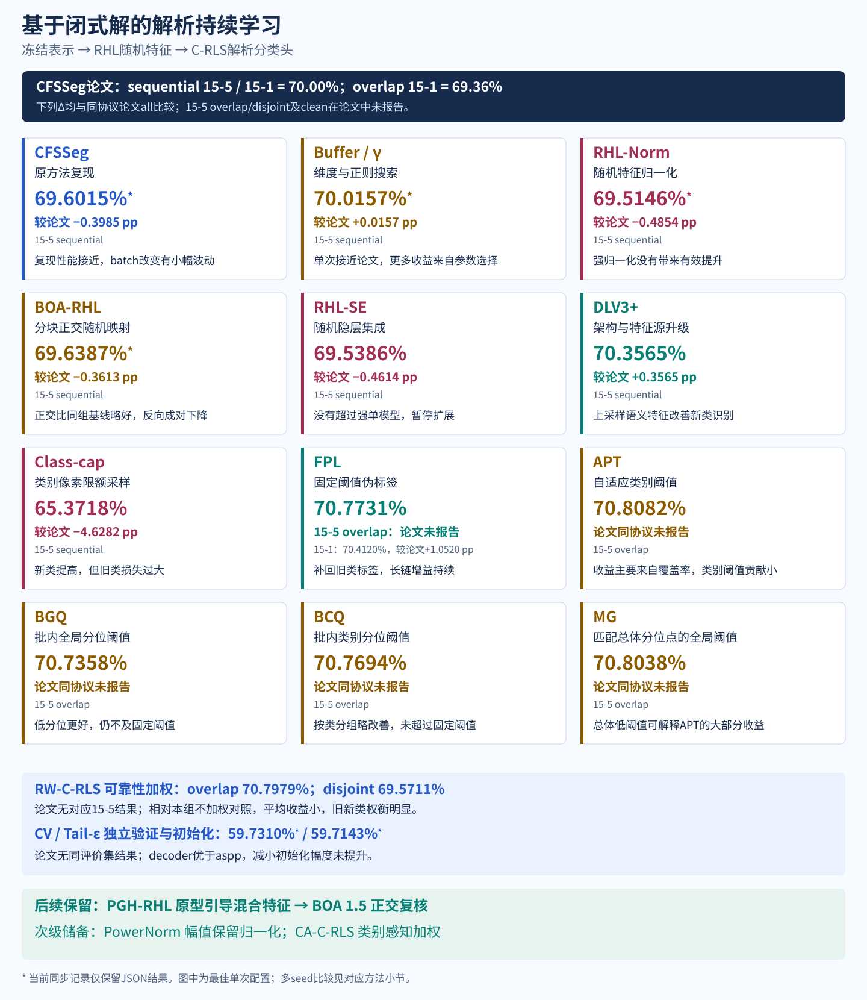

# 基于闭式解的解析持续学习

## 1. 2D实验总览

结果为 PASCAL VOC 2012 的 mIoU（%），差值单位为百分点（pp）。上标*表示当前跨服务器同步记录中只保留了该实验的JSON结果及配套配置。

### 1.1 原论文结果

| 任务 | 设置       | old % | new % | all %     |
| ---- | ---------- | ----- | ----- | --------- |
| 15-5 | sequential | 78.10 | 42.00 | **70.00** |
| 15-1 | sequential | 78.10 | 42.00 | **70.00** |
| 15-1 | disjoint   | 77.66 | 40.33 | **68.77** |
| 10-1 | disjoint   | 70.85 | 42.13 | **57.17** |
| 15-1 | overlap    | 79.16 | 38.00 | **69.36** |
| 10-1 | overlap    | 75.02 | 41.20 | **58.91** |

配置：`15-5`先学15个前景类，再一次加入5类；`15-1`分5次各加入1类；`10-1`分10次各加入1类。背景类始终单独计入。模型为DeepLabV3–ResNet101。原论文表III、IV的结果见[CFSSeg原文](https://arxiv.org/html/2412.10834v2#S5)。

### 1.2 各已实验方法的最佳结果

“最佳”取该方法已完成配置中的最高all；多seed均值在对应方法小节列出。

| 方法                                   | 协议                    | old %   | new %   | 最佳 all %  | 论文 all % | Δall pp |
| -------------------------------------- | ----------------------- | ------- | ------- | ----------- | ---------- | ------- |
| CFSSeg基础复现*             | 15-5 sequential         | 78.4678 | 41.2291 | **69.6015** | 70.0000    | -0.3985 |
| CFSSeg长链复现*             | 15-1 sequential         | 78.2523 | 41.5258 | **69.5079** | 70.0000    | -0.4921 |
| Buffer/γ搜索*               | 15-5 sequential         | 78.4955 | 42.8804 | **70.0157** | 70.0000    | +0.0157 |
| RHL-Norm：特征归一化*       | 15-5 sequential         | 77.7754 | 43.0802 | **69.5146** | 70.0000    | -0.4854 |
| BOA-RHL：分块正交随机映射*  | 15-5 sequential         | 77.8225 | 43.4507 | **69.6387** | 70.0000    | -0.3613 |
| RHL-SE：随机头集成                     | 15-5 sequential         | 77.9811 | 42.5228 | **69.5386** | 70.0000    | -0.4614 |
| DLV3+：分割架构与特征源升级            | 15-5 sequential         | 77.9276 | 46.1287 | **70.3565** | 70.0000    | +0.3565 |
| Class-cap：类别像素限额采样            | 15-5 sequential         | 71.0924 | 47.0660 | **65.3718** | 70.0000    | -4.6282 |
| FPL：固定阈值伪标签                    | 15-1 overlap            | 79.6171 | 40.9558 | **70.4120** | 69.3600    | +1.0520 |
| FPL：固定阈值伪标签                    | 15-5 overlap            | 79.6761 | 42.2836 | **70.7731** | —          | —       |
| FPL：固定阈值伪标签                    | 15-5 disjoint           | 77.8582 | 42.6021 | **69.4639** | —          | —       |
| BGQ：批内全局分位阈值                  | 15-5 overlap            | 79.6345 | 42.2601 | **70.7358** | —          | —       |
| BCQ：批内类别分位阈值                  | 15-5 overlap            | 79.6758 | 42.2691 | **70.7694** | —          | —       |
| APT：离线自适应类别阈值                | 15-5 overlap            | 79.7185 | 42.2949 | **70.8082** | —          | —       |
| APT：离线自适应类别阈值                | 15-5 disjoint           | 77.8822 | 42.6233 | **69.4872** | —          | —       |
| MG：总体分位点匹配的全局阈值           | 15-5 overlap            | 79.7124 | 42.2965 | **70.8038** | —          | —       |
| MG：总体分位点匹配的全局阈值           | 15-5 disjoint           | 77.8822 | 42.6237 | **69.4873** | —          | —       |
| RW-C-RLS：可靠性加权                   | 15-5 overlap            | 79.6944 | 42.3291 | **70.7979** | —          | —       |
| RW-C-RLS：可靠性加权                   | 15-5 disjoint           | 77.8475 | 43.0866 | **69.5711** | —          | —       |
| CV：独立验证集特征源选择*   | 15-5 sequential / clean | 67.6596 | 34.3595 | **59.7310** | —          | —       |
| Tail-ε：新增类别初始化调整* | 15-5 sequential / clean | 67.6173 | 34.4247 | **59.7143** | —          | —       |

配置：每行在该方法内部选择最优配置；RW-C-RLS在overlap中最佳为confidence权重，在disjoint中为confidence×margin。Tail-ε行取新尝试的ε=0、1e-4中较好的1e-4；原ε=1e-3对照为59.7310%。`clean`为独立训练留出集。原论文没有15-5 overlap/disjoint或clean结果，对应论文差值记“—”。

### 1.3 总结

**架构升级是目前幅度最明确的改进。** DeepLabV3+结合上采样ASPP特征达到70.3565%，相对论文表列70.0%高0.3565 pp；新类达到46.1287%，比论文42.0%高4.1287 pp。V3+仅使用decoder时只有68.9663%，说明收益依赖特征源选择。

**随机特征侧的收益仍然较小。** Buffer搜索的最佳单次为70.0157%，但8224维的三seed均值为69.9014%；BOA正交映射比同组默认映射提升0.0789 pp。固定归一化没有带来有效增益，随机头集成的最佳结果69.5386%仍低于69.5598%的强单模型。

**伪标签的主要收益来自补回更多旧类像素。** 固定0.6阈值在15-5 overlap/disjoint上相对不使用伪标签分别提升0.4640/0.5201 pp；15-1 overlap最终达到70.4120%，比论文同协议69.36%高1.0520 pp。类别自适应阈值虽达到70.8082%，但与总体分位点匹配的全局阈值比较，六组平均只高0.0020 pp；类别阈值本身贡献很小。

**可靠性加权没有形成稳定净收益，clean实验则确定了后续比较起点。** W1两种权重平均提升仅0.0190/0.0339 pp，并表现出旧类与新类之间的权衡。独立验证集上，decoder三seed均值比aspp高0.5184 pp；将新增列初始化ε从1e-3改为0或1e-4均未提升。后续宜保留V3+特征适配和固定伪标签，优先研究语义特征或解析目标的改造。

## 2. 实验协议与指标

`sequential`保留已见旧类与当前新类标注；`disjoint`将当前步的旧类标为背景，且图像按任务分开；`overlap`允许图像跨任务出现，背景还可能包含未来类别。本文的overlap对应原论文的overlapped。

| 评价集合                          | 典型all  | 用途                                    |
| --------------------------------- | -------- | --------------------------------------- |
| VOC官方验证集（代码中命名为test） | 约69–71% | 复现、历史方法与参数比较                |
| 按当前任务过滤的旧验证集          | 约44–45% | 观察到类别覆盖不全，已由clean方案替代   |
| 独立clean holdout                 | 约59%    | 从训练池留出10%，用于选择特征源与超参数 |
| 官方验证集全类复评                | 约69–70% | 检查旧验证集的排序与类别覆盖            |

配置：历史官方验证集与clean holdout使用不同的图片和step0模型，分别比较。15-5最终`old`为0–15共16类（含背景），`new`为16–20共5类，`all=(16×old+5×new)/21`。15-1中间步的new为截至该步累计学到的新类。

原论文sequential表列78.1/42.0/70.0；前两项按16∶5加权约为69.50，与表列all存在约0.50 pp差异。本文保留论文原值70.0作对照，各方法的实际改进幅度主要看同组实验。

## 3. 原方法复现与batch调整

CFSSeg先在step0训练DeepLab特征提取器，增量阶段冻结特征，通过固定随机隐层RHL将像素特征映射到高维，再用C-RLS递归岭回归更新分类头。15-5只进行一次增量更新，15-1进行五次；复现实验检验基础流程，batch调整则观察数据分批、随机增强和数值计算对结果的影响。第3–8节均为sequential；除基础复现中的15-1外，其余为15-5。

### 3.1 基础复现

| 配置                             | old %     | new %     | all %     |
| -------------------------------- | --------- | --------- | --------- |
| 15-1_local*           | 77.905035 | 40.278896 | 68.946431 |
| 15-1_trs*             | 78.252339 | 41.525806 | 69.507926 |
| 15-5_bs64*            | 78.008491 | 42.107460 | 69.460626 |
| 15-5_bs32*            | 77.794165 | 43.209936 | 69.559825 |
| 15-5_bs16_trs_eval1*  | 78.406135 | 41.364401 | 69.586675 |
| 15-5_bs16_trs_eval2*  | 78.467818 | 41.229112 | 69.601459 |
| 15-5_base16_bs16_trs* | 78.391552 | 40.918132 | 69.469309 |
| 15-5_base64_bs32*     | 78.215196 | 41.854106 | 69.557794 |

配置：`local/trs`区分运行服务器；`bsN`为增量阶段batch size；`base16/base64`表示step0的batch size；`eval1/eval2`表示同一实验目录的两次评估。15-1取最终step5，15-5取最终step1；这组默认buffer为8196、γ=1。

**结论：** 15-5基础复现落在69.46–69.60%，15-1两条完整链为68.9464%和69.5079%。改变batch会带来小幅波动，但没有改变基础方法的性能区间。

### 3.2 batch与局部buffer调整

这组实验沿用原方法，改变增量batch和随机隐层输出维度，检查训练设置敏感性。buffer越大表示高维随机特征越多，但并不保证结果单调提高。

| 配置                               | old %     | new %     | all %     |
| ---------------------------------- | --------- | --------- | --------- |
| bs48_legacy*            | 77.833662 | 41.169224 | 69.104034 |
| bs32_b8192*             | 77.780953 | 42.524475 | 69.386554 |
| bs32_b8196*             | 77.794165 | 43.209936 | 69.559825 |
| bs48_legacy_repeat*     | 77.833662 | 41.169224 | 69.104034 |
| bs48_b8196*             | 77.885718 | 41.876431 | 69.312078 |
| trs_b8204_bs32_repeat1* | 78.453101 | 41.476948 | 69.649255 |
| local_b8216_bs32*       | 78.347894 | 40.939494 | 69.441133 |
| trs_b8216_bs32_repeat1* | 78.347894 | 40.939494 | 69.441133 |
| trs_b8200_bs32_repeat1* | 78.441627 | 41.372389 | 69.615618 |
| trs_b8200_bs32_repeat2* | 78.441627 | 41.372389 | 69.615618 |
| base64_bs32_b8200*      | 77.885255 | 42.366267 | 69.428353 |
| trs_b8208_bs32*         | 78.482606 | 41.739757 | 69.734309 |
| trs_b8196_bs32*         | 78.285110 | 41.798586 | 69.597842 |
| trs_b8192_bs32*         | 78.385633 | 41.129685 | 69.515170 |
| trs_b8204_bs32_repeat2* | 78.453101 | 41.476948 | 69.649255 |
| trs_b8212_bs32*         | 78.359929 | 41.436241 | 69.568575 |
| trs_b8216_bs32_repeat2* | 78.347894 | 40.939494 | 69.441133 |

配置：`bN`为buffer维度，`bsN`为增量batch，`base64`为step0 batch64，`repeatN`为相同名义配置的重复运行。`legacy`保留当时旧buffer设置，不能等同于显式指定b8196。TRS这组局部搜索复用base16模型；γ固定为1。

**结论：** bs48没有优于bs32，buffer的微调呈非单调波动。局部调整中b8208达到69.7343%，随后用统一队列进一步比较buffer和γ。

## 4. Buffer与γ超参数搜索

Buffer控制RHL输出维度，γ是岭回归正则强度。较大的buffer增加非线性表示容量，也增加矩阵计算成本；γ限制分类头权重幅值。先在相同设置下扫描维度和γ，再用多个独立RHL随机种子判断结果是否稳定。

### 4.1 单seed维度与正则搜索

| 配置                         | old %     | new %     | all %     |
| ---------------------------- | --------- | --------- | --------- |
| b8192_g1_rhlm1*   | 78.386000 | 41.130341 | 69.515605 |
| b8196_g0p1_rhlm1* | 78.285447 | 41.799328 | 69.598276 |
| b8196_g10_rhlm1*  | 78.285493 | 41.798673 | 69.598155 |
| b8196_g1_rhlm1*   | 78.285459 | 41.799244 | 69.598265 |
| b8200_g1_rhlm1*   | 78.441694 | 41.373135 | 69.615847 |
| b8204_g0p1_rhlm1* | 78.453205 | 41.476979 | 69.649341 |
| b8204_g10_rhlm1*  | 78.453269 | 41.476317 | 69.649233 |
| b8204_g1_rhlm1*   | 78.453220 | 41.476892 | 69.649332 |
| b8208_g1_rhlm1*   | 78.482991 | 41.738912 | 69.734401 |
| b8212_g1_rhlm1*   | 78.360513 | 41.438021 | 69.569444 |
| b8216_g1_rhlm1*   | 78.348233 | 40.940211 | 69.441561 |
| b8220_g1_rhlm1*   | 78.380413 | 41.658075 | 69.637000 |
| b8224_g1_rhlm1*   | 78.431891 | 41.834654 | 69.718263 |

配置：`b8196`表示8196维随机特征；`g0p1/g1/g10`表示γ=0.1/1/10；`rhlm1`表示rhl_seed=-1，即沿用全局随机状态。所有行增量bs32、norm=none，复用同一base16模型。

**结论：** γ从0.1变到10几乎不改变结果；buffer局部变化的影响更大，但没有单调趋势。b8208是这一轮最优点，all=69.7344%。

### 4.2 多seed与右侧维度扩展

| 配置                             | old %     | new %     | all %     |
| -------------------------------- | --------- | --------- | --------- |
| b8208_g1_rhl1*        | 78.482991 | 41.738912 | 69.734401 |
| b8208_g1_rhl2*        | 78.460207 | 42.373424 | 69.868116 |
| b8208_g1_rhl3*        | 78.426517 | 42.326289 | 69.831224 |
| b8224_g1_rhl1*        | 78.431891 | 41.834654 | 69.718263 |
| b8224_g1_rhl2*        | 78.418566 | 42.982502 | 69.981408 |
| b8224_g1_rhl3*        | 78.432651 | 42.739210 | 69.934213 |
| b8228_g1_rhl2*        | 78.457253 | 41.956255 | 69.766539 |
| b8232_g1_rhl2*        | 78.487667 | 42.436347 | 69.904020 |
| b8236_g1_rhl2*        | 78.257919 | 42.639057 | 69.777237 |
| b8240_g1_rhl2*        | 78.316999 | 42.741709 | 69.846692 |
| b8208_g1_rhl4*        | 78.542803 | 42.540610 | 69.970852 |
| b8208_g1_rhl5*        | 78.368723 | 41.733559 | 69.646065 |
| b8224_g1_rhl4*        | 78.495463 | 42.880448 | 70.015697 |
| b8224_g1_rhl5*        | 78.322193 | 42.138840 | 69.707109 |
| b8224_g1_rhl2_repeat* | 78.418566 | 42.982502 | 69.981408 |
| b8232_g1_rhl4*        | 78.558232 | 42.148790 | 69.889317 |
| b8232_g1_rhl5*        | 78.391172 | 41.779339 | 69.674069 |

配置：`rhl1…rhl5`只改变RHL映射的随机种子；`repeat`为重复确认。其余均为bs32、γ=1、norm=none和同一base16模型。b8228–b8240是向更大维度的扩展。

| 配置与种子范围                 | 平均old % | 平均new % | 平均all % |
| ------------------------------ | --------- | --------- | --------- |
| b8208 / rhl1–5*     | 78.456248 | 42.142559 | 69.810132 |
| b8224 / rhl1–5*     | 78.420153 | 42.515131 | 69.871338 |
| b8224 / rhl2、4、5* | 78.412074 | 42.667263 | 69.901405 |
| b8232 / rhl2、4、5* | 78.479023 | 42.121492 | 69.822468 |

配置：前两行使用rhl_seed=1、2、3、4、5；后两行使用rhl_seed=2、4、5，按相同种子配对比较。

**结论：** 单次最高为b8224、rhl4的70.0157%。8224对8232的三seed均值高0.0789 pp，对8208的五seed均值高约0.0612 pp。8224适合作为固定起点，继续逐个维度搜索的收益有限。

## 5. RHL-Norm：随机特征归一化

归一化作用于RHL与ReLU之后、解析分类头之前。L2将每个像素特征缩放到单位长度；L2√d再乘随机特征维度d的平方根；LayerNorm同时消除通道均值并调整方差。目的是减少像素间幅值差异，使岭回归处理更一致的特征尺度。

| 配置                                 | old %     | new %     | all %     |
| ------------------------------------ | --------- | --------- | --------- |
| rhl_none_g1_bs64*         | 78.008491 | 42.107460 | 69.460626 |
| rhl_l2_g1_bs64*           | 77.939010 | 42.287276 | 69.450502 |
| rhl_ln_g1_bs64*           | 77.957369 | 42.079210 | 69.414950 |
| rhl_l2sqrt_g0p1_bs64*     | 77.943326 | 41.656666 | 69.303645 |
| rhl_l2sqrt_g1_bs64*       | 77.943325 | 41.656656 | 69.303642 |
| rhl_l2sqrt_g10_bs64*      | 77.943321 | 41.656592 | 69.303624 |
| rhl_l2sqrt_g1_retry_bs32* | 77.775407 | 43.080168 | 69.514636 |

配置：`rhl`指随机隐层输出；`none/l2/ln/l2sqrt`依次为不归一化、L2、无可学习仿射参数的LayerNorm、L2√d；`g0p1/g1/g10`表示γ=0.1/1/10；`bs64/bs32`表示增量batch；`retry`是重跑标记，不是新算法，原`rhl_l2sqrt_g1_retry`实际使用bs32。

**结论：** 相同bs64下，none的69.4606%最高，L2基本持平，LayerNorm和L2√d下降；γ搜索没有改善L2√d。bs32重跑的69.5146%也低于同batch默认映射的69.5598%。完全压平幅值可能削弱特征中的有效强度信息，后续若继续归一化，应考虑部分保留幅值，而不是重复强归一化扫描。

## 6. RHL-SE：随机隐层子空间集成

RHL-SE固定同一个特征提取器，训练不同随机映射对应的解析分类头，再融合各头输出。等权融合直接平均；全局加权对模型分配固定权重；类别或old/new分组加权按类别调整模型贡献；confidence gate根据当前像素的置信度选择或加权成员。它依靠不同随机头的错误互补获得提升。

| 配置                                 | old %   | new %   | all %   |
| ------------------------------------ | ------- | ------- | ------- |
| RHL子空间成员 seed1*      | 78.0085 | 42.1075 | 69.4606 |
| RHL子空间成员 seed2*      | 77.8998 | 42.3649 | 69.4391 |
| RHL子空间成员 seed3*      | 77.9544 | 42.4415 | 69.4989 |
| K2等权logit融合                      | 77.9567 | 42.4183 | 69.4952 |
| K2等权概率融合                       | 77.9577 | 42.4256 | 69.4976 |
| K2等权概率融合CPU复核                | 77.9577 | 42.4256 | 69.4976 |
| K3加权logit融合                      | 77.9837 | 42.3648 | 69.5030 |
| K3加权概率融合A                      | 77.9724 | 42.4030 | 69.5035 |
| K3加权概率融合B                      | 77.9848 | 42.3737 | 69.5060 |
| K3等权logit融合                      | 77.9974 | 42.3163 | 69.5019 |
| K3等权概率融合                       | 77.9985 | 42.3254 | 69.5049 |
| old/new分组概率融合                  | 78.0029 | 42.3043 | 69.5033 |
| 手工class-wise概率融合               | 78.0022 | 42.3893 | 69.5229 |
| 置信度门控概率融合                   | 78.0191 | 42.2294 | 69.4977 |
| 验证集驱动class-wise完整评估 batch1  | 77.9804 | 42.5218 | 69.5379 |
| 验证集驱动class-wise完整评估 batch1  | 77.9804 | 42.5218 | 69.5379 |
| 验证集驱动class-wise完整评估 batch16 | 77.9811 | 42.5228 | 69.5386 |
| 验证集驱动class-wise完整评估 batch32 | 77.9803 | 42.5236 | 69.5382 |
| 验证集驱动class-wise测试             | 77.9804 | 42.5218 | 69.5379 |

配置：`seed1/2/3`为独立RHL种子，成员训练时全局seed1、batch64、buffer8196、γ=1。`K2`融合seed2/3，`K3`融合seed1/2/3；`logit`融合激活前分数，`prob`融合类别概率分数。K3加权logit使用0.2/0.4/0.4；加权概率A使用0.1/0.45/0.45，B使用0.2/0.4/0.4，均按seed1/2/3顺序。`old/new`为旧类偏seed1、新类偏seed2/3的两组权重；手工`class-wise`按逐类测试诊断设权重，“验证集驱动”则按验证表现选择权重后固定评估。置信度门控以seed1为主模型、门限0.10、融合权重2/4/4；CPU表示在CPU上复评。表中batch1/16/32均为评估batch；两条同名batch1记录是重复评估。

**结论：** 最佳融合结果为69.5386%，比最佳成员seed3的69.4989%高0.0397 pp，但低于69.5598%的强单模型。成员之间高度相似，互补空间小；增加融合规则没有产生足够收益，暂不继续扩展。

## 7. BOA-RHL：分块正交与反向成对随机映射

BOA-RHL（Block-Orthogonal Antithetic RHL）改变随机投影矩阵的构造：分块正交使同一块内投影方向尽量不重复；反向成对用W与−W同时投影，使ReLU保留输入在正负方向的响应。在固定总维度下，成对结构也会减少不同投影轴的数量。

| 配置                                                 | old %     | new %     | all %     |
| ---------------------------------------------------- | --------- | --------- | --------- |
| gaussian_legacy_seed1_bs32*               | 77.794165 | 43.209936 | 69.559825 |
| orthogonal_legacy_seed1_bs32*             | 77.822460 | 43.450724 | 69.638714 |
| orthogonal_antithetic_legacy_seed1_bs32*  | 77.706707 | 38.376759 | 68.342433 |
| orthogonal_antithetic_kaiming_seed1_bs32* | 77.657324 | 37.797318 | 68.166847 |

配置：`gaussian`是兼容名称，legacy路径实际使用PyTorch Linear默认初始化；`orthogonal`表示分块正交；`antithetic`表示W/−W成对。`legacy/kaiming`分别使用原始尺度和较大的Kaiming尺度；`seed1`为RHL seed1，`bs32`为增量batch32。固定buffer8196、γ=1、norm=none。

**结论：** 正交映射达到69.6387%，相对同组默认映射提升0.0789 pp，新类提升0.2408 pp。反向成对两组分别降到68.3424%和68.1668%，主要退化在新类；放大尺度未改善。保留正交方向的小规模多seed复核，反向成对不再优先。

## 8. DeepLabV3+升级与类别像素采样

### 8.1 架构与解析特征源

DeepLabV3+在ASPP高层语义特征之外融合低层空间信息，并通过decoder恢复细节。解析分类头可以读取decoder输出、ASPP输出，或上采样后的ASPP特征。这里改变的是分割头结构与特征接口，ResNet101骨干保持一致。

| 配置                    | old %   | new %   | all %   |
| ----------------------- | ------- | ------- | ------- |
| V3+ ASPP上采样特征      | 77.9276 | 46.1287 | 70.3565 |
| V3+ ASPP特征            | 77.7115 | 45.0984 | 69.9464 |
| V3+ buffer8200敏感性    | 78.1346 | 39.3059 | 68.8897 |
| V3+ buffer8216敏感性    | 78.1784 | 40.2370 | 69.1447 |
| V3+ decoder特征         | 78.1453 | 39.5933 | 68.9663 |
| V3+ decoder降采样特征   | 77.5002 | 40.1131 | 68.5985 |
| V3+ step1 batch32敏感性 | 78.1453 | 39.5933 | 68.9663 |
| V3+主线黄金重放         | 77.9276 | 46.1287 | 70.3565 |

配置：`decoder`为V3+融合后的解码特征；`decoder_stride8`将decoder特征降采样到步长8；`aspp`为原ASPP空间分辨率；`aspp_up`将ASPP特征上采样后送入RHL。buffer8200/8216两行使用decoder，其余特征源对照使用8196；默认step0 batch32、step1 batch16，“step1 batch32”改为32。“主线黄金重放”使用auto→aspp_up，重跑最佳配置。

**结论：** aspp_up最高，为70.3565%；比同架构decoder的68.9663%高1.3902 pp。aspp为69.9464%，decoder_stride8为68.5985%。更高层语义特征与合适空间分辨率的结合，比直接使用融合后的decoder更适合这一组解析头。

### 8.2 Class-cap：按类别限制像素数

Class-cap在解析拟合前对每类像素设置数量上限，减少多数类占比和高维矩阵计算量。它相当于改变用于拟合的像素分布，可能提高稀少类的相对影响，也会丢弃旧类样本。

| 配置            | old %   | new %   | all %   |
| --------------- | ------- | ------- | ------- |
| aspp_up_no_cap  | 77.9276 | 46.1287 | 70.3565 |
| aspp_up_cap4096 | 69.4642 | 45.5214 | 63.7635 |
| aspp_up_cap8192 | 71.0924 | 47.0660 | 65.3718 |

配置：`no_cap`使用不限制类别像素数的V3+ aspp_up基线；`cap4096/cap8192`表示拟合采样时每类最多保留4096/8192个像素；这不是buffer维度。

**结论：** cap8192的新类提高到47.0660%，但旧类降至71.0924%，all只有65.3718%；cap4096进一步降至63.7635%。旧类样本损失超过新类收益，不继续作为涨点方法。

## 9. 伪标签：从补回旧类到阈值与权重

### 9.1 为什么需要伪标签

在overlap/disjoint中，当前任务只标注新类，图片里的旧类可能被写成背景。例如前一步学过“汽车”，当前步学习“羊”，汽车像素在当前mask中也可能是背景。直接拿这张mask训练，会要求模型把汽车也预测成背景。伪标签让上一阶段模型充当teacher：当它认为某个背景像素是旧类且分数足够高，就把该像素的训练目标恢复成相应旧类；显式新类标注保持原样。

具体处理顺序是：①取当前标签为背景、teacher最高分预测为旧类的像素作为候选；②读取其最高类别分数p；③按阈值决定是否接收；④接收的像素改用teacher旧类标签，未接收的仍为背景。例如p=0.72、阈值0.6时接收，阈值0.8时不接收。**接收率是接收像素数/候选像素数，不是正确率。**

本组teacher使用逐类别sigmoid分数，最高分可用于排序，但所有类别分数之和不要求等于1。下面依次比较“是否补标签”“如何选阈值”“接收后如何分配权重”。

### 9.2 FPL：固定阈值

FPL（Fixed-threshold Pseudo-Labeling）对所有旧类采用同一个分数门槛。低阈值补回更多像素，也可能接收更多错误标签；高阈值更保守，却可能丢掉困难但有用的旧类。本组属于原有伪标签机制的开关与阈值调参。

| 配置      | old %     | new %     | all %     | 接收率   |
| --------- | --------- | --------- | --------- | -------- |
| off       | 79.117900 | 42.120900 | 70.309100 | —        |
| fixed 0.6 | 79.676100 | 42.283600 | 70.773100 | 94.9132% |
| fixed 0.7 | 79.634600 | 42.270300 | 70.738300 | 90.3503% |
| fixed 0.8 | 79.583000 | 42.259200 | 70.696400 | 84.6965% |
| fixed 0.9 | 79.502400 | 42.239300 | 70.630200 | 76.1808% |

配置：本表为15-5 overlap、seed1、step1；`off`不使用伪标签，`fixed 0.6/0.7/0.8/0.9`分别要求p≥0.6/0.7/0.8/0.9。seed控制整次训练随机性，和前面只控制随机映射的rhl_seed不同。

**结论：** fixed0.6最好，all从70.3091%升至70.7731%，提升0.4640 pp；阈值继续升高时，接收率和结果一起下降。本组更需要旧类覆盖，而非更激进地筛除低分像素。

### 9.3 BGQ / BCQ：批内分位数阈值

分位数阈值不是固定分数，而是按候选分数的排序位置决定门槛。q=0.1表示取第10百分位，通常保留较高的约90%；q=0.7通常只保留约30%。BGQ（Batch Global Quantile）把一个batch的候选像素合在一起求门槛；BCQ（Batch Class Quantile）按teacher预测类别分组，各类分别求门槛，避免高分大类主导统一门槛。

| 配置                           | old %     | new %     | all %     | 接收率   |
| ------------------------------ | --------- | --------- | --------- | -------- |
| batch_global q0.7              | 79.142300 | 42.112400 | 70.325700 | 30.0003% |
| batch_global q0.5              | 79.267200 | 42.148700 | 70.429400 | 50.0001% |
| batch_global q0.3              | 79.446900 | 42.210700 | 70.581100 | 70.0000% |
| batch_global q0.1              | 79.634500 | 42.260100 | 70.735800 | 90.0000% |
| batch_class q0.7               | 79.294100 | 42.163600 | 70.453500 | 30.0008% |
| batch_class q0.5               | 79.425700 | 42.221700 | 70.567600 | 50.0005% |
| batch_class q0.3               | 79.559600 | 42.254000 | 70.677300 | 69.9999% |
| batch_class q0.3 + min_conf0.6 | 79.559500 | 42.251200 | 70.676600 | 69.7287% |
| batch_class q0.1               | 79.675800 | 42.269100 | 70.769400 | 89.9997% |

配置：15-5 overlap、seed1、step1；`batch_global/batch_class`分别为BGQ/BCQ；`q0.1/0.3/0.5/0.7`表示分位点；`min_conf0.6`将最终阈值设为max(分位阈值,0.6)。例如`batch_class q0.3 + min_conf0.6`先在每类中取30%分位点，再将低于0.6的门槛抬到0.6。

**结论：** BGQ最佳70.7358%，BCQ最佳70.7694%，均未超过fixed0.6的70.7731%。降低q、提高覆盖明显有利；按类别分组只缩小了与固定阈值的差距。

### 9.4 APT：离线自适应类别阈值

APT（Adaptive Pseudo-label Thresholding）先用teacher扫描训练数据，收集各旧类候选分数分布，再为每类计算分位阈值并保存到文件。训练期间直接读取这些门槛，因此称为`artifact_class`；artifact只是“离线保存的阈值文件”，不是另一种模型。与BCQ相比，门槛来自整个校准训练集，不随当前batch跳动。

| 配置                         | old %     | new %     | all %     | 接收率   |
| ---------------------------- | --------- | --------- | --------- | -------- |
| artifact q0.20               | 79.621800 | 42.247300 | 70.723100 | 80.1851% |
| artifact q0.10               | 79.679000 | 42.268000 | 70.771600 | 90.1512% |
| artifact q0.07               | 79.692900 | 42.275600 | 70.784000 | 93.0301% |
| artifact q0.05               | 79.702700 | 42.282100 | 70.793000 | 95.0256% |
| artifact q0.05 + min_conf0.6 | 79.677200 | 42.276800 | 70.772300 | 93.6502% |
| artifact q0.03               | 79.711800 | 42.290200 | 70.801900 | 97.0145% |
| artifact q0.015              | 79.717400 | 42.293900 | 70.807000 | 98.4628% |
| artifact q0.01               | 79.718500 | 42.294900 | 70.808200 | 98.9409% |
| artifact q0.01 + min_conf0.6 | 79.676100 | 42.283600 | 70.773100 | 94.9132% |
| artifact q0.005              | 79.718500 | 42.294900 | 70.808100 | 99.4369% |
| artifact q0.00               | 79.715400 | 42.294800 | 70.805700 | 99.9798% |

配置：15-5 overlap、seed1；`artifact qX`表示按类使用离线X分位阈值；未写min_conf时为0。q越小，阈值越低、接收越多；q=0近似全接收。`min_conf0.6`为绝对分数下限，不是再保留60%的像素。

**结论：** q=0.01最好，为70.8082%，比fixed0.6高0.0351 pp；q=0.005几乎相同。将最低分数设为0.6后，结果回到fixed0.6附近，增益与额外接收的低分候选密切相关。

同样的方法用于disjoint：

| 配置                          | old %     | new %     | all %     | 接收率   |
| ----------------------------- | --------- | --------- | --------- | -------- |
| off                           | 77.088400 | 42.881000 | 68.943800 | —        |
| fixed 0.6                     | 77.858200 | 42.602100 | 69.463900 | 90.6862% |
| artifact q0.005               | 77.882000 | 42.615200 | 69.485200 | 99.4795% |
| artifact q0.01                | 77.881000 | 42.612900 | 69.483800 | 98.9413% |
| artifact q0.015               | 77.880100 | 42.610500 | 69.482600 | 98.4050% |
| artifact q0.00                | 77.882200 | 42.623300 | 69.487200 | 99.9936% |
| artifact q0.005 + min_conf0.6 | 77.858200 | 42.602100 | 69.463900 | 90.6862% |

配置：15-5 disjoint、seed1、step1；`off`关闭伪标签，`fixed 0.6`使用统一分数门槛0.6，`artifact qX`按类使用离线X分位阈值。未写min_conf时为0，`min_conf0.6`将最低分数门槛设为0.6。teacher与校准数据均取disjoint对应配置。

**结论：** fixed0.6比off提高0.5201 pp；APT最佳为q=0的69.4872%，比fixed0.6再高0.0233 pp。近乎全接收优于强筛选，但伪标签提高旧类的同时会轻微降低新类。

### 9.5 固定阈值与APT的多seed比较

在相同seed下比较两种阈值，观察单次的微小增益是否重复出现；两边使用同一个teacher和基础模型。

| seed | fixed all % | APT all % | Δall pp | fixed old % | APT old % | fixed new % | APT new % |
| ---- | ----------- | --------- | ------- | ----------- | --------- | ----------- | --------- |
| 1    | 70.773100   | 70.808200 | +0.0351 | 79.676100   | 79.718500 | 42.283600   | 42.294900 |
| 2    | 70.760800   | 70.801700 | +0.0409 | 79.625700   | 79.675200 | 42.393200   | 42.406400 |
| 3    | 70.363200   | 70.405800 | +0.0426 | 79.622500   | 79.673400 | 40.733300   | 40.749300 |

配置：15-5 overlap；fixed为统一阈值0.6，APT为artifact_class、q=0.01、min_conf=0；seed=1/2/3对应三组完整训练随机种子。

| seed | fixed all % | APT all % | Δall pp | fixed old % | APT old % | fixed new % | APT new % |
| ---- | ----------- | --------- | ------- | ----------- | --------- | ----------- | --------- |
| 1    | 69.463900   | 69.487200 | +0.0233 | 77.858200   | 77.882200 | 42.602100   | 42.623300 |
| 2    | 69.384200   | 69.418100 | +0.0339 | 77.962000   | 77.978200 | 41.935400   | 42.025700 |
| 3    | 69.244100   | 69.285800 | +0.0417 | 77.816700   | 77.856600 | 41.811700   | 41.859100 |

配置：15-5 disjoint；fixed为统一阈值0.6，APT为artifact_class、q=0、min_conf=0；seed=1/2/3对应三组完整训练随机种子。

**结论：** 六组均比fixed0.6略高，平均约+0.0362 pp；改善可以重复，但幅度很小。下一组实验进一步区分收益究竟来自“类别自适应”，还是“把总体阈值降低”。

### 9.6 MG：匹配总体分位点的全局阈值

MG（Matched Global threshold）保留APT校准时的总体分位门槛，但所有旧类共用它，不再分配类别专属阈值。这样，两种方法都接收约99%–100%的候选，差别主要落在“统一阈值还是分类阈值”。如果APT仍明显更好，才能说明按类别分配门槛有独立作用。

| 配置           | MG统一阈值  | APT all % | MG all %  | Δall pp   | Δold pp   | Δnew pp   |
| -------------- | ----------- | --------- | --------- | --------- | --------- | --------- |
| overlap_seed1  | 0.447265625 | 70.808156 | 70.803822 | +0.004334 | +0.006169 | -0.001539 |
| overlap_seed2  | 0.419921875 | 70.801674 | 70.799660 | +0.002013 | +0.002520 | +0.000394 |
| overlap_seed3  | 0.443359375 | 70.405765 | 70.399926 | +0.005838 | +0.007256 | +0.001301 |
| disjoint_seed1 | 0.029296875 | 69.487240 | 69.487314 | -0.000075 | +0.000055 | -0.000490 |
| disjoint_seed2 | 0.048828125 | 69.418100 | 69.418154 | -0.000054 | -0.000093 | +0.000070 |
| disjoint_seed3 | 0.048828125 | 69.285784 | 69.285809 | -0.000024 | -0.000030 | -0.000008 |

配置：均为15-5 step1；overlap的APT使用q=0.01，disjoint使用q=0；MG统一阈值逐seed取对应校准文件中的global_threshold。三个Δ均为APT−MG。MG匹配总体分位门槛，不要求两边接收每一个完全相同的像素。

**结论：** overlap平均只高0.004062 pp，disjoint平均低0.000051 pp，六组平均+0.002005 pp。APT相对fixed0.6的大部分改善可以用更低的总体阈值解释，类别阈值分配的净收益很小，不再继续这一阈值搜索路线。

### 9.7 W0：置信度能否判断伪标签可靠性

W0按teacher分数将候选像素分成十档，再用完整标注统计每档的正确率。confidence是最高类别分数p₁；margin是最高分与第二高分之差p₁−p₂，表示第一名领先第二名多少。两个分数都高，通常意味着teacher更加确定。

| 设置     | 接收像素正确率 | 隐藏旧类召回率 | 真背景误标旧类（像素） | 旧类间错分（像素） |
| -------- | -------------- | -------------- | ---------------------- | ------------------ |
| overlap  | 89.4548%       | 90.2821%       | 3,703,358              | 542,322            |
| disjoint | 77.1731%       | 83.3488%       | 7,657,741              | 1,629,323          |

配置：15-5、seed1、MG阈值。接收像素正确率=接收伪标签中预测正确的比例；隐藏旧类召回率=被背景标注遮住的真实旧类中，被正确恢复的比例；错误像素数来自同次统计。

**结论：** confidence与confidence×margin的十档正确率呈单调趋势，桶级Spearman相关系数为1.0。分数有可靠性排序能力，主要错误是真背景被改成旧类；这为连续加权提供了动机。

### 9.8 RW-C-RLS：接收以后按可靠性加权

W1保持MG已接收的像素及其hard标签不变，只调整每个伪标签对解析拟合的影响。confidence模式用w=p₁；confidence×margin模式用w=p₁(p₁−p₂)。例如p₁=0.8、p₂=0.5，两种权重分别为0.8和0.24。显式GT像素保留权重1，ignore像素权重0，未改成伪标签的背景仍按原背景目标处理。

加权岭回归同时将像素特征z和目标y乘√w：

\[
\min_W \sum_i w_i\|z_iW-y_i\|_2^2+\gamma\|W\|_F^2,\qquad z_i^{\prime}=\sqrt{w_i}z_i,\quad y_i^{\prime}=\sqrt{w_i}y_i.
\]

这样低置信度像素影响较小，高置信度像素影响较大；它与前面的hard threshold不同，后者决定像素是否换标签，这里决定换标签后贡献多大。

| 配置                         | old %   | new %   | all %   | 较MG Δall pp |
| ---------------------------- | ------- | ------- | ------- | ------------ |
| overlap / MG / weight=1      | 79.7124 | 42.2965 | 70.8038 | +0.0000      |
| overlap / confidence         | 79.6944 | 42.3291 | 70.7979 | -0.0059      |
| overlap / confidence×margin  | 79.6653 | 42.3804 | 70.7879 | -0.0159      |
| disjoint / MG / weight=1     | 77.8822 | 42.6237 | 69.4873 | +0.0000      |
| disjoint / confidence        | 77.8750 | 42.8312 | 69.5312 | +0.0439      |
| disjoint / confidence×margin | 77.8475 | 43.0866 | 69.5711 | +0.0838      |

配置：15-5、seed1、bs32；overlap使用MG阈值0.447265625，disjoint使用0.029296875。`weight=1`为不加权对照；confidence与confidence×margin仅改变已接收伪标签的像素权重。

**结论：** 两种加权跨设置平均仅提升0.0190/0.0339 pp。overlap略降；disjoint改善主要来自新类，同时旧类下降。margin模式在disjoint使新类提高0.4629 pp、旧类下降0.0347 pp，说明更强降权放大了旧新类权衡。整体收益不足，暂停后续W2/W3。

### 9.9 15-1长链：固定伪标签是否持续有效

将off、fixed0.6和fixed0.7沿五个增量step连续运行，观察伪标签作用能否保持到最后一类，而不只改善一次增量。

| 配置     | step1 all % | step2 all % | step3 all % | step4 all % | step5 all % |
| -------- | ----------- | ----------- | ----------- | ----------- | ----------- |
| off      | 76.603300   | 76.054400   | 72.466700   | 72.329200   | 69.770300   |
| fixed0.6 | 76.897600   | 76.355300   | 72.855600   | 72.712500   | 70.412000   |
| fixed0.7 | 76.865900   | 76.315900   | 72.754300   | 72.611800   | 70.160600   |

配置：15-1 overlap、seed1；off关闭伪标签，fixed0.6/0.7使用固定分数阈值。step1–5每步增加1类，all分别覆盖当时已见的17、18、19、20、21类。

| 配置     | step | old %     | 累计new % |
| -------- | ---- | --------- | --------- |
| off      | 1    | 80.211600 | 18.869500 |
| off      | 2    | 79.831500 | 45.837000 |
| off      | 3    | 79.352000 | 35.745000 |
| off      | 4    | 79.244700 | 44.667600 |
| off      | 5    | 78.952600 | 40.387000 |
| fixed0.6 | 1    | 80.522400 | 18.901100 |
| fixed0.6 | 2    | 80.148500 | 46.009500 |
| fixed0.6 | 3    | 79.783000 | 35.909900 |
| fixed0.6 | 4    | 79.682600 | 44.832000 |
| fixed0.6 | 5    | 79.617100 | 40.955800 |
| fixed0.7 | 1    | 80.489100 | 18.895100 |
| fixed0.7 | 2    | 80.112100 | 45.946500 |
| fixed0.7 | 3    | 79.675400 | 35.841600 |
| fixed0.7 | 4    | 79.573800 | 44.763600 |
| fixed0.7 | 5    | 79.415000 | 40.546500 |

配置：与上表为同三条链；old始终为0–15，累计new分别为16、16–17、16–18、16–19、16–20。

**结论：** fixed0.6最终70.4120%，比off高0.6417 pp，比论文同协议高1.0520 pp；fixed0.7最终70.1606%。固定伪标签的增益能保持到长链末端，0.6仍优于更保守的0.7。

## 10. Clean validation：独立验证集与后续参数实验

**Clean validation是把“用于选参数的图片”从所有训练阶段完整隔离。** 从训练池划出10%（1058张）作为holdout，step0训练、step1重对齐和后续增量更新都排除这些图片；step0也重新训练。这样，验证结果反映模型在未参与拟合的图片上的表现。

做这组实验有两个目的：一是修正旧的任务过滤验证集类别覆盖不全的问题；二是在固定评价集合上选择AIR特征源、buffer和新增类别初始化。本节均使用DeepLabV3：aspp为ASPP输出，decoder为ASPP之后再经过卷积、BN和ReLU的特征，没有V3+的低层特征融合。

### 10.1 旧验证集与全类评估的排序

同一模型分别在旧任务过滤验证集和官方验证集全类评估，检查特征源排序是否受评价集合影响。

| 配置                              | 旧val all % | 全类old % | 全类new % | 全类all % |
| --------------------------------- | ----------- | --------- | --------- | --------- |
| aspp_b8224_g1_rhl2*    | 45.128510   | 77.964663 | 43.589873 | 69.780190 |
| aspp_b8224_g1_rhl4*    | 45.419521   | 77.872292 | 43.573340 | 69.705875 |
| aspp_b8224_g1_rhl5*    | 45.375004   | 77.772371 | 43.447505 | 69.599784 |
| decoder_b8224_g1_rhl2* | 44.410433   | 78.418386 | 42.983607 | 69.981534 |
| decoder_b8224_g1_rhl4* | 44.366720   | 78.495423 | 42.881430 | 70.015901 |
| decoder_b8224_g1_rhl5* | 44.031749   | 78.322172 | 42.139357 | 69.707216 |
| aspp_b8208_g1_rhl2*    | 44.961106   | 78.048262 | 42.955292 | 69.692793 |
| aspp_b8240_g1_rhl2*    | 44.977517   | 77.928034 | 43.251886 | 69.671808 |

配置：均为V3、bs32、γ=1；aspp/decoder为解析头输入特征源，b为buffer维度，rhl为随机映射种子。旧val按当前任务筛图，右侧三项使用官方验证集全类评估。

**结论：** 旧val上aspp看似更好，全类评估却由decoder领先。评价集合的类别覆盖会改变排序，需要用统一的clean holdout重新比较。

### 10.2 E1.1：独立验证集上的特征源与buffer

复用同一clean step0，在独立holdout上重新比较V3的aspp与decoder，并在aspp中比较8208/8224/8240维度。

| 配置                              | old %     | new %     | all %     |
| --------------------------------- | --------- | --------- | --------- |
| aspp_b8208_g1_rhl2*    | 66.669852 | 33.873359 | 58.861163 |
| aspp_b8224_g1_rhl2*    | 66.686339 | 34.671571 | 59.063775 |
| aspp_b8224_g1_rhl4*    | 66.671254 | 34.987339 | 59.127465 |
| aspp_b8224_g1_rhl5*    | 66.859922 | 34.591848 | 59.177047 |
| aspp_b8240_g1_rhl2*    | 66.538138 | 33.999062 | 58.790739 |
| decoder_b8224_g1_rhl2* | 67.659633 | 34.359493 | 59.731028 |
| decoder_b8224_g1_rhl4* | 67.557143 | 34.373363 | 59.656243 |
| decoder_b8224_g1_rhl5* | 67.570254 | 33.827870 | 59.536353 |

配置：`aspp/decoder`为特征源；`b8208/8224/8240`为RHL维度；`g1`为γ=1；`rhl2/4/5`为独立RHL种子。step0 batch16、增量batch32、norm=none，全部使用同一个clean holdout。

| 配置                                   | 平均old % | 平均new % | 平均all % |
| -------------------------------------- | --------- | --------- | --------- |
| aspp_b8224 / rhl2、4、5*    | 66.739172 | 34.750253 | 59.122763 |
| decoder_b8224 / rhl2、4、5* | 67.595677 | 34.186909 | 59.641208 |

配置：两行均为b8224、γ=1，按rhl_seed=2、4、5的三次结果取均值。

**结论：** decoder均值59.6412%，比aspp的59.1228%高0.5184 pp。aspp新类略好，但旧类损失更大；V3后续使用decoder。aspp内部8224优于8208和8240。

### 10.3 E1.2：新增类别权重的初始化幅度

解析分类头加入新类别时，会增加新的输出权重列。ε控制这些列初始随机值的幅度；ε=0从零开始，ε=1e-4或1e-3保留不同强度的随机初值。它影响新增列初始化，γ则控制岭回归正则，两者作用不同。

| 配置                                      | old %     | new %     | all %     |
| ----------------------------------------- | --------- | --------- | --------- |
| decoder_b8224_g1_rhl2_eps1e-3* | 67.659633 | 34.359493 | 59.731028 |
| decoder_b8224_g1_rhl2_eps0*    | 67.611945 | 34.431573 | 59.711857 |
| decoder_b8224_g1_rhl2_eps1e-4* | 67.617340 | 34.424687 | 59.714327 |

配置：decoder、buffer8224、γ=1、rhl_seed=2、增量bs32和同一clean step0固定，仅改变`eps`；`eps1e-3`为0.001，`eps1e-4`为0.0001，`eps0`为零初始化。

**结论：** ε=0与1e-4的all分别比1e-3低0.0192/0.0167 pp，没有提升。保留1e-3作为当前性能基线，不继续围绕这一极小差距扩大搜索。

## 11. 尚未完成的方法：保留与尝试优先级

### 优先级1：保留PGH-RHL，作为主要新方法候选

**PGH-RHL（Prototype-Guided Hybrid RHL，原型引导混合随机隐层）**在随机特征之外增加“这个像素与各类别原型有多像”的响应，让解析头同时看到随机展开和语义锚点。方案包括cosine或RBF相似度、单原型或多原型；目前停留在设计。建议先用step0可见类别建立固定原型，并与同维度随机特征比较。原型随step改变会改变特征坐标，需要先解决历史统计如何沿用，再扩展为动态原型。

### 优先级2：保留BOA 1.5，做一次有限复核

**BOA 1.5**不是另一套结构，而是对现有正交初始化补齐多seed、投影尺度与容量对照。基础初始化和runner已有，后续矩阵尚未完成。先固定buffer和特征能量比较默认/正交映射的三个配对seed；若仍只有约0.08 pp增益，就作为辅助组件保留，不扩大反向成对和大buffer搜索。

### 优先级3：保留PowerNorm与CA-C-RLS作为独立储备

**PowerNorm-RHL（幅值保留归一化）**在none与L2√d之间连续调整：将特征乘以`(√d/‖h‖)^β`，β=0保留原特征，β=1为完全归一化。它要检验“保留一部分幅值”是否比完全压平更合适；需要同时匹配特征尺度与γ。完整实现和新实验尚未完成，优先级低于语义特征改造。

**CA-C-RLS（Class-Aware C-RLS，类别感知递归岭回归）**按训练像素的类别频次分配权重，例如少数类使用较大权重，再同时对特征和目标乘√w。它与W1的区别是：CA依据类别稀缺程度，W1依据teacher对单个像素的可靠性。原方案是每像素一个标量权重，可使用共享加权Gram；只有要求事后重新调整历史类别权重时，才需要额外的类别统计。训练计数与权重流程尚未完成，可先做简单old/new组权重对照。

### 暂停：SE 2.0与Snapshot

**RHL-SE 2.0**进一步按像素可靠性选择成员；**Snapshot Analytic Ensemble（快照解析集成）**使用不同step0训练时刻的模型产生多个成员。两者都增加集成复杂度，而现有随机头集成收益有限；在不再需要集成学习主题的前提下，暂不继续。

clean协议下的新γ搜索、batch稳定性和step0学习率/loss调整属于后续基线维护；在主方法确定后按需补充，不单独作为创新方向。
