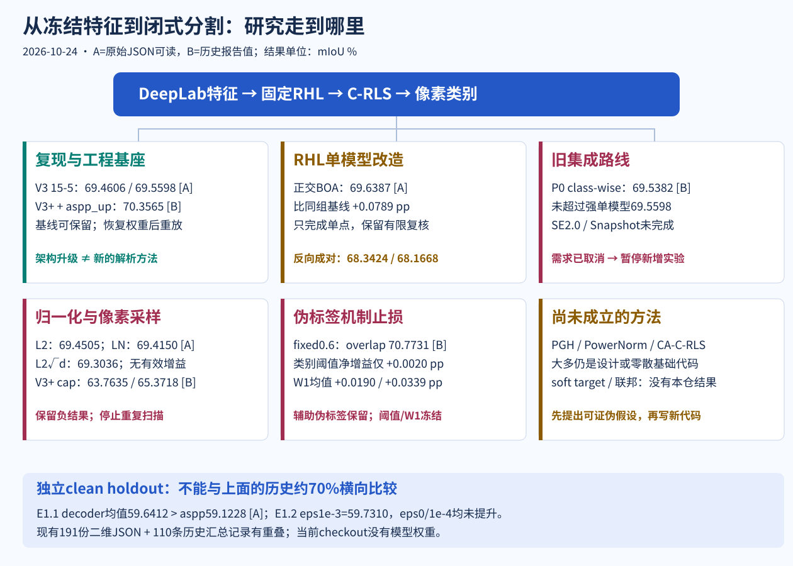

# 给你和师兄的10分钟方法速览

日期：2026-10-24。A=本次读取原始JSON；B=历史正式报告/CSV，原文件本次不在checkout。数字均为mIoU百分数，差值为pp。**约70%的历史官方val-as-test与约59%的clean holdout不是同一评价集。**

## 已做的实验与结论

| 方法/实验 | 主要结果 all % | 结论 | 证据 |
|---|---:|---|---|
| 原V3 15-5 sequential | 69.4606 / 69.5598 | 复现基线，非新方法 | A |
| 原V3 15-1 sequential最终step5 | 1128=68.9464；1128_trs=69.5079 | 两条完整历史链；旧Home归属有误 | A |
| RHL归一化，batch64 | none69.4606；L2 69.4505；LN69.4150；L2√d69.3036 | 没有有效增益，停扫 | A |
| BOA四case | baseline69.5598；正交69.6387；反向成对68.3424/68.1668 | 正交单点+0.0789，尚未多seed确认；反向成对止损 | A |
| RHL-SE | 最佳P0约69.5382 vs强单模型69.5598 | 未超过强基线；集成需求取消后暂停 | B（成员A） |
| V3+ source | decoder68.9663；aspp69.9464；aspp_up70.3565 | 有效工程升级，main已接入 | B |
| V3+ class-cap | cap4096=63.7635；cap8192=65.3718 | 伤旧类，停止 | B |
| buffer调参 | 8224三seed均值69.9014 vs8232的69.8225 | 局部工程选择，不是核心创新 | A |
| overlap固定伪标签 | off70.3091 → fixed0.6 70.7731 | 固定伪标签辅助有效 | B |
| disjoint固定伪标签 | off68.9438 → fixed0.6 69.4639 | 总体增益伴随old/new权衡 | B |
| 15-1 overlap | off69.7703；fixed0.6 70.4120；fixed0.7 70.1606 | 五步链已完成；没有artifact五步结论 | B |
| adaptive artifact | 比fixed0.6六组均值+0.0362 pp | 绝大部分是覆盖率收益 | B |
| matched-global控制 | artifact额外收益六组均值仅+0.0020 pp | 类别阈值主张不成立，冻结 | B |
| W1 confidence/margin权重 | 平均+0.0190/+0.0339 pp | 已做4组，未过+0.1 pp门槛，STOP | B |
| clean E1.1 | decoder59.6412 vs aspp59.1228，三seed均值 | clean V3继续decoder | A |
| 最后E1.2 | eps1e-3 59.7310；eps0 59.7119；eps1e-4 59.7143 | 两次新尝试均未提升 | A |

这里的“没有有效提升”是当前协议的结论，不是断言方法在所有数据集永远无效。失败原因的机制推测与已证实观测见 [详细版](03_方法与实验完整回顾.md)。

## 尚未完成的内容

| 项目 | 到哪一步 | 现在建议 |
|---|---|---|
| BOA1.5 | 基础代码已迁到rhl-next；新多seed/尺度/容量矩阵未跑 | 最多一次有界复核 |
| PGH原型引导、PowerNorm | 设计文档；完整实现与结果未见 | 先论证闭式兼容与机制，不直接大扫 |
| CA-C-RLS | 有旧GeneralizedARM类；新方法未接通 | 与W1区别开，低维检查成本 |
| soft/partial target | 候选提案，没有结果 | 新假设时再启动 |
| SE2.0、Snapshot | 只有旧gate/resume部分基础，完整方法未做 | 暂停集成线 |
| clean E1.3/E2 | gamma、LR、loss等参数部分已接线，新协议实验未做 | 不把调参当主要研究贡献 |
| 联邦持续分割 | 当前仓库未实现、未实验 | 可以保留2D分割代码，先对照AFCL/FISS找差异 |

## 接手时记住四件事

1. **main是基线；rhl-next是BOA候选；adaptive分支已冻结。** 本地adaptive比远端落后17个提交，不要只看本地旧HEAD判断W1进度。
2. **原始模型文件缺失。** 当前两个worktree都没有`.pth/.pt/.ckpt`，部分伪标签、集成和V3+原始结果也需取回；历史报告不能替代完整实验包。
3. **取消集成约束已生效。** 保留有用工具和负结果，不再为“集成”而堆模块。
4. **闭式解+联邦持续学习已有AFCL。** 可研究分割中的客户端背景语义冲突、部分标签或统计通信成本；需要新的问题和证据。

完整逐实验数值、old/new、全部参数与per-class来源在 [详细版及附录](03_方法与实验完整回顾.md)；会议演示可直接打开 [交接网页](06_方法与实验交接.html)。
