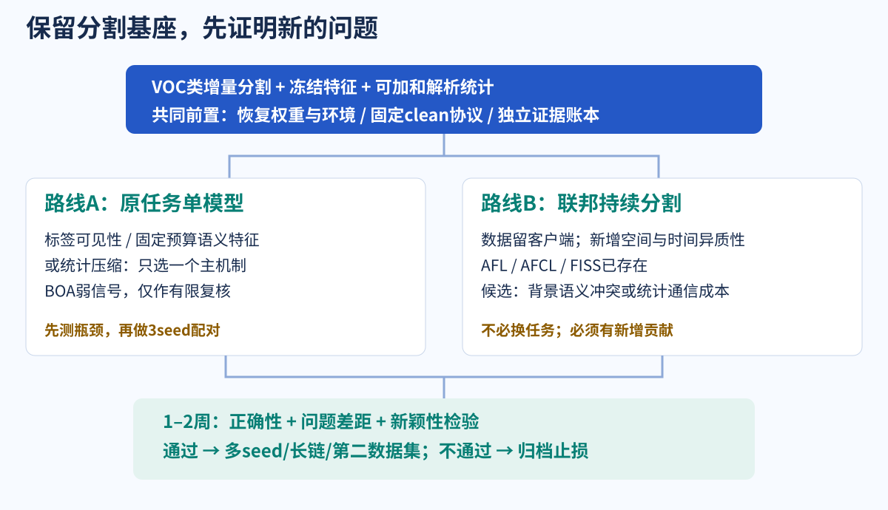

# 取消集成约束后：联邦持续学习与原方法改进路线

证据核查日期：2026-10-24；协作计划更新与交付日期：2026-10-25。本文区分“已有事实”“数学推导”“候选假设”。所有新路线均未在本仓库做实验，不给出虚构的预期mIoU。文献检索是面向选题的重点核查，不是穷尽性系统综述。



## 1. 对新情况的直接回答

**可以继续做类增量语义分割，不必换任务、换数据、推倒代码。** 联邦学习改变的是数据由谁持有、模型如何协作训练；持续学习改变的是数据/类别如何随时间到来；语义分割仍然是对每个像素预测类别。这三个维度可以自然组合。

建议先保留VOC、DeepLabV3、冻结特征和解析头，做单机模拟的“联邦类增量语义分割”验证。以后确有必要再扩展ADE20K或真实多机构数据。不建议一开始同时改成医学3D、换大backbone、换联邦框架、加复杂异步机制。

但有一个关键前提：**联邦持续学习已有闭式解方法AFCL，联邦增量语义分割也已有FISS。** 把SegACIL复制成几个客户端、上传矩阵，足够形成工程baseline，尚不足以形成新论文核心贡献。新问题需要落在已有方法没有充分解决的分割机制上。[AFCL](https://arxiv.org/abs/2505.12245)、[FISS](https://arxiv.org/abs/2304.04620)

## 2. 用通俗例子讲联邦与持续学习

想象三所学校都有图片练习册：A多是汽车，B多是动物，C多是室内物品。练习册不能集中交出去，但每所学校可以把学习结果交给协调老师，再得到一个大家共同改进的模型。

**联邦学习**：数据留在各自客户端，本地计算更新，服务器汇总。经典FedAvg是在各端做若干梯度训练后按本地样本量加权聚合模型参数；联邦并不限定必须使用FedAvg，也可交换其他合法的模型统计量。[FedAvg原论文](https://proceedings.mlr.press/v54/mcmahan17a.html)

**持续学习**：不是一次学完。第一月学车，第二月学羊，第三月学沙发；学新内容时还要保留旧能力。

**联邦持续学习**：三所学校同时分散学习，而且每所学校的新内容随时间变化。A可能已经见过羊，B还只会车；新客户端又带来其他类别。难点同时来自“学校之间不一样”和“同一学校前后不一样”。

**联邦持续分割**：上述对象换成像素标签。一张图中的羊，可能在A被标为“羊”，在只标车的B被标为“背景”。两个客户端的“背景”并不是同一种语义，这比单纯分发图片分类任务更棘手。FISS正是研究这种背景漂移与客户端遗忘的已有工作。[FISS，CVPR 2023](https://arxiv.org/abs/2304.04620)

| 维度 | 选择 | 对本工作的含义 |
|---|---|---|
| 数据组织 | 集中式 / 联邦式 | 单机也能顺序模拟多个隔离客户端 |
| 时间变化 | 静态 / 类增量 / 域增量 | 第一版保留类增量，避免同时换研究问题 |
| 预测任务 | 分类 / 分割 | 保留像素级分割和现有标注协议 |
| 更新方法 | 梯度 / 解析 / 混合 | step0表征学习与后续解析更新分开说明 |

联邦聚合最终可以产生**一个全局模型**，不是原来要求的多模型预测集成。取消集成要求与采用联邦训练并不冲突。数据不直接上传也不自动构成正式隐私保证；共享梯度已知可能泄露数据，上传统计量同样需要另行论证其可泄露信息，不能只凭“不传图片”宣称隐私已解决。[DLG原论文](https://proceedings.neurips.cc/paper_files/paper/2019/hash/60a6c4002cc7b29142def8871531281a-Abstract.html)

## 3. 截至本次核查，哪些已有工作不能绕开

| 工作 | 已覆盖的问题 | 对选题的约束 |
|---|---|---|
| [FedAvg，2017](https://proceedings.mlr.press/v54/mcmahan17a.html) | 客户端本地训练、服务器参数聚合 | 是基础对照，不是本工作新机制 |
| [AFL，CVPR 2025](https://arxiv.org/abs/2405.16240) | 预训练冻结表示下的解析联邦聚合、分区不变性 | 不能再把“闭式解能聚合”作为首次提出 |
| [AFCL，2025预印本](https://arxiv.org/abs/2505.12245)；[2026 CVPR Findings版本](https://openaccess.thecvf.com/content/CVPR2026F/papers/Tang_AFCL_Achieving_Spatio-Temporal_Invariance_to_Data_Heterogeneity_in_Federated_Continual_CVPRF_2026_paper.pdf) | 冻结特征、解析联邦持续学习、时空分区不变性；公开实验涉及图像分类数据 | 直接最近邻；要说明像素分割带来的新增困难与解决机制 |
| [FISS，CVPR 2023](https://arxiv.org/abs/2304.04620) | 联邦增量语义分割、背景漂移、异质遗忘、新客户端 | 不能声称首次结合FL+CISS |
| [Learning From Each Other / HFA，TPAMI 2026](https://pubmed.ncbi.nlm.nih.gov/41678480/) | 广义联邦增量分割、软伪标签、关系约束与客户端任务变化 | 需要比较已有强任务专用方案，不能只赢FedAvg |
| [DeepAFL，ICLR 2026](https://arxiv.org/abs/2603.00579) | 用解析残差层增强表示能力 | “解析学习只能单层”不是现状；简单再加一层需要重查新颖性 |
| [UFPS](https://pmc.ncbi.nlm.nih.gov/articles/PMC10873159/) | 异质分布下部分标注联邦分割 | “部分标签/背景冲突”也已有研究；需要强调持续时间维度、解析目标与代价 |
| [Towards realistic incremental scenario，2025](https://proceedings.mlr.press/v274/kwak25a.html) | overlap中图像跨task重复与partitioned协议 | 客户端划分和时间划分须分别定义，防止意外重复数据优势 |

AFL/AFCL/DeepAFL作者列表包含Huiping Zhuang，与项目历史背景直接相关；建议第一次与师兄讨论就对齐与组内已有工作的关系，避免沿已发表结论重新走一遍。此处只依据公开论文作者列表，不推断师兄本人参与了哪项工作。

检索还显示许多部分标注、伪标签及通信压缩相关路线。上表不构成“剩余空白已获证实”的保证；本文后续机制均为待证伪候选。

## 4. 为什么解析学习适合联邦：从两本账开始

冻结共享encoder与随机映射，像素特征记为Z，目标记为Y。每个客户端k在时间t的新数据可形成：

\[
A_{k,t}=Z_{k,t}^{\top}Z_{k,t},\qquad
B_{k,t}=Z_{k,t}^{\top}Y_{k,t}.
\]

直觉上，A记“特征之间怎样共同出现”，B记“特征和类别怎样对应”。服务器只对本轮新贡献累加：

\[
A_t=A_{t-1}+\sum_k\Delta A_{k,t},\quad
B_t=\operatorname{pad}(B_{t-1})+\sum_k\Delta B_{k,t},\quad
W_t=\operatorname{solve}(A_t+\lambda I,B_t).
\]

这是对**固定特征、固定目标、固定权重集合**的岭回归直接推导，不是本文提出的新定理。服务器不需要平均本地W；通常
`average(solve(A_k+λI,B_k))`不等于`solve(sum(A_k)+λI,sum(B_k))`。正则项在全局目标中按定义加一次，不能把每个客户端的λI重复累计。

与累计全数据的解相等需要满足：

1. encoder、RHL权重、归一化和特征坐标完全相同；仅“seed同名”不够，应校验feature hash。
2. 类别ID全局一致，新增列对历史充分统计量的语义明确；未知不一定等于负类。
3. 每条训练事件只累计一次；每轮重复上传累计矩阵会重复计数。要有client/task/event版本与确认机制。
4. 参与比较的是同一批样本、同一增强与目标。丢batch、不同裁剪、重新生成伪标签均会改变这个条件。
5. 部分参与时，仅对已收到贡献的并集等价；不能声称等价于尚未上线客户端的数据。
6. 若target来自不断变化的teacher，换任务/客户端顺序可能改变Y。此时最多声称**给定已构造Z、Y后的聚合顺序不变**，不能宣称整个语义学习过程无条件顺序不变。

本仓当前RecursiveLinear反复求逆，新增列还带随机tail。因此联邦基线应新增显式A/B累计与solve接口，先在固定小矩阵上验证，不应直接把旧`R`和`W`随意平均。新类别先验若非零，必须在目标中显式定义，不能同时宣称是零先验标准ridge的精确解。

## 5. 哪些代码保留，哪些需要增加

| 保留/复用 | 新增或改造 |
|---|---|
| VOC读取、task定义、sequential/overlap/disjoint标签语义 | 按**图像ID**划分客户端；同图像的像素不能泄漏到不同客户端/评价集 |
| DeepLabV3/V3+ feature API | 全局feature版本协议；冻结BN统计与RHL参数，客户端验证同一hash |
| RHL与解析矩阵数学 | `AnalyticStatistics`：accumulate、merge、pad、solve，检查重复事件 |
| old/new/all及per-class指标 | 全局/客户端/最差客户端表现、跨step forgetting、通信字节与峰值内存 |
| manifest、结果落盘、clean holdout | federation manifest：client split、参与率、task order、类别映射、teacher与feature hash |
| 伪标签分支的teacher适配与诊断思路 | 从冻结分支选择性移植，不整包合并W1训练改动 |
| 当前单机调试方式 | 顺序模拟客户端，先不接多机RPC框架 |

建议模块边界（**建议目录，尚未实现**）：

```text
federated/
  partitions.py       # image-level client/task manifests
  statistics.py       # additive A/B and exact-once merge
  protocol.py         # global labels, feature versions, participation
  simulator.py        # sequential client execution on one GPU
  evaluation.py       # pooled confusion + per-client metrics + bytes
```

**step0怎么来必须说清楚**：最小pilot可先复用当前集中式step0，仅研究增量阶段的联邦化，并将其明示为“集中式/公共预训练初始化的联邦增量实验”。若主张全流程联邦，就必须让step0也通过联邦训练，或使用各方均可访问的公开预训练模型。不能把全部私有客户端数据先集中训练encoder却不披露。

## 6. 推荐优先检验的联邦研究问题

### 6.1 主候选：部分标签下的背景语义冲突如何进入解析目标

候选研究问题：**客户端与时间的类别可见集合不同，如何避免把“本地未标注旧类”当成“全局确定背景”写入不可回溯的充分统计量，同时保留可加和更新？**

动机来自本项目现有W0/W1证据：错误伪标签、困难旧类与权重之间存在结构性权衡，单调压低低confidence像素未带来足够净收益。联邦下客户端标注集合差异可能放大该问题，但这一点必须实测，不能由单机负结果直接断言。

一个可审查的数学起点是对每个输出类c定义观测掩码或可靠性`m(i,c)`，仅在目标语义明确时监督该项：

\[
\min_{w_c}\sum_i m_{i,c}(z_i^\top w_c-y_{i,c})^2+\lambda\|w_c\|^2.
\]

每类对应`A_c=Σ m(i,c) z_i z_iᵀ`和`b_c=Σ m(i,c) z_i y(i,c)`，可以跨客户端加和，**但不同类通常需要不同A_c，不能继续假装一个共享R就能精确求解**。这种masked least squares本身并非新的统计学方法；创新需要在分割标注语义、可压缩结构、持续更新一致性或有证据的效果上成立。

第一步不是设计一堆confidence参数，而是明确标签规则：当前显式前景GT、确认负类、可能含旧类的背景、未来未知类别、ignore分别怎样进入目标。真实raw旧类标签只能用于oracle诊断，不能偷用于客户端训练。

最小比较：naive-background、固定伪标签、matched-global、明确可见性mask；同teacher、同特征、同分区。若mask只通过忽略大批困难像素改善某一类，要同时检查新类、旧类与最差客户端，而不能只报全局均值。

### 6.2 备选：受限通信下的解析统计，而非只减少轮数

当前d=8224，单个d×d的float64 Gram约 **516.01 MiB**，float32约258.00 MiB；float64的B（21类）约1.32 MiB。即使只发一次，上传量仍大。若每类各存一个Gram，21类约 **10.58 GiB**，尚未计临时矩阵与特征。

候选可比较固定共享低维投影、分块、低秩sketch、对称存储。不要声称压缩后仍与原8224维解完全相等：精确性可能只对应投影后的目标，或仅有近似误差界。先画精度—通信—计算的三维取舍；若低维普通RHL同成本已同样有效，复杂sketch没有必要。

该方向可服务联邦，也可先在原集中式任务验证。与背景目标主候选分开做，不在第一篇方法中同时堆两条尚未验证的主创新。

### 6.3 暂不优先：边联邦边更新encoder

客户端encoder漂移会使各端Gram处在不同坐标系；历史统计也随时间过时。adapter/LoRA并不会自动绕开这个问题。除非先有严格的特征对齐/统计迁移方案，否则先冻结共享表示。DeepAFL已探索解析表示学习，必须另做差异审查。[DeepAFL](https://arxiv.org/abs/2603.00579)

## 7. 联邦路线的最小实验矩阵与止损

以下门槛是**本次建议**，不是过去已经预注册的判据；正式跑前由你和师兄固定。

| 阶段 | 最小任务 | 对照/验收 | 不通过如何处理 |
|---|---|---|---|
| F0：数学与工程 | 固定小规模X/Y；1/2/5客户端；打乱上传顺序、新类扩列、重复消息 | 集中式solve与累加solve在合理条件数下float64相对误差≤1e-8；重复不增计数 | 只修正确性，不跑大VOC |
| F1：联邦baseline | VOC15-5，5客户端，同步task；IID与两档image-level类别偏斜 | 与集中式同特征/同有效数据匹配；记录实际数据数与bytes | 不一致先查drop_last、augmentation、tail、标签列 |
| F2：问题成立性 | 部分标签；同步vs错开任务到达，2–3个分区seed | 证明naive背景导致的错误与客户端可见集合相关 | 若没有足够差距，停止语义冲突主张 |
| F3：单机制pilot | 主候选mask/目标校正；固定伪标签、matched-global、朴素解析联邦 | 建议全局all均值至少+0.5 pp；old不下降>0.2 pp；最差客户端不显著恶化 | 不扩复杂网格；报告负结果 |
| F4：稳健与成本 | 至少3个数据划分/训练seed；5/10客户端；50%参与率；15-1长链 | 分开报告类别异质性、时序异质性与缺席；平均±SD、paired差 | 明确限定适用范围 |
| F5：论文验证 | 第二个分割数据集、FISS/HFA等任务专用对照、消融和成本 | 相同backbone、预训练、数据可见性与训练预算；最终测试仅冻结后使用 | 不为赶稿删掉困难对照 |

non-IID划分不能把每个像素独立Dirichlet分配，那会破坏一幅图的完整性和客户端边界。应按图像多标签向量分配，记录每客户端图数、像素类别分布、缺失类别及类间共现。时间轴单独控制类别到达顺序。

评价除最终old/new/all外，至少包括跨step均值、旧类峰值到当前值的forgetting、每客户端宏平均与最差客户端、全局pool confusion矩阵、总上传/下载字节、累计运行时间和峰值内存。客户端mIoU算术平均与全局pool mIoU不是同一指标，应分别标名。

## 8. 如果继续原SegACIL单模型路线

### 8.1 先停止低价值循环

不再扩大8192附近几个维度的搜索，不挑“最佳seed”，不重复固定norm、不继续classwise threshold/min_conf/q网格，也不为了取消的集成目标做Snapshot。历史BOA只有弱信号，不能把“迁移完代码”当继续投入的理由。

### 8.2 从可证伪瓶颈出发

| 优先级 | 候选 | 首先要证明什么 | 最小对照 |
|---|---|---|---|
| P0 | 表征/样本质量诊断 | 错误集中于边界、小目标、特定新类还是标签语义 | 同一frozen feature上的逐类、区域、范数统计；仅诊断不训练 |
| P1 | 分割目标可见性/背景校正 | hard label/单标量weight的损失在哪里 | fixed与matched-global保持；比较目标构造而非再调阈值 |
| P1备选 | 固定预算语义特征/PGH | 类别信息能改善可分性，且特征在全增量过程中合法固定 | random-only、固定step0原型、随机原型、等维度随机新增分支 |
| P2 | 解析统计效率 | 相同精度能否明显降内存/时间 | 小buffer、低秩/分块、同字节预算对照 |
| P3 | BOA正交复核 | +0.0789是否跨配对seed且非尺度伪效应 | 同能量baseline/orthogonal，至少3seed |
| 储备 | PowerNorm/类别平衡 | 幅值/类频确为瓶颈且保留闭式结构 | trace-matched gamma；分别做norm与class weight |

PGH不能一次用完整数据提取未来类别原型，也不能每step换原型后继续沿用旧Gram而仍宣称联合等价。先选固定step0原型作为小实验；若不足以提供新类信息，再研究合法的统计扩展，而不是先写几十个K/sigma开关。

### 8.3 建议的两周单模型验证包

第一周恢复clean step0和环境；重放一条基线，生成错误画像；只选一个机制，固定所有参数与数据顺序。第二周完成3个配对seed的baseline/method，不超过一个小规模机制对照。

建议继续门槛：all均值≥+0.3至+0.5 pp、方向在大多数配对中一致、old/new无隐藏严重退化；或在all基本不变时实现预先约定的明显成本下降。小于门槛仍可作为辅助消融，但不能靠不断扫参包装核心创新。门槛需在看新结果之前固定。

通过才扩15-1、overlap/disjoint和第二数据集；V3+用作方法迁移对照，明确`model×method`的2×2设计，而不是把换模型的增益混入方法贡献。未通过就归档，转向另一个有独立机制动机的问题。

## 9. 两条路线如何选

| 维度 | 原任务单模型改进 | 联邦持续分割 |
|---|---|---|
| 初始工程成本 | 较低，已有pipeline | 中等，要加分区、统计聚合与参与协议 |
| 现有结果能否直接成为主表 | 多为背景与阴性证据；新方法仍需重放 | 大多只能作集中式基线，不能当联邦结果 |
| 新颖性风险 | 微小模块/调参容易贡献不足 | AFL/AFCL/FISS已覆盖大框架，简单组合不够 |
| 强叙事条件 | 找到分割解析目标或表示的具体瓶颈 | 找到客户端+时间共同导致的分割机制问题并解决 |
| 适合的合作方式 | 你管复现与基线，师兄共同审机制和对照 | 一人负责现有分割与标签协议，一人负责聚合/文献/异质性；交叉复核 |
| 我的建议 | 保留为低成本验证基座 | 用1–2周做问题与新颖性验证，通过后再正式转主线 |

推荐先共用一个“解析统计+分割目标”的基座。第一轮不同时全面推进两篇论文：先确认联邦新增困难真实且与已有工作有清晰差异；否则沿原单模型路线做更扎实的目标/效率改进。

## 10. 从现在开始的协作计划

| 时段 | 你与师兄需要交付 | 决策点 |
|---|---|---|
| 2026-10-25—10-31 | 读简版/核查；恢复权重、环境、原始logs；AFL/AFCL/FISS对照一页表；确定step0来源 | 是否存在可解释的独立研究问题 |
| 2026-11-01—11-07 | clean基线重放；F0数学验证；小型F1或单模型pilot | 正确性与问题差距是否足够 |
| 2026-11-08—11-21 | 只选一条主路线，完成核心机制与多seed配对 | 达到事先固定的效果/成本门槛才扩展 |
| 后续3–5周 | 长链、第二数据集、强baseline、消融、论文图表与写作 | 结果稳定、贡献清楚后决定投稿 |

旧文档写“2026年底前录用”，用户本次没有再次确认这一期限。若它仍是硬约束，当前时间到年底约两个月，**不能把上述研发计划当作保证年底录用的时间表**；应尽早与师兄/导师对齐投稿窗口、最小研究范围与是否允许改期。本报告不虚构任何会议截止日期。

合作时每项实验只指定一名owner，另一人审核protocol和source。共享results账本、同一feature/base hash、独立SUBPATH；把失败记录当作节省重复劳动的资产。不要同时修改同一Trainer后分别报告“只改了一个变量”。

## 11. 本轮已经决定与仍待研究的内容

已经由用户明确：集成学习不再是必须，师兄将参与合作。已经由仓库证据明确：W1与hard threshold路线冻结，BOA复核未完成，当前缺模型权重。

本报告建议但尚未实验证实：优先保留类增量分割、用单机联邦模拟验证背景语义/可见性问题；若问题空间或新颖性不成立，则回到原任务单模型目标/效率改进。没有自动启动新实验、创建联邦分支或宣布方法已经有效。

正文文献均给出可点击的一手论文/作者来源。HFA的出版信息及摘要由PubMed记录和作者主页交叉核验：[作者列表与论文入口](https://henghuiding.com/publications/)。本仓证据与全部历史结果见 [方法完整回顾](03_方法与实验完整回顾.md)。
